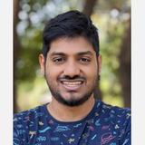
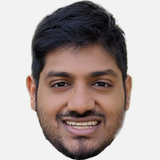
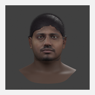
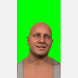
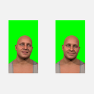
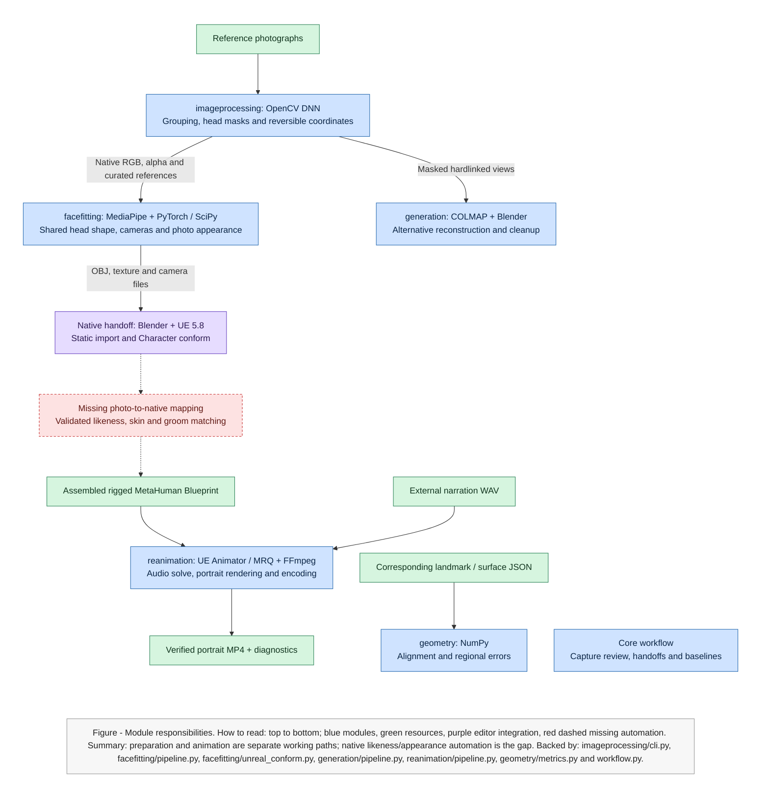

# ailias

Photo-to-MetaHuman tooling: prepare reference images, fit a complete head, inspect
native Unreal assets, and animate an existing rig with supplied narration.
Python coordinates local OpenCV, PyTorch/SciPy, COLMAP, Blender and Unreal workers.

**Current limitation:** native conforming, rigging and animation work technically,
but facial resemblance and skin/hair transfer are below expectations. Native
feature profiles are scriptable; automatic photo-to-native likeness fitting and
photographic appearance transfer are not complete.

## Visual pipeline

Actual retained images in 160 x 160 thumbnails, with aspect ratio preserved.
These illustrate stage contracts across different jobs, not one fully automated
successful run. **LLM** means a language model; none is required by these stages.

| Input representation | Module / operation | Output representation |
|---|---|---|
|  | **imageprocessing** - Detect/group faces, remove background and retain reversible photo coordinates. **LLM:** no. **GPU:** optional; explicit CPU/CUDA. **Needs:** local OpenCV and prepared detection/parsing/matting weights; no Blender or Unreal. |  |
|  | **facefitting / fit** - Fit shared head identity with per-photo camera/expression. **LLM:** no. **GPU:** configured CUDA; explicit CPU solver available. **Needs:** GNM, MediaPipe and PyTorch/SciPy; Blender for the review scene, not numerical fitting. |  |
|  | **facefitting / appearance** - Project observed colour onto the fitted mesh and approximate scalp hair. **LLM:** no. **GPU:** configured CUDA projection/rendering. **Needs:** reviewed fit and Blender; no Unreal. Colour still contains photographed lighting. |  |
|  | **Native handoff / features** - Import/conform geometry, apply explicit native edits and optionally assemble a rig. **LLM:** no. **GPU:** required for the validated full-rig editor path. **Needs:** UE 5.8, MetaHuman content/plugins and compatible assets; Blender prepares import files. Photo skin/hair transfer remains incomplete. |  |
|  plus narration WAV | **reanimation** - Solve face/head motion from supplied audio, render and encode. **LLM:** no; no speech synthesis. **GPU:** UE rendering; configured NVENC encoding, explicit CPU encoder available. **Needs:** UE 5.8 Animator/MRQ plugins, assembled rig and FFmpeg; no Blender. |  |

Image provenance and resize/crop records: [pipeline media](docs/images/pipeline/provenance.json).
The native thumbnail is an animated frame, not a neutral matched-camera render.
These are stage-specific requirements, not simultaneous residency requirements;
tool paths, devices and model preparation are covered by the module guides.

### Resources passed between stages

| Producer | Retained resources | Next consumer / reuse |
|---|---|---|
| `imageprocessing scan / cleanse` | Run manifest, portrait RGB, native-grid head RGB/alpha, source transforms, curation | `facefitting fit` and `generation reconstruct`; aligned analysis images do not replace native pixels |
| `facefitting fit` | Neutral OBJ, identity parameters, observations, cameras, overlays, review scene | `appearance` uses the exact reviewed mesh and fitting evidence |
| `facefitting appearance` | Hair-free OBJ/MTL, photo-colour PNG, coverage, geometry/UV NPZ, scene, approximate hair Alembic | `unreal-import` consumes mesh/material/texture; Alembic still needs validated native alignment/binding |
| `facefitting unreal-import / unreal-conform` | Static-mesh or Character packages, native receipts, camera/landmark evidence | `unreal-features` accepts explicit edits and optional assembly; photo-guided geometry/skin/groom mapping remains incomplete |
| `facefitting unreal-features / unreal-review` | Isolated Character revision, edit/reload receipts, optional runtime assets and neutral review frame | Validate native likeness before animation; failed assembly/inspection does not become an accepted rig |
| Native rig/build | Assembled rigged Blueprint with Face mesh, head bone and facial post-process | `reanimation run` plus an independent mono PCM16 WAV |
| `reanimation` | Performance, sequence/map, verified MP4, first/last PNGs, hashes | Playback/compositing; technical media checks do not certify likeness |
| `generation` - alternative route | Sparse model, estimated cameras, fused samples, textured mesh and cleaned scene | `clean-mesh` / static Unreal import; current real-photo outputs are fragments, not a full head |
| `geometry` - independent validator | Named-landmark/region errors, alignment transform, optional sampled-surface distances | Comparison reports; requires corresponding measurement JSON, not arbitrary OBJ input |

## Module architecture



**Backed by:** [module ownership and file-based communication](docs/dev.readme.md#architecture).
Core capture/handoffs are a separate bookkeeping workflow, not an automatic
consumer of every experimental job. Geometry validation requires supplied correspondences.
For alternative face-first routes, repositories and small-model tradeoffs, see
[photo-to-MetaHuman research](docs/imageprocessing/photo-to-metahuman-research.md).

## Quick setup

Use Python 3.12+ in the shared workspace environment; preserve its existing
CUDA/OpenCV/Torch installation.

```powershell
Set-Location C:\projectWorkspace\ailias
.\scripts\setup-gpu.ps1
& C:\projectWorkspace\.venv\Scripts\Activate.ps1
python -m ailias --help
```

Model/tool preparation is explicit. Scans, status checks and imports do not
silently install models or replace the shared runtime.

| Task | Command / guide |
|---|---|
| Prepare analysis models | `python -m ailias imageprocessing models subject` |
| Analyze photos | `python -m ailias imageprocessing scan subject C:\photos --device cuda` |
| Review and select references | [Imageprocessing commands](docs/imageprocessing/README.md#usage) |
| Fit / texture / import a head | [Facefitting commands](docs/facefitting/README.md#usage) |
| Animate a compatible existing rig | [Reanimation commands](docs/reanimation/README.md#usage) |
| Inspect retained resources | `python -m ailias cleanup --alias subject` - dry run; `--apply` deletes eligible remnants |
| Record capture and external handoffs | [Core workflow](docs/workflow.md) |

## Configuration

Global `--config` selects `config\settings.json`; `--data-root` overrides its
data directory. Module flags select their own JSON policies. Per-run overrides,
where implemented, take precedence without rewriting those files.
See each module guide below for defaults, units and parameter meanings.

## Current state - below expectations

| Frontal reference | Fitted geometry | Blender appearance | Unreal result |
|---|---|---|---|
|  |  |  |  |

Missing hairstyle/facial hair, different eyes/skin and incorrect feature
resemblance remain visible. Pose, expression and lighting differ; this is a
visual diagnostic, not a likeness score.
[Full comparison](docs/facefitting/images/current-likeness-comparison.png).

## Current Blender baseline

The preserved scene and pinned mesh/texture/camera inputs are the reference for
further native refinement; animation success is not a geometry or appearance certificate.
See [baseline resources](docs/facefitting/README.md#current-working-baseline).

## Documentation

| Document | Dev guide | Purpose |
|---|---|---|
| [Core workflow](docs/workflow.md) | [Development](docs/dev.readme.md) | Capture, durable state, handoffs, global configuration and cleanup |
| [Imageprocessing](docs/imageprocessing/README.md) | [Internals](docs/imageprocessing/dev.readme.md) | Grouping, head extraction, curation and colour policy |
| [Facefitting](docs/facefitting/README.md) | [Internals](docs/facefitting/dev.readme.md) | Head geometry, appearance and native Character handoff |
| [Generation](docs/generation/README.md) | [Internals](docs/generation/dev.readme.md) | Alternative COLMAP reconstruction and Blender cleanup |
| [Geometry](docs/geometry/README.md) | [Internals](docs/geometry/dev.readme.md) | Corresponding-landmark and sampled-surface comparison |
| [Reanimation](docs/reanimation/README.md) | [Internals](docs/reanimation/dev.readme.md) | Existing rig plus WAV to portrait video |
| [Decisions](docs/analysis.md) | [Open work](docs/todo/README.md) | Tradeoffs, limitations and acceptance criteria |
