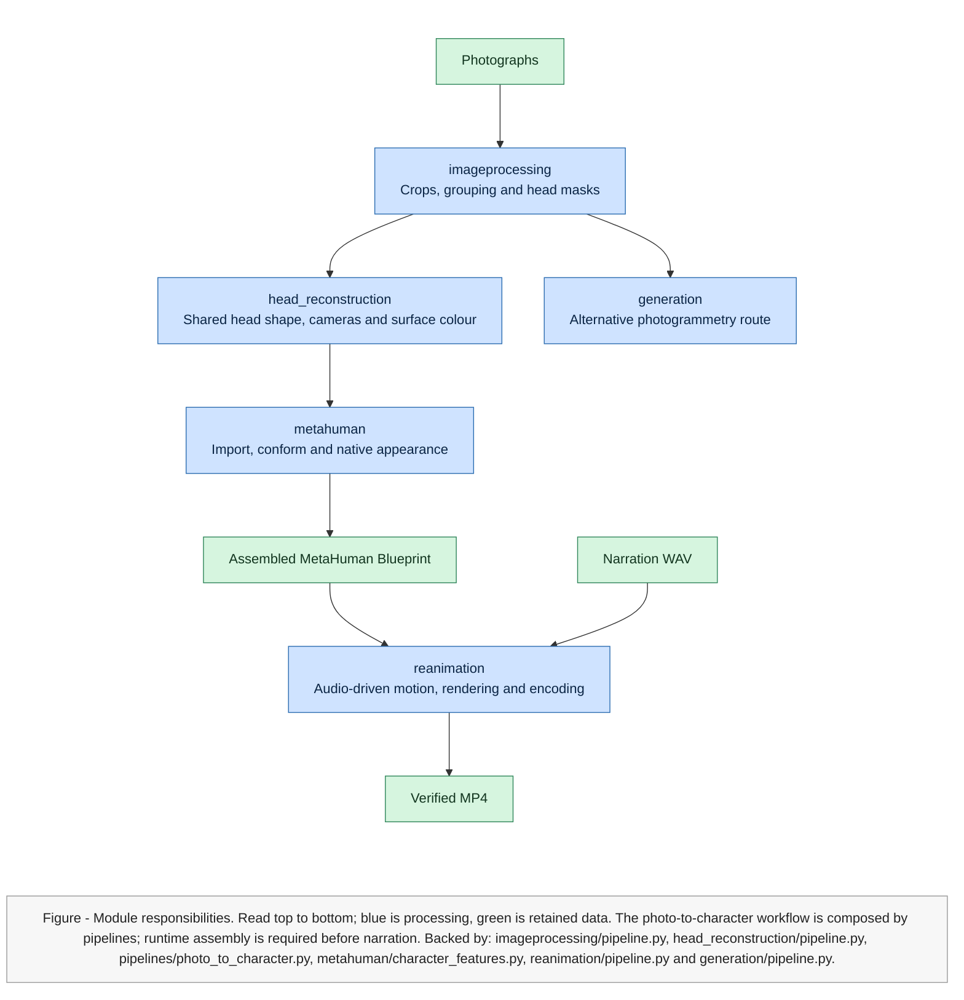
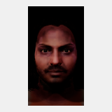

# ailias

Local tools for preparing photographs, fitting a head mesh, creating editable
Unreal MetaHuman assets, and rendering an existing rig with supplied narration.
The Python CLI coordinates image-analysis libraries, Blender, Unreal and FFmpeg.

## Quick setup

Use Python 3.12+ in the shared workspace environment:

```powershell
Set-Location C:\projectWorkspace\ailias
& C:\projectWorkspace\.venv\Scripts\Activate.ps1
python -m pip install -e .
python -m ailias --help
```

Optional dependencies, model preparation and external-tool requirements are
documented by module. GPU operations use explicitly configured devices; preparing
the CLI does not download models or replace an existing CUDA installation.

## Usage

```powershell
python -m ailias imageprocessing models subject
python -m ailias imageprocessing scan subject C:\photos --device cuda
python -m ailias facefitting models subject
python -m ailias facefitting fit subject RUN_ID face-001
```

Review the generated crops before selecting a group or fitting geometry.
For recorded-video inputs, use `facefitting video-evidence`; `video-create`
consumes its saved images to create a mesh, Blender scene and editable Character.
Add `--assemble` to build its runtime actor, or supply `--voice WAV --ffmpeg EXE`
to continue through assembly, audio-driven animation and verified video publication.
Missing native rig/textures require explicit `--cloud-services` authorization.

| Task | Command or procedure |
|---|---|
| Review and prepare photographs | [Imageprocessing](docs/imageprocessing/README.md#usage) |
| Fit geometry and create native assets | [Facefitting commands](docs/facefitting/README.md#usage) |
| Animate an assembled MetaHuman | [Reanimation](docs/reanimation/README.md#usage) |
| Manage the shared Unreal editor | `python -m ailias generation unreal-session status --project $project` |
| Preview resource cleanup | `python -m ailias cleanup --alias subject` |
| Apply verified cleanup | `python -m ailias cleanup --alias subject --apply` |
| Record capture review and external handoffs | [Core workflow](docs/workflow.md) |

## Module architecture



**Backed by:** [implementation ownership and communication](docs/dev.readme.md#architecture).
The public `facefitting` commands and saved `facefitting` data paths are independent
of the internal `head_reconstruction`, `metahuman` and `pipelines` package names.

### Data representations

| Photograph | Head-only input | Fitted mesh | Surface appearance | Native Character |
|---|---|---|---|---|
|  |  |  |  |  |

The fitted mesh, surface appearance and native Character come from the same
photo-to-character run. These illustrate formats rather than a likeness guarantee.
[Image provenance](docs/images/pipeline/provenance.json) records their sources.

## Configuration and output

Global `--config FILE` selects `config\settings.json`; `--data-root` overrides its
data directory. Module flags select fitting, appearance, rendering and tool
policies without rewriting those files.

Each subject has a `data\ALIAS` directory containing manifests and retained
outputs. Completed jobs release scratch. Major-output retention preserves
referenced results, active jobs and edited files. Native-package deletion is
deferred while Unreal is open; it never restarts the editor to reclaim storage.
See [cleanup contracts](docs/dev.readme.md#resource-cleanup).

## Interpretation limits

Head fitting estimates shape from photographs and a model prior; hidden anatomy
and absolute scale are not independently measured. Projected colour includes
photographed lighting, and stock grooms do not reconstruct individual hair strands.
Saved-asset and media checks establish persistence and file validity, not facial
resemblance, calibrated skin colour, acting quality or lip-sync accuracy.

## Documentation

| Document | Dev guide | Purpose |
|---|---|---|
| [Core workflow](docs/workflow.md) | [Development](docs/dev.readme.md) | Capture, durable state, configuration and resource ownership |
| [Imageprocessing](docs/imageprocessing/README.md) | [Internals](docs/imageprocessing/dev.readme.md) | Photo grouping, head extraction and curation |
| [Head reconstruction](docs/head_reconstruction/README.md) | [Internals](docs/head_reconstruction/dev.readme.md) | Numerical fitting, mesh export and photo appearance |
| [MetaHuman](docs/metahuman/README.md) | [Internals](docs/metahuman/dev.readme.md) | Native assets, feature profiles, assembly and reload verification |
| [Facefitting commands](docs/facefitting/README.md) | [Workflow internals](docs/facefitting/dev.readme.md) | Public command reference and cross-module execution |
| [Generation](docs/generation/README.md) | [Internals](docs/generation/dev.readme.md) | Alternative photogrammetry and external-tool execution |
| [Geometry](docs/geometry/README.md) | [Internals](docs/geometry/dev.readme.md) | Landmark and sampled-surface comparison |
| [Reanimation](docs/reanimation/README.md) | [Internals](docs/reanimation/dev.readme.md) | Supplied narration and an assembled rig to video |
| [Design decisions](docs/analysis.md) | [Quality criteria](docs/todo/README.md) | Tradeoffs and acceptance requirements |
