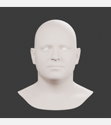
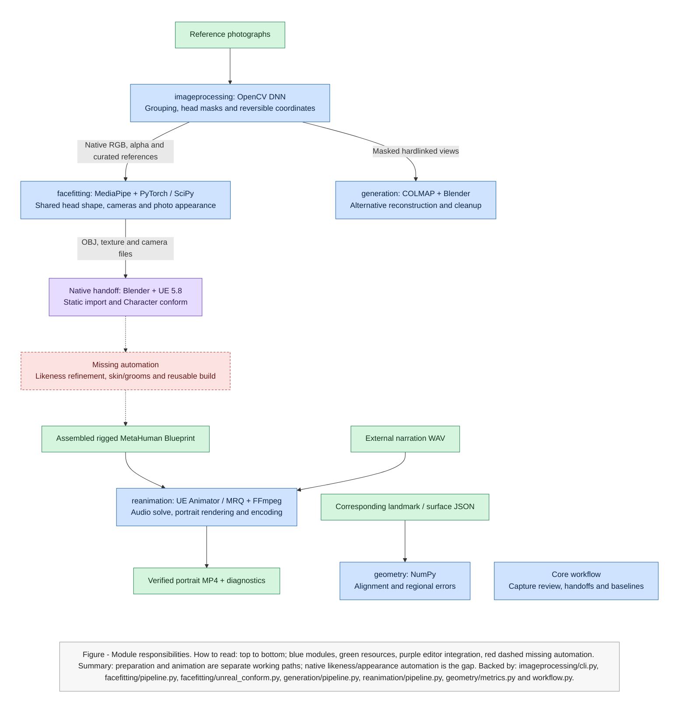

# ailias

Photo-to-MetaHuman tooling: prepare reference images, fit a complete head, inspect
native Unreal assets, and animate an existing rig with supplied narration.
Python coordinates local OpenCV, PyTorch/SciPy, COLMAP, Blender and Unreal workers.

**Current limitation:** the personal-head animation works technically, but facial
resemblance and skin/hair transfer are below expectations. Automated native
feature refinement and appearance transfer are not implemented end to end.

## Visual pipeline

Actual retained images, reduced for documentation. These illustrate stage
contracts across different jobs, not one fully automated successful run.

| Input representation | Module / operation | Output representation |
|---|---|---|
|  | **imageprocessing**: detect, group and extract head-only foreground |  |
|  | **facefitting / fit**: jointly estimate identity, cameras and expression from multiple views |  |
|  | **facefitting / appearance**: project observed photo colour and approximate scalp hair |  |
|  | **Native handoff**: import/conform geometry; photographic appearance is **not** carried through yet |  |
|  plus narration WAV | **reanimation**: solve face/head motion, render and encode |  |

Image provenance and resize/crop records: [pipeline media](docs/images/pipeline/provenance.json).
The native thumbnail is an animated frame, not a neutral matched-camera render.

### Resources passed between stages

| Producer | Retained resources | Next consumer / reuse |
|---|---|---|
| `imageprocessing scan / cleanse` | Run manifest, portrait RGB, native-grid head RGB/alpha, source transforms, curation | `facefitting fit` and `generation reconstruct`; aligned analysis images do not replace native pixels |
| `facefitting fit` | Neutral OBJ, identity parameters, observations, cameras, overlays, review scene | `appearance` uses the exact reviewed mesh and fitting evidence |
| `facefitting appearance` | Hair-free OBJ/MTL, photo-colour PNG, coverage, geometry/UV NPZ, scene, approximate hair Alembic | `unreal-import` consumes mesh/material/texture; Alembic still needs validated native alignment/binding |
| `facefitting unreal-import / unreal-conform` | Static-mesh or Character packages, native receipts, camera/landmark evidence | Native refinement/build boundary; no reusable automatic skin/groom/assembly handoff yet |
| Native rig/build | Assembled rigged Blueprint with Face mesh, head bone and facial post-process | `reanimation run` plus an independent mono PCM16 WAV |
| `reanimation` | Performance, sequence/map, verified MP4, first/last PNGs, hashes | Playback/compositing; technical media checks do not certify likeness |
| `generation` - alternative route | Sparse model, estimated cameras, fused samples, textured mesh and cleaned scene | `clean-mesh` / static Unreal import; current real-photo outputs are fragments, not a full head |
| `geometry` - independent validator | Named-landmark/region errors, alignment transform, optional sampled-surface distances | Comparison reports; requires corresponding measurement JSON, not arbitrary OBJ input |

## Module architecture



**Backed by:** [module ownership and file-based communication](docs/dev.readme.md#architecture).
Core capture/handoffs are a separate bookkeeping workflow, not an automatic
consumer of every experimental job. Geometry validation requires supplied correspondences.

## Quick setup

Use Python 3.12+ in the shared workspace environment; preserve its existing
CUDA/OpenCV/Torch installation.

```powershell
Set-Location C:\projectWorkspace\ailias
.\scripts\setup-gpu.ps1
& C:\projectWorkspace\.venv\Scripts\Activate.ps1
python -m ailias --help
```

Model/tool preparation is explicit. Scans, status checks and imports do not
silently install models or replace the shared runtime.

| Task | Command / guide |
|---|---|
| Prepare analysis models | `python -m ailias imageprocessing models subject` |
| Analyze photos | `python -m ailias imageprocessing scan subject C:\photos --device cuda` |
| Review and select references | [Imageprocessing commands](docs/imageprocessing/README.md#usage) |
| Fit / texture / import a head | [Facefitting commands](docs/facefitting/README.md#usage) |
| Animate a compatible existing rig | [Reanimation commands](docs/reanimation/README.md#usage) |
| Inspect retained resources | `python -m ailias cleanup --alias subject` - dry run; `--apply` deletes eligible remnants |
| Record capture and external handoffs | [Core workflow](docs/workflow.md) |

## Configuration

Global `--config` selects `config\settings.json`; `--data-root` overrides its
data directory. Module flags select their own JSON policies. Per-run overrides,
where implemented, take precedence without rewriting those files.
See each module guide below for defaults, units and parameter meanings.

## Current state - below expectations

| Frontal reference | Fitted geometry | Blender appearance | Unreal result |
|---|---|---|---|
|  |  |  |  |

Missing hairstyle/facial hair, different eyes/skin and incorrect feature
resemblance remain visible. Pose, expression and lighting differ; this is a
visual diagnostic, not a likeness score.
[Full comparison](docs/facefitting/images/current-likeness-comparison.png).

## Current Blender baseline

The preserved scene and pinned mesh/texture/camera inputs are the reference for
further native refinement; animation success is not a geometry or appearance certificate.
See [baseline resources](docs/facefitting/README.md#current-working-baseline).

## Documentation

| Document | Dev guide | Purpose |
|---|---|---|
| [Core workflow](docs/workflow.md) | [Development](docs/dev.readme.md) | Capture, durable state, handoffs, global configuration and cleanup |
| [Imageprocessing](docs/imageprocessing/README.md) | [Internals](docs/imageprocessing/dev.readme.md) | Grouping, head extraction, curation and colour policy |
| [Facefitting](docs/facefitting/README.md) | [Internals](docs/facefitting/dev.readme.md) | Head geometry, appearance and native Character handoff |
| [Generation](docs/generation/README.md) | [Internals](docs/generation/dev.readme.md) | Alternative COLMAP reconstruction and Blender cleanup |
| [Geometry](docs/geometry/README.md) | [Internals](docs/geometry/dev.readme.md) | Corresponding-landmark and sampled-surface comparison |
| [Reanimation](docs/reanimation/README.md) | [Internals](docs/reanimation/dev.readme.md) | Existing rig plus WAV to portrait video |
| [Decisions](docs/analysis.md) | [Open work](docs/todo/README.md) | Tradeoffs, limitations and acceptance criteria |
