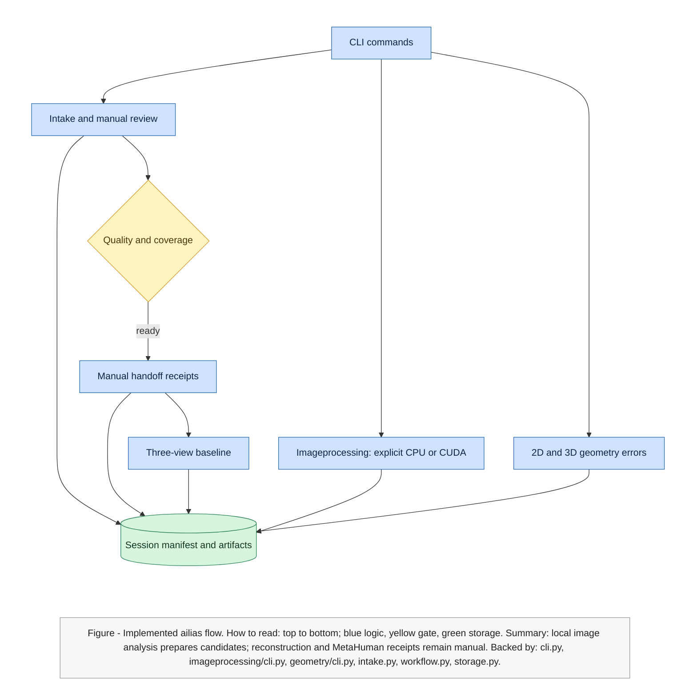

[Back to REPO_ROOT](../README.md)

# Development

Use `C:\projectWorkspace\.venv` for all applications: the existing working CUDA
environment is exposed there without copying it. From the project root,
`.\scripts\setup-gpu.ps1` installs ailias into that shared environment.
Do not create a project venv or install the CPU OpenCV extra over the CUDA build.
NumPy/OpenCV/HEIC are optional runtime dependencies, not a second test framework:

```powershell
& C:\projectWorkspace\.venv\Scripts\python.exe -m unittest discover -s src\ailias -t src -v
```

Units generate synthetic images/geometry in temporary directories and use fake
inference backends. HEIC decoding and connected-component association use the
real lightweight codecs/operators, never model inference. No unit uses user
photos, network, external tools or GPU probing. See the imageprocessing guide
for explicitly invoked real-directory validation, separate from units.
No linter/formatter has been added.

## Implemented architecture



**Backed by:** `src\ailias\cli.py` (`execute`), `intake.py` (`ingest`,
`review_photo`, `validate`), `workflow.py` (`attach`, `baseline`) and `storage.py`
(`Store`), plus `imageprocessing\cli.py` and `geometry\cli.py` (`execute`).
Diagram syntax was authored without a Mermaid render check.
External editors are not shown because ailias does not call them.

| Module | Responsibility |
|---|---|
| `settings.py` | Validated policy and one configuration source |
| `storage.py` | Session boundary, writer lock, atomic manifests, source references, managed handoff artifacts, history |
| `resources.py` | Conservative cleanup of unreferenced files inside one owned job folder |
| `intake.py` | Lightweight image checks, manual review, angular coverage |
| `workflow.py` | Ordered manual artifact contracts, baseline generation, integrity status |
| `cli.py` | CLI argument schema, JSON output and exit codes |
| `imageprocessing` | Explicit CPU or CUDA in the shared environment, reusable crops/masks, grouping, zero-copy selections |
| `geometry` | Aligned landmark errors and optional sampled-surface distances, not an identity classifier |
| `tests` | Focused observable pipeline behavior and failure tests |

Artifacts are immutable by content identity, not filesystem permissions. Changes
on disk are detected by hash checks. Session state uses schema version 1. There
is no database, queue or background service. An explicit imageprocessing cleanup
command migrates legacy copied photos and consolidates generated assets; it is
not a general schema migration framework. Failed operations cannot partially
commit a manifest, but hard termination may require explicit cleanup.

Intake changes invalidate all stages. Replacing a manual handoff invalidates
that stage and its successors, preserving prior records in history. Downstream
commands verify prerequisites against stored policy and source hashes.

Python orchestrates this increment because Pillow, OpenCV's native C++ operators
and NumPy's native numerical kernels fit the workload without an extra service.
This is not a Python-only architecture: the small image backend protocol is a
boundary for another runtime if a measured need arises. No CPU/GPU stack is
silently replaced or automatically switched.

Future reconstruction adapters must keep camera/texture provenance and run only
on explicit opt-in. Reuse the shared environment; do not introduce a separate
backend environment without an explicit owner decision. Unreal API calls must be verified
against the installed version before implementation.
