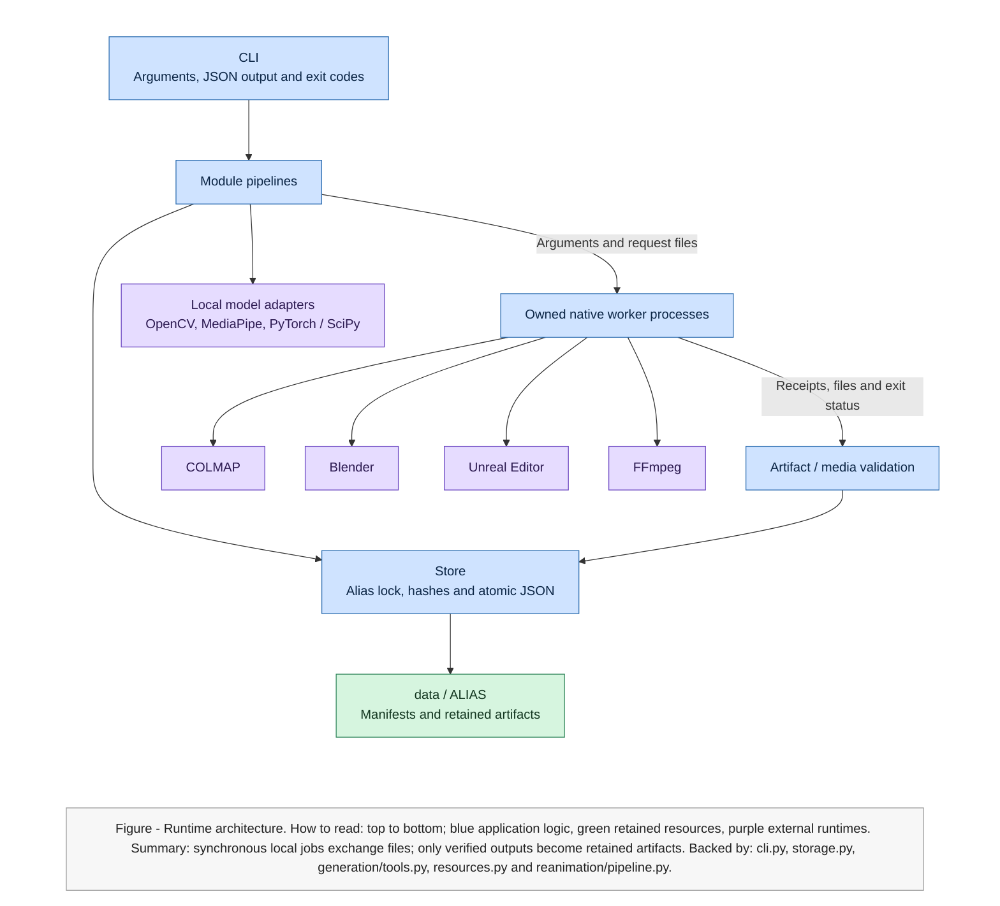

[Back to REPO_ROOT](../README.md) | [Core workflow](workflow.md)

# Development

## Setup and tests

Use Python 3.12+ in `C:\projectWorkspace\.venv`. The setup script reuses the
shared environment; do not replace its CUDA/OpenCV/Torch stack.

```powershell
.\scripts\setup-gpu.ps1
& C:\projectWorkspace\.venv\Scripts\python.exe -m unittest discover -s src\ailias -t src -v
```

Units use temporary fixtures and fake inference/native workers. Model execution,
GPU checks and editor integration are explicit opt-in operations outside unit
discovery. No project linter/formatter is configured.

## Architecture

The [root diagram](../README.md#module-architecture) maps product responsibilities.
This diagram shows process and persistence boundaries.



**Backed by:** `src\ailias\cli.py:execute`, `storage.py:Store`,
`generation\tools.py:NativeTools`, `resources.py` and `reanimation\pipeline.py`.

| Component | Responsibility / communication |
|---|---|
| CLI | Synchronous Python calls into module pipelines; JSON results on stdout, diagnostics on stderr |
| Module pipelines | Validate inputs, create unique jobs, invoke local adapters and persist results |
| Store | Per-alias writer exclusion, atomic manifests, source references and content hashes |
| Local model adapters | In-process inference/numerics; appearance workers separate incompatible native imports |
| Native workers | Owned child processes using arguments, environment request paths, JSON receipts and artifact files |
| Validators | Check saved native packages or media, not just worker return values |
| Retained data | File-based state; no application database, service or distributed queue |

COLMAP's transient SQLite database is job scratch, not application storage.
Artifacts are immutable by recorded identity, not filesystem permissions.

## Module ownership

| Area | Ownership | Guide |
|---|---|---|
| `settings.py`, `intake.py` | Capture thresholds, review and angular coverage | [Workflow](workflow.md) |
| `storage.py`, `workflow.py` | Durable sessions, ordered handoffs, history and baseline records | [Workflow](workflow.md) |
| `resources.py`, `maintenance.py` | Owned-file finalization and dependency-safe cleanup | [Cleanup](#resource-cleanup) |
| `imageprocessing` | Photo grouping, head derivatives and curation | [Internals](imageprocessing/dev.readme.md) |
| `facefitting` | Shared head shape, appearance preparation and native conform | [Internals](facefitting/dev.readme.md) |
| `generation` | Alternative photogrammetry/native cleanup | [Internals](generation/dev.readme.md) |
| `geometry` | Supplied-measurement comparison | [Internals](geometry/dev.readme.md) |
| `reanimation` | Existing rig plus audio to verified video | [Internals](reanimation/dev.readme.md) |

## Configuration

Global precedence: `--data-root` -> selected JSON `data_root` -> default relative
data directory. `--config FILE` selects that JSON; relative data paths resolve
against the configuration file. Module policies have their own CLI selectors;
their complete key tables live in module usage guides.

### Core: `config\settings.json`

| Key | Default | Meaning |
|---|---|---|
| `data_root` | `..\data` | Session/artifact directory relative to this configuration |
| `min_photos`, `max_photos` | `8`, `15` | Capture-set count bounds |
| `min_short_side` | `1024` | Minimum image short side, pixels |
| `min_edge_energy` | `18` | Minimum lightweight focus/edge-energy score |
| `max_dark_fraction` | `0.6` | Maximum dark-pixel fraction |
| `max_bright_fraction` | `0.6` | Maximum bright-pixel fraction |
| `angle_tolerance` | `10` | Allowed deviation in degrees from required capture views |

The capture policy is independent of imageprocessing's face-region thresholds.
Neither establishes anatomical accuracy.

## State and failure handling

| Event | Behavior |
|---|---|
| Intake changes | Invalidate downstream manual stages |
| Replaced handoff | Invalidate that stage and successors; preserve prior history |
| Missing/changed dependency | Fail integrity checks rather than silently rebase hashes |
| Native worker success without files | Fail; receipts alone do not prove saved assets |
| Editor failure after writes | Report possible partial packages; no external-project deletion |
| Hard termination | May leave a running job/lock; inspect evidence rather than reusing its namespace |

## Resource cleanup

Producing jobs finalize their own unreferenced scratch on success/failure.
Originals, shared model/tool caches, referenced results and preserved baselines
are not scratch. Native packages are never automatically swept.

```powershell
python -m ailias cleanup --alias subject
python -m ailias cleanup --alias subject --apply
python -m ailias cleanup --alias subject --prune-job 'facefitting\appearance\OBSOLETE_REVISION'
```

The default is a JSON dry run. `--apply` rechecks hashes, dependency metadata,
writer exclusion and symlink/junction boundaries before deleting exact files.
Whole-job pruning requires explicit IDs and refuses referenced, edited, active
or unregistered outputs. Receipts live under `maintenance\cleanups`.

Reanimation normally keeps verified video and boundary PNGs; `--keep-frames`
retains the sequence. Source/model downloads and atomic writes remove their
own temporary files. Hard kills can prevent finalizers; cleanup is idempotent.

## Documentation and media

Usage guides own commands, I/O and configuration meanings; dev guides own
internals, contracts and tests. Current quality is shown in the root comparison;
run-by-run records belong in job manifests/research, not README narratives.

Root thumbnails are reduced copies of existing pipeline products, not new
model generation. [Media provenance](images/pipeline/provenance.json) records
source hashes and display transforms. Keep cross-stage illustrations distinct
from matched-camera validation or a single reproducible pipeline run.
Portraits embedded in READMEs must fit within 256x256 pixels; link larger
diagnostics instead. Mermaid source is maintained inline; no local Mermaid
renderer is currently configured.
