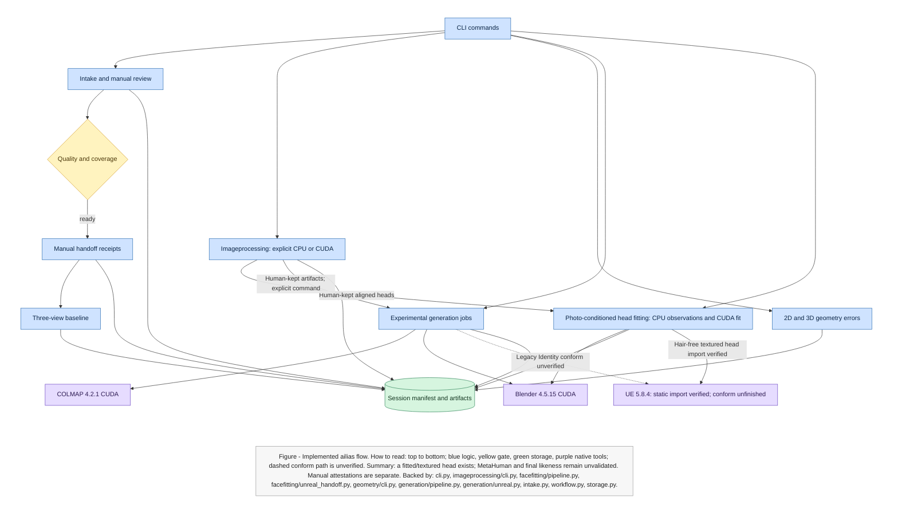

[Back to REPO_ROOT](../README.md)

# Development

Use `C:\projectWorkspace\.venv` for all applications: the existing working CUDA
environment is exposed there without copying it. From the project root,
`.\scripts\setup-gpu.ps1` installs ailias into that shared environment.
Do not create a project venv or install the CPU OpenCV extra over the CUDA build.
NumPy/OpenCV/HEIC are optional runtime dependencies, not a second test framework:

```powershell
& C:\projectWorkspace\.venv\Scripts\python.exe -m unittest discover -s src\ailias -t src -v
```

Units generate synthetic images/geometry in temporary directories and use fake
inference backends. HEIC decoding and connected-component association use the
real lightweight codecs/operators, never model inference. No unit uses user
photos, network, external tools or GPU probing. See the imageprocessing guide
for explicitly invoked real-directory validation, separate from units.
No linter/formatter has been added.

Production Python modules start with a short module docstring explaining their
responsibility and any important boundary. Keep command details and architecture
in the linked guides; avoid restating imports or narrating individual statements.

## Research decision guide

Read the plain-language module notes for what is implemented, what is proposed,
why each approach was chosen, its limitations and the evidence needed next:
[image observations and grouping](imageprocessing/dev.readme.md#research-decisions-in-plain-language),
[head fitting, completion and skin appearance](generation/dev.readme.md#research-decisions-in-plain-language),
[implemented dense CUDA head fitting](facefitting/dev.readme.md),
and [dimensions, scale and geometry errors](geometry/dev.readme.md#research-decisions-in-plain-language).
Detailed primary references live in the linked module research records.

## Implemented architecture



**Backed by:** `src\ailias\cli.py` (`execute`), `intake.py` (`ingest`,
`review_photo`, `validate`), `workflow.py` (`attach`, `baseline`) and `storage.py`
(`Store`), `imageprocessing\cli.py` and `geometry\cli.py` (`execute`),
`generation\pipeline.py` (`reconstruct`, `clean_mesh`) and
`generation\unreal.py` (`run_unreal`) and `facefitting\pipeline.py` (`run_fit`).
Diagram syntax was authored without a Mermaid render check.
COLMAP/Blender are locally verified native dependencies; Unreal is an
installed engine with verified fitted-head static import. Character/Identity
conform, production appearance transfer and rigging remain unverified.

| Module | Responsibility |
|---|---|
| `settings.py` | Validated policy and one configuration source |
| `storage.py` | Session boundary, writer lock, atomic manifests, source references, managed handoff artifacts, history |
| `resources.py` | Owned-job finalization, junction-safe traversal and cross-pipeline dependencies |
| `maintenance.py` | Dry-run-first remnant cleanup and guarded explicit old-job pruning |
| `intake.py` | Lightweight image checks, manual review, angular coverage |
| `workflow.py` | Ordered manual artifact contracts, baseline generation, integrity status |
| `cli.py` | CLI argument schema, JSON output and exit codes |
| `imageprocessing` | Explicit CPU or CUDA in the shared environment, reusable crops/masks, grouping, zero-copy selections |
| `geometry` | Aligned landmark errors and optional sampled-surface distances, not an identity classifier |
| `generation` | Experimental native reconstruction, minimal Blender cleanup, guarded Unreal handoffs; [internals and tests](generation/dev.readme.md) |
| `facefitting` | Dense observations, CUDA head fit/photo projection, approved-geometry appearance/hair previews and verified static-head Unreal handoff; [internals and tests](facefitting/dev.readme.md) |
| `tests` | Focused observable pipeline behavior and failure tests |

Artifacts are immutable by content identity, not filesystem permissions. Changes
on disk are detected by hash checks. Session state uses schema version 1. There
is no application database, queue or background service; native COLMAP uses a
job-local transient SQLite database. An explicit imageprocessing cleanup
command migrates legacy copied photos and consolidates generated assets; it is
not a general schema migration framework. Failed operations cannot partially
commit a manifest, but hard termination may require explicit cleanup.

Intake changes invalidate all stages. Replacing a manual handoff invalidates
that stage and its successors, preserving prior records in history. Downstream
commands verify prerequisites against stored policy and source hashes.

Python orchestrates this increment because Pillow, OpenCV's native C++ operators
and NumPy's native numerical kernels fit the workload without an extra service.
This is not a Python-only architecture: the small image backend protocol is a
boundary for another runtime if a measured need arises. No CPU/GPU stack is
silently replaced or automatically switched.

Native tools are shared under `C:\projectWorkspace\tools`, not per-job downloads
or Python environments. Generation runs only on explicit commands, keeps
camera/texture provenance, reuses hardlinked canonical input views and removes
transient databases/depth/maps in finalizers. Isolated units use fake tools;
authorized real CUDA checks live in `src\integration_tests\generation`, excluded
from discovery/package installation. Unreal API execution still requires actual
installed-version validation for Character conform and rigging. Fitted-head
static import is verified separately. Clay geometry is owner-approved;
photographic appearance/final likeness are not, and no MetaHuman is complete.

## Resource cleanup

Every producing pipeline has an owned-file finalizer: image scanning/cleansing,
selection, geometry comparisons, reconstruction/input preparation, head fitting,
appearance, static-head import, native conform and reanimation. Atomic writes and
model downloads remove their own temporary files. Finalizers run on success and
failure; completed artifacts, requests/receipts and diagnostic logs are retained
where part of that pipeline's contract. Reconstruction retains its existing
stricter policy of dropping uncommitted requests and partial Blender outputs.
Intake/manual attachments retain content-addressed user inputs; they are not scratch.

Native jobs now record a `resource_ownership` inventory. Uncommitted partial outputs
and scratch are discarded. Reanimation retains the first/last available frames
even on failure, removes partial videos and interior frames, and keeps published
verified MP4s. `--keep-frames` explicitly retains every source PNG instead.
Explicitly cancelled revisions also release interior frames when their existing
video still matches its recorded hash; the video and boundary frames stay intact.
Neither cleanup path automatically deletes Unreal packages, shared model/tool
caches, original photos or selected/user-edited Blender assets.

```powershell
python -m ailias cleanup --alias arka
python -m ailias cleanup --alias arka --apply
python -m ailias cleanup --alias arka --prune-job 'facefitting\appearance\OBSOLETE_REVISION'
python -m ailias cleanup --alias arka --prune-job 'facefitting\appearance\OBSOLETE_REVISION' --apply
```

`OBSOLETE_REVISION` must be an actual generated job ID; the default is a JSON-only
dry run, not deletion. `--prune-job` is repeatable and required to remove whole
historical jobs; there is no age-only purge. Pruning refuses retained references,
active/interrupted jobs, changed/missing registered outputs and unregistered owner
files. Approved-baseline/review metadata and downstream manifests are read across
all pipelines, including when legacy `imageprocessing cleanup` reclaims PNG assets.
Legacy absolute audit references are recognized without requiring metadata rewrites.

Application holds the alias writer lock and rechecks metadata, candidate hashes
and symlink/junction boundaries before unlinking exact files. Corrupt metadata
fails closed; partial deletion errors are counted rather than reported as success.
Receipts live under `data\ALIAS\maintenance\cleanups`; cleanup receipts do not
become live artifact references. Default remnant cleanup never rewrites retained
job manifests, and rerunning it is idempotent.

Focused units in `ailias.tests.test_resources` and the affected module suites use
temporary fixtures/fake native workers. They cover failure cleanup, cross-pipeline
protection, dry-run/application, edited outputs, stale plans, linked paths and
video-frame retention. No native render, model inference or cloud request is
needed to validate resource ownership.
