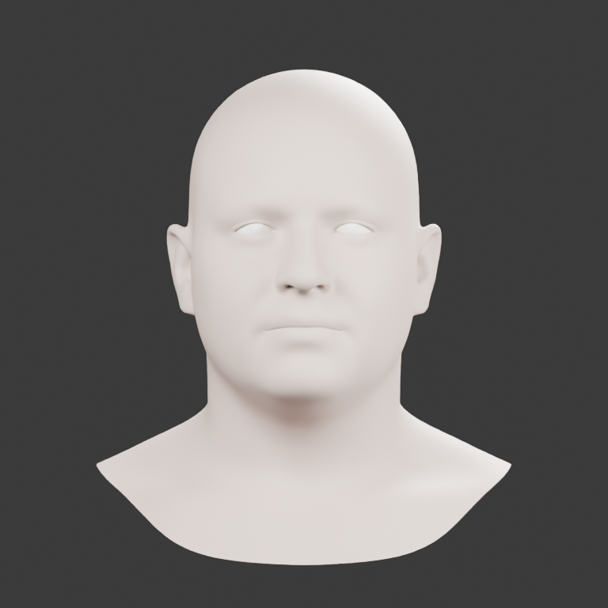
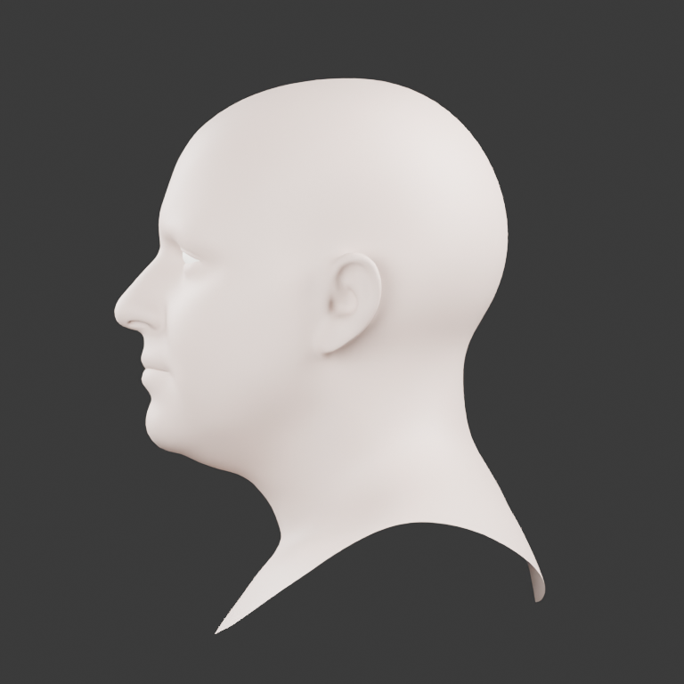
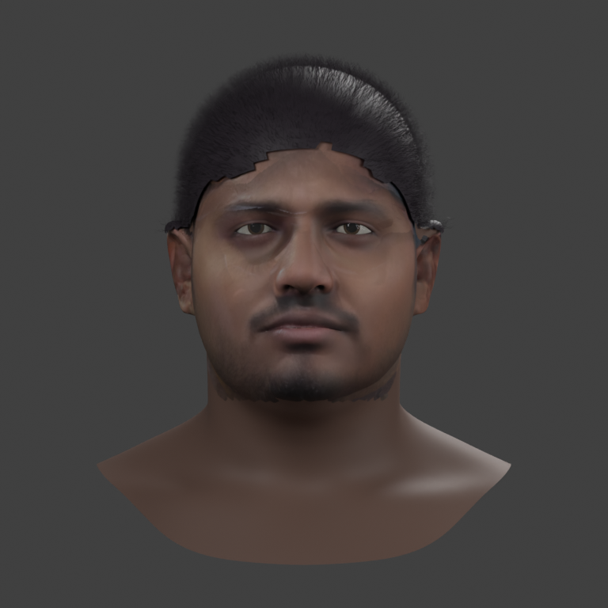
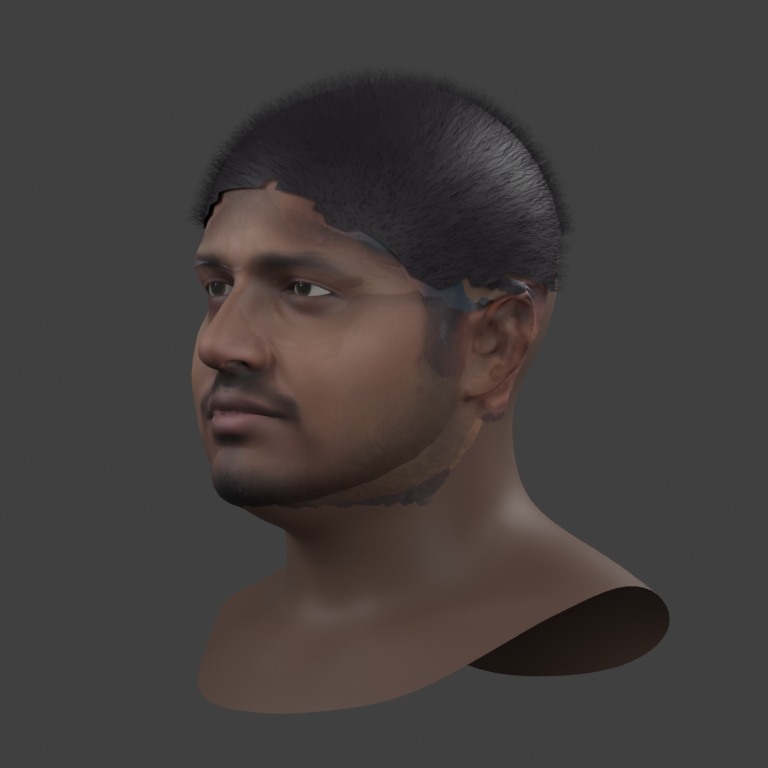
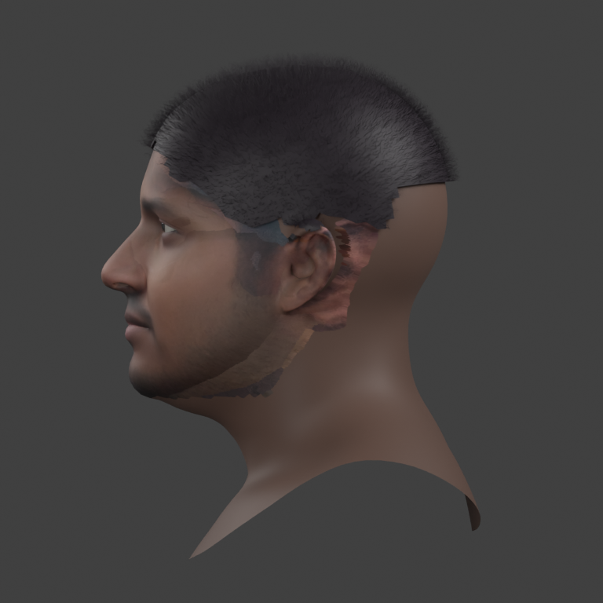
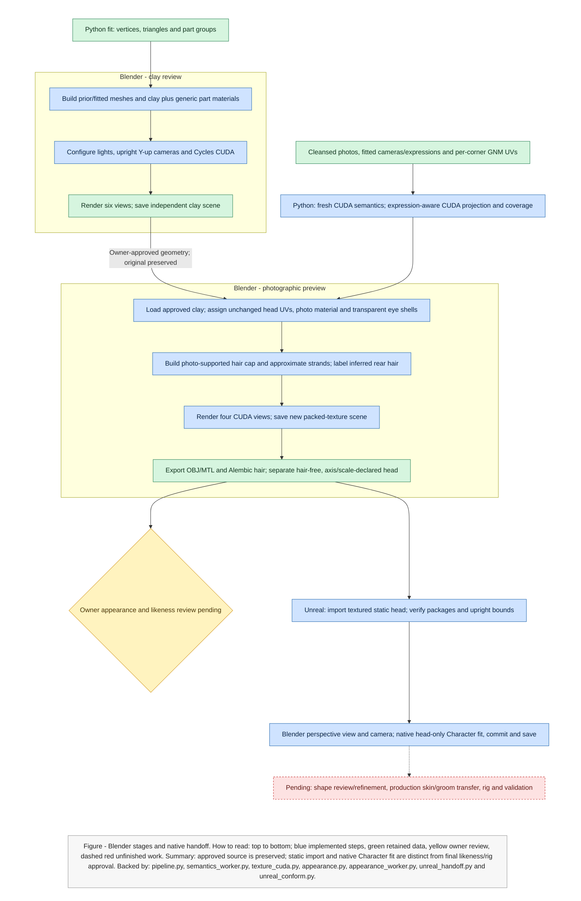
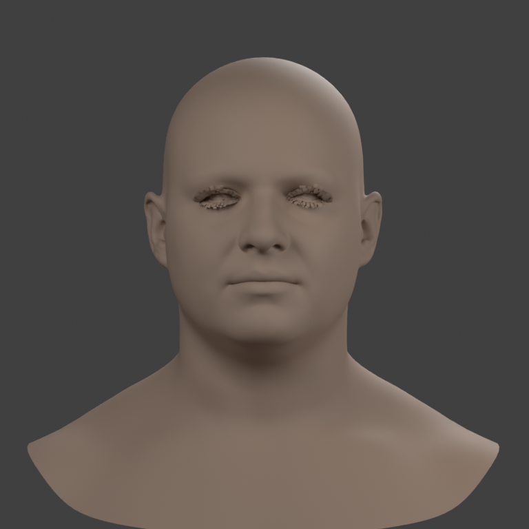

[Back to REPO_ROOT](../../README.md) | [Development](dev.readme.md)

# Photo-conditioned head fitting

This experimental path fits a coherent GNM head prior to current human-kept
portraits. It is separate from COLMAP and does not declare a MetaHuman, calibrated
scan or verified likeness. Dense observations use MediaPipe CPU on Windows;
the configured fitting backend is explicitly CUDA, with no silent CPU fallback.

## Current working baseline

The owner selected diagnostic `20261117T0525Z-hairfree-camera` as the working
starting point on November 17, 2026. See the [comparison near the top of the root README](../../README.md#current-blender-baseline).
The scene is
`data\arka\facefitting\diagnostics\20261117T0525Z-hairfree-camera\hairfree-matched-camera.blend`.

Its source geometry is the approved `20261116T153125Z-44390de9` fit and its
appearance comes from `20261116T163340Z-14973ca7`. The new scene uses the existing
estimated perspective camera and reversibly hides the approximate scalp groom;
it does not deform the face or reconstruct hidden scalp skin.

`data\arka\facefitting\working-baseline.json` pins the selected scene, images,
geometry, texture, camera evidence and source reference with integrity hashes.
Use it as the starting reference for incremental accuracy and feature work.
Keep this baseline intact; improved samples and corrections must produce new
revisions with comparisons against it. Selecting a baseline does not itself
implement an automatic warm-start option in the fitting CLI.
Do not refit/regenerate geometry or save additional `.blend` copies without an
explicit owner request. Current personal-head work reuses this existing scene
and refines the native Character in Unreal.

Current limitations include texture seams, generic eyes and expression
mismatch. Working-baseline selection is not final calibrated-likeness approval
or MetaHuman rigging. See [hair-free fitting guidance](hair-fitting-guidelines.md).

## Approved clay baseline

These are actual Blender Cycles renders from job
`20261116T153125Z-44390de9`, not reference photos or generated concept art.
The owner approved this **clay geometry** on November 16, 2026; photographic
skin, hair, MetaHuman conversion and final likeness are separate stages.

| Front | Three-quarter | Profile |
|---|---|---|
|  |  |  |

The images are documentation copies of retained renders. The original model and
review scene remain unchanged under the job's Git-ignored data directory.

## Photo appearance preview

These are actual renders from revision `20261116T163340Z-14973ca7`: a 2,048-pixel
photo-derived colour atlas, generic eyes with transparent outer shells, and
14,000 evidence-guided **approximate** hair strands. This appearance has **not**
been owner-approved. It retains photographed lighting, hairline/ear seams and
prior-driven hidden anatomy; it is not a finished photorealistic MetaHuman.

| Front | Three-quarter | Profile |
|---|---|---|
|  |  |  |

## Blender stages and appearance handoff

Blender builds/reviews geometry and assigns prepared appearance; the fitting and
photo projection run in Python. **Clay, photographic preview, approximate hair
and an upright textured static-head import in UE 5.8.4 are locally verified.**
A native head-only Character draft is now saved and reload-checked too.
Final shape/likeness review, production appearance transfer, assembly and rig
validation remain separate, unfinished work.



**Backed by:** `src\ailias\facefitting\pipeline.py` (`render_review`, `run_fit`),
`blender_worker.py` (`main`), `appearance.py` (`run_appearance`),
`semantics_worker.py` (`main`), `texture_cuda.py` (`bake`),
`appearance_worker.py` (`main`, `add_hair`) and `unreal_handoff.py`
(`import_appearance`), `tracking_worker.py` (`main`) and `unreal_conform.py`
(`conform_head`). Dashed work is not a completed or validated MetaHuman.
Mermaid rendering has not been checked; no local renderer is installed.

The clay worker owns mesh creation/materials, lighting/cameras, six GPU renders
and an independent `.blend`. Python invokes native workers synchronously through
`NativeTools.run` with JSON/NPZ files. Appearance preparation isolates fresh
OpenCV CUDA semantics from Torch CUDA projection, then produces UV colour,
coverage and hair evidence. The appearance worker loads the approved scene,
assigns material/UVs and adds separate hair objects without changing the head.
Its new `.blend` packs the texture; OBJ/MTL files reference the adjacent PNG.
Unreal is a separate commandlet process; it receives a hair-free candidate and
persists actual `.uasset` packages, not just a success receipt.
The [native generation module](../generation/README.md) has a different Blender
cleanup worker for COLMAP meshes; it is not the photo-conditioned head fitter.

## Setup and use

Use the existing shared workspace Python. The CUDA extra pins the official
PyTorch CUDA build matched to the pre-existing TorchVision distribution;
do not install another OpenCV/CUDA environment.

```powershell
Set-Location C:\projectWorkspace\ailias
python -m pip install -e ".[facefitting]"
python -m pip install -e ".[facefitting-cuda]" --extra-index-url https://download.pytorch.org/whl/cu126
python -m ailias facefitting models arka
python -m ailias facefitting fit arka RUN_ID face-001 --generation-config config\generation-poc.json
python -m ailias facefitting status arka JOB_ID
python -m ailias facefitting appearance arka APPROVED_FIT_JOB
python -m ailias facefitting appearance-status arka APPEARANCE_REVISION
python -m ailias facefitting unreal-import arka APPEARANCE_REVISION `
  --editor 'C:\Program Files\Epic Games\UE_5.8\Engine\Binaries\Win64\UnrealEditor-Cmd.exe' `
  --project 'C:\projectWorkspace\ailias\data\arka\unreal\AiliasReview\AiliasReview.uproject'
python -m ailias facefitting unreal-conform arka IMPORT_JOB_ID `
  --editor 'C:\Program Files\Epic Games\UE_5.8\Engine\Binaries\Win64\UnrealEditor-Cmd.exe' `
  --project 'C:\projectWorkspace\ailias\data\arka\unreal\AiliasReview\AiliasReview.uproject'
```

`models` explicitly downloads or verifies pinned public models, correspondence
data and license provenance. `fit` performs fresh dense inference, compares
shared-identity candidates on held-out photos, refits the winner using all
eligible photos, exports a neutral OBJ and produces Blender review renders.
It requires current curated/cleansed heads; it never promotes automatic positives
or copies original photos. Colour/lighting and subject-association limitations
from [imageprocessing](../imageprocessing/README.md) still apply.

`config\facefitting.json` owns device, fit budgets and regularization.
`device: "cuda:0"` selects that GPU; `"cpu"` explicitly selects the SciPy reference.
`max_iterations` applies to CUDA Levenberg-Marquardt and `max_nfev` to SciPy.
Rendering/tool settings remain in the supplied generation configuration.
The permissive native-SfM gates in `generation-poc.json` are not used to approve
the head fit: it has separate held-out accuracy and mesh-deformation checks.

`appearance` requires a retained owner approval of that exact clay mesh under
`facefitting\reviews\FIT_JOB-clay-approval.json`; it never creates that approval
itself. `config\appearance.json` bounds CUDA photo/atlas sizes, view count and
hair/render budgets. The command creates a new revision and removes temporary
resized photo arrays on completion/failure. Source photos remain external.

## Outputs and interpretation

Each unique job under `data\ALIAS\facefitting\runs` retains observations, source
transforms, excluded views, model/license hashes, candidate parameters,
held-out results, final parameters/cameras, OBJ, per-photo overlays, comparison
sheet and Blender scene. `status` detects changed dependencies or outputs.
Render workers are retained by content hash so later application updates do not
silently rewrite provenance. Originals and prior/user-edited scenes are untouched.

The mesh has 17,821 prior vertices and 35,324 triangles, **not** that many
independently measured features. Only supported exterior correspondences receive
image constraints. Hidden ears, rear scalp, eyes, teeth and neck remain
prior-driven. The fit job remains neutral clay. Appearance revisions under
`facefitting\appearance` retain the new scene, texture/coverage PNGs, hair evidence,
OBJ/MTL, hair Alembic, multiview renders and exact worker/source hashes.
Unobserved skin is a neutral colour, not invented photographic detail; the
coverage map does not count padding/fill as observations. Hair colour, supported
roots and approximate length use photos; strand layout and hidden hair do not.

The separate Unreal head export declares `OBJ=(GNM Z,X,Y)*100`. The verified
UE importer produces `UE=(GNM Z,-X,Y)*100`: X forward, Z up, nominal scale only,
**not** calibrated centimetres. Exported vertices are compared with the approved
head under that transform, and imported bounds are checked. Blender's scene and
hair Alembic retain original GNM coordinates; the Alembic is not an already
validated ready-to-bind Unreal groom. OBJ eye optics/skin shading are only a preview transfer.

## Native Character draft and hair later

`unreal-conform` requires the existing verified import and its project. It defaults
to `facefitting\working-baseline.json` when present; `--baseline MANIFEST` selects
an explicit owner-approved baseline. It verifies all pinned files and that the
baseline derives from the imported appearance revision. For that baseline it uses
a temporary frontal tracking camera in memory, without changing its shifted
perspective review camera, geometry or saved `.blend`. Legacy appearance-only
jobs retain their existing camera path. It tracks native
face contours and creates a new head-only Character. Native solver coordinates
are `(GNM X,Z,Y)*100`, matching the Character's +Y-facing template; this rotates
the target and camera together without changing the saved +X-facing static preview.
It commits face/body state, hashes the saved package and removes temporary RGBA
pixels. It makes no cloud, texture-synthesis or rig request.

Baseline-backed job `79893d83e1cb4c58a6574db06c6a828e` saved/reloaded the native
draft after 93.391 seconds of native solving. All 12 baseline hashes verify;
its 17,821 source vertices match the approved OBJ within `5e-10` model units.
The photo-derived skin and facial hair have **not** been transferred. Raw landmark
movement is mostly global repositioning, not likeness evidence: translation-removed
RMS is 0.56579 native units, similarity-aligned RMS 0.41629. The draft's appearance
and final shape remain unfinished/unapproved. No complete personal MetaHuman exists.
The interactive editor resaved the package on close before resource cleanup, so
the original solve manifest's package hash no longer matches; it is not silently
rebased. A separate read-only audit found 0.01671 native-unit RMS landmark
difference from the original solve, versus 0.56571 from the factory template
after removing translation. This is a 79-landmark check, not full-mesh or likeness
validation. The current package is preserved, with separate audit evidence under
`facefitting\reviews\79893d83e1cb4c58a6574db06c6a828e-current-native-audit.json`.

Job `73508d43f43540eaafa792c527abc083` saved a real Character in 81.375 seconds
of native execution, tracked 16 curves and survived a separate editor reload.
This is its actual reloaded face geometry rendered as clay, **not** the original
GNM mesh and not a final material/eye/rig preview:



The fit is coherent, but eye/eyelid detail, surface refinement and likeness
remain unapproved. Optional Core Data is still missing: installed-engine logs
disable skin editing, but Character creation/editing and the local solve work.

**Hair can be added or replaced later.** Keep it separate while finalizing the
head. For skinned hair, create a Groom Binding targeting the final skeletal head,
then validate deformation and LODs; the static GNM preview is not that target.
See Epic's [binding workflow](https://dev.epicgames.com/documentation/unreal-engine/setting-up-bindings-for-grooms-in-unreal-engine).
The local Alembic did create a real unbound Groom, but reload inspection reports
**28,000 curves versus 14,000 intended Blender strands**. That discrepancy and
axis/scale/root alignment are unresolved; this groom is not approved for binding.
Evidence: `data\arka\unreal\native-review.json` and the retained import log.

Acceptance means `awaiting_human_likeness_review`, never automatic likeness
approval. Landmark agreement can improve while anatomy or resemblance remains
wrong. See [research, evidence and performance](dev.readme.md).
The [MetaHuman workflow investigation](../generation/metahuman-workflow-investigation.md)
recommends UE 5.8's head-only Custom Mesh experiment, not passing GNM topology
to From Template. Static import and a first native head fit now exist; refinement,
rigging, assembly and final likeness validation are not complete. Creator Core
Data remains absent; see the linked investigation before attempting production
MetaHuman appearance work.
