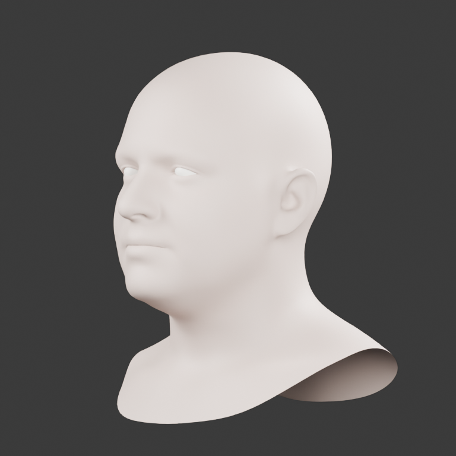
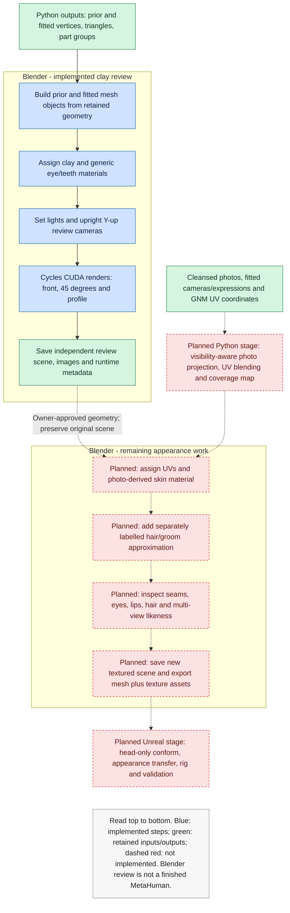

[Back to REPO_ROOT](../../README.md) | [Development](dev.readme.md)

# Photo-conditioned head fitting

This experimental path fits a coherent GNM head prior to current human-kept
portraits. It is separate from COLMAP and does not declare a MetaHuman, calibrated
scan or verified likeness. Dense observations use MediaPipe CPU on Windows;
the configured fitting backend is explicitly CUDA, with no silent CPU fallback.

## Approved clay baseline

These are actual Blender Cycles renders from job
`20261116T153125Z-44390de9`, not reference photos or generated concept art.
The owner approved this **clay geometry** on November 16, 2026; photographic
skin, hair, MetaHuman conversion and final likeness are separate stages.

| Front | Three-quarter | Profile |
|---|---|---|
|  |  |  |

The images are documentation copies of retained renders. The original model and
review scene remain unchanged under the job's Git-ignored data directory.

## Blender stages and appearance handoff

The current Blender worker builds and reviews the fitted geometry; it does not
perform the head fitting itself. Photo-texture projection/blending belongs to
Python preparation, followed by UV/material assignment and appearance review in
Blender. **The clay pipeline is implemented; the appearance and Unreal branches
below remain planned until their outputs are generated and validated.**



**Backed by:** `src\ailias\facefitting\pipeline.py` (`render_review`, `run_fit`),
`blender_worker.py` (`main`), the pinned model's `triangle_uvs`, and retained
`cameras.json`. Dashed nodes describe pending work, not existing code or a
successful UE solve. Mermaid rendering has not been checked.

The clay worker owns mesh creation/materials, lighting/cameras, six GPU renders
and an independent `.blend`; Python invokes it synchronously through
`NativeTools.run` using JSON plus NPZ files and collects the outputs. The planned
texture preparation will produce a UV image and coverage evidence, not claim
lighting-free albedo. Planned hair remains distinct from skin pixels. Blender
will consume those assets in a new scene, leaving the approved clay scene intact.
Unreal is a separate downstream editor process, not another Blender operation.
The [native generation module](../generation/README.md) has a different Blender
cleanup worker for COLMAP meshes; it is not the photo-conditioned head fitter.

## Setup and use

Use the existing shared workspace Python. The CUDA extra pins the official
PyTorch CUDA build matched to the pre-existing TorchVision distribution;
do not install another OpenCV/CUDA environment.

```powershell
Set-Location C:\projectWorkspace\ailias
python -m pip install -e ".[facefitting]"
python -m pip install -e ".[facefitting-cuda]" --extra-index-url https://download.pytorch.org/whl/cu126
python -m ailias facefitting models arka
python -m ailias facefitting fit arka RUN_ID face-001 --generation-config config\generation-poc.json
python -m ailias facefitting status arka JOB_ID
```

`models` explicitly downloads or verifies pinned public models, correspondence
data and license provenance. `fit` performs fresh dense inference, compares
shared-identity candidates on held-out photos, refits the winner using all
eligible photos, exports a neutral OBJ and produces Blender review renders.
It requires current curated/cleansed heads; it never promotes automatic positives
or copies original photos. Colour/lighting and subject-association limitations
from [imageprocessing](../imageprocessing/README.md) still apply.

`config\facefitting.json` owns device, fit budgets and regularization.
`device: "cuda:0"` selects that GPU; `"cpu"` explicitly selects the SciPy reference.
`max_iterations` applies to CUDA Levenberg-Marquardt and `max_nfev` to SciPy.
Rendering/tool settings remain in the supplied generation configuration.
The permissive native-SfM gates in `generation-poc.json` are not used to approve
the head fit: it has separate held-out accuracy and mesh-deformation checks.

## Outputs and interpretation

Each unique job under `data\ALIAS\facefitting\runs` retains observations, source
transforms, excluded views, model/license hashes, candidate parameters,
held-out results, final parameters/cameras, OBJ, per-photo overlays, comparison
sheet and Blender scene. `status` detects changed dependencies or outputs.
Render workers are retained by content hash so later application updates do not
silently rewrite provenance. Originals and prior/user-edited scenes are untouched.

The mesh has 17,821 prior vertices and 35,324 triangles, **not** that many
independently measured features. Only supported exterior correspondences receive
image constraints. Hidden ears, rear scalp, eyes, teeth and neck remain
prior-driven. The material is neutral clay, not measured skin tone/albedo;
hair, a personalized rig, MetaHuman conversion and animation are not implemented.

Acceptance means `awaiting_human_likeness_review`, never automatic likeness
approval. Landmark agreement can improve while anatomy or resemblance remains
wrong. See [research, evidence and performance](dev.readme.md).
The [MetaHuman workflow investigation](../generation/metahuman-workflow-investigation.md)
recommends UE 5.8's head-only Custom Mesh experiment, not passing GNM topology
to From Template. This route has not yet been executed locally.
