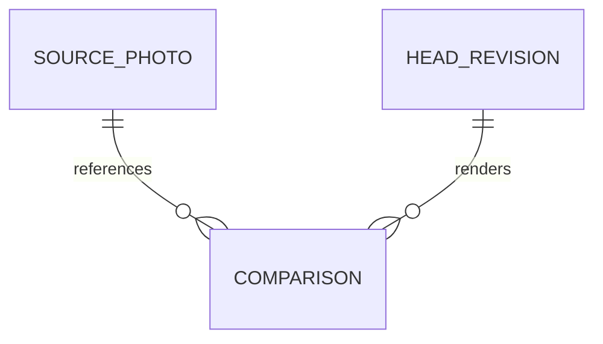

[Back to REPO_ROOT](../../README.md) | [Face fitting](README.md)

# Hair-free fitting versus final likeness

| Field | Value |
|---|---|
| Owner | ailias workspace |
| Status | Research-backed policy; one diagnostic completed and selected as working baseline |
| Last updated | 2026-11-17 |
| Scope | Existing-photo head fitting and reversible Blender review; no personal-face Unreal conform |

## 1. Problem Statement

**A clear view of facial skin helps reconstruction; a bald final character is
not automatically more accurate.** These are different goals: measuring the
underlying face versus reproducing a person's complete appearance.

Epic's current capture guidance asks for unobstructed facial features, including
keeping hair from blocking the face. It does not require shaving the head [1].
Disney/ETH research explains that conventional facial capture can incorrectly
wrap reconstructed skin around facial hair, while specialized methods reconstruct
skin and hair separately [2,3]. Those research systems are not claimed to be
implemented in ailias.

## 2. Implementation

### Recommended working policy

| Stage | Hair policy | Why |
|---|---|---|
| New reference capture | Keep hair away from facial features; do not require a shaved head | Avoid occlusion, following Epic [1] |
| Existing-photo fitting | Separate visible skin evidence from hair-covered regions | Proposed application of the skin/hair distinction in [2,3]; hidden skin is uncertain |
| Blender geometry review | Temporarily hide the approximate scalp groom, using an unchanged mesh and matched camera | Diagnostic choice: inspect actual facial proportions without a distracting groom |
| Appearance review | Compare clay and albedo-only renders before adding styling | Distinguish shape, projection, texture and lighting errors |
| Final likeness | Restore a reference-matched hairstyle and facial hair as separate appearance elements | Hair contributes to the person's complete appearance; clean geometry alone is not the final double [2,3] |

Hiding a Blender hair object does **not** reveal skin hidden in source photos,
repair eye/nose correspondence or establish a more accurate identity. This is
an engineering inference, not a measured improvement for this user. Do not
digitally erase photo hair and treat the invented skin as a measurement.

Hair-free does not mean empty eye sockets or removing eyebrows indiscriminately.
Epic's mesh guidance calls for visible eye whites and clear eye/lid separation;
empty sockets can produce tracking artifacts. It recommends albedo textures,
unlit albedo review, or uniform frontal lighting when albedo is unavailable [4].

### Proposed review relationships

This conceptual ER diagram describes comparison provenance, not a new database
or an implemented metadata schema:

Backed by: the requested original-photo versus Blender comparison workflow.
This is a proposed review relationship, not evidence that an experiment passed.
Diagram source has not been renderer-checked.

Operational scope is one person and one new diagnostic revision at a time:
`1 subject * 1 revision = 1 experiment`. No service, database, broker or new
network inference endpoint is proposed; distributed CAP choices and API RPS
are not applicable. GPU rendering is serialized with owned Unreal render work.
The single GPU, local disk and reference coverage remain local failure or
quality limits; retain source assets and failed receipts rather than hiding them.

## 3. Success Criteria

- Preserve original photos, approved geometry and earlier Blender scenes.
- Show an actual matched-view comparison; keep hair visibility reversible.
- Separate camera, eye, geometry and texture problems before another deformation.
- Do not equate render completion or lower surface distance with likeness.
- Report whether the current diagnostic changed geometry or only presentation.
- Require a separate visual check of the final reference-matched hair.

No percentage improvement from removing hair has been measured here.

## 4. Task Breakdown

| Work | State |
|---|---|
| Distinguish capture visibility, skin fitting and final appearance using primary sources | Research complete |
| Produce one new hair-free Blender diagnostic from the intact approved head | Completed as `20261117T0525Z-hairfree-camera`; owner selected it as the working starting baseline, not final likeness certification |
| Evaluate hair restoration after facial shape/appearance acceptance | Deferred; not a reason to deform skin around hair |

## 5. Reference Links

1. [Epic: MetaHuman Animator Video Capture Guidelines, UE 5.8](https://dev.epicgames.com/documentation/metahuman/metahuman-animator-video-capture-guidelines-in-unreal-engine?application_version=5.8).
2. [Winberg et al., Facial Hair Tracking for High Fidelity Performance Capture, 2022](https://assets.studios.disneyresearch.com/app/uploads/2022/07/Facial-Hair-Tracking-for-High-Fidelity-Performance-Capture.pdf).
3. [Beeler et al., Coupled 3D Reconstruction of Sparse Facial Hair and Skin](https://la.disneyresearch.com/wp-content/uploads/Coupled3DReconstructionOfSparseFacialHairAndSkin1.pdf).
4. [Epic: Mesh to MetaHuman, From Mesh](https://dev.epicgames.com/documentation/metahuman/from-mesh?lang=en-US).
