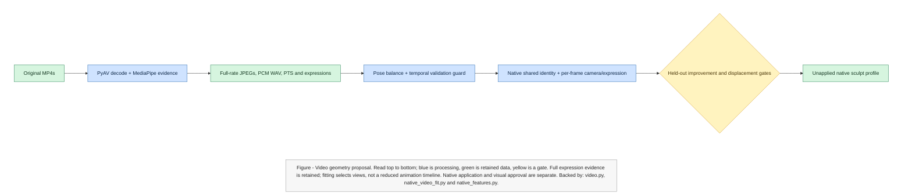
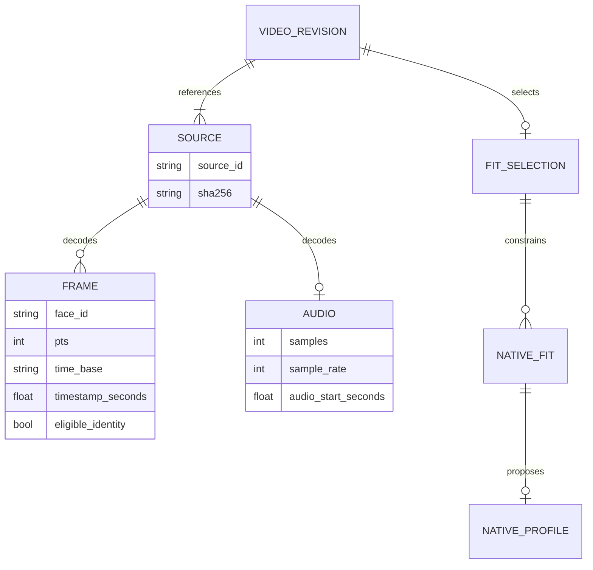

[Back to REPO_ROOT](../../README.md) | [Module guide](README.md)

# Video-derived identity and performance - Facefitting

| Field | Value |
|---|---|
| Owner | ailias |
| Status | Full retained-frame run passes through new native close-up; visual likeness and assembled runtime remain unaccepted/out of scope |
| Last updated | 2026-11-18 |
| Services in scope | Local video evidence, native response calibration, identity fitting, UE feature editing |
| Reviewers | Owner; visual likeness acceptance remains separate |

**Recommendation:** retain original recordings; sample one frame per second
for routine geometry, then fit one shared identity with separate camera/expression
variables for selected views. Use explicit all-frame extraction when a complete
expression timeline is required. Keep original-rate video/audio for animation.
Do not average smiling/speaking faces into a neutral head or mistake mono-video
animation for identity reconstruction. The new path does not use Blender.

## 1. Problem Statement

Gap A: older photographs mixed camera, illumination and expression; previous
native shape edits did not establish satisfactory likeness. The owner supplied
five same-session recordings and explicitly reopened geometry work at
23:38 +05:30 on November 17. Approved UE appearance `f6b61b60` remains a
protected baseline, not a likeness certificate.

Gap B: the first pass retained 243 full-resolution frames at approximately
3 frames/second, not one every three seconds. The owner correctly required
every-frame retention for short expressions. That full-rate run completed with
2412 images (all 720 from GX012987). On November 18 the owner chose one-second
sampling for future geometry work. All-frame mode remains available and rejects
truncation/count mismatch; both modes keep exact presentation timestamps.
See `video.py:sampled_frames` and `config/video-evidence.json`.

Gap C: none of the first 239 successfully detected sampled faces met the strict
neutral-expression threshold. This does **not** justify weakening the neutral
gate. An explicitly expression-aware selection instead requires a per-frame
expression model. See first extraction manifest
`data\arka\facefitting\video\3d1c4539ae404f8bb596a39328314114\manifest.json`.

Epic's identity-take guidance calls for relaxed, closed lips and open eyes;
its mono-video workflow produces animation. The uploaded MP4s have one RGB
video stream plus audio/data streams, not a supplied calibrated stereo/depth
capture. Native Identity-from-footage is therefore not assumed to be a direct
RGB-video-to-scan shortcut. Sources [1-4].

This is a local, single-owner pipeline; there are no external service teams,
on-call rotations or contact aliases to resolve.

## 2. Implementation

### Options and why chosen

| Option | Useful output | Decision / tradeoff |
|---|---|---|
| Full-rate frame/audio extraction + shared parametric identity | Inspectable images, timestamped expression evidence, neutral geometry proposal | Chosen: reuses installed MediaPipe/GNM and native response fitting; separates identity and expression, but landmarks and unseen anatomy remain predictions. [5,6] |
| Native mono-video MetaHuman Performance | Facial/body animation curves | Suitable for performance, not proof of correct personal rest geometry. Retain original MP4 and clock-aligned audio for this separate stage. [2,3] |
| Depth/stereo Identity capture | Supported native identity workflow | Better direct native route when the required capture actually exists; no synthetic depth is presented as measured depth here. [1,4] |
| COLMAP over all expressive frames | Static-scene photogrammetry | Not selected: face deformation and stationary background confound a rigid-scene solve. Masking excludes background features but does not make expressions rigid. [7] |
| INSTA / neural head avatar | Novel-view neural rendering | Not selected for this task: additional training/tracking and a different representation, not a ready editable MetaHuman mesh/rig. [8] |

### Local workflow and contracts



**Backed by:** `video.py:extract_evidence`, `select_expression_aware`;
`native_video_fit.py:fit_native_video`. Mermaid source was reviewed; no rendered
diagram check is claimed.

**Decode/evidence** synchronously reads local MP4s through PyAV, writes processing
JPEGs and PCM16 mono 48 kHz WAV, and records original PTS/time base, decoded index,
video/audio clock origins, source hashes and image-grid facial landmarks.
As of November 18, JPEGs preserve aspect ratio at at most 1920 pixels on the
long side without upscaling; `original_source_size` separately records input
dimensions. Previously extracted 4K images and original recordings are retained.
No frame interpolation or expression synthesis is performed. Audio gaps fail
rather than silently concatenating discontinuous timing. Sources [5,9].

**Selection** reads those local records synchronously, balances predicted pose
bins, prefers lower expression/blur, and enforces spacing plus a two-second
training/validation guard. Strict-neutral selection remains separate from
expression-aware selection. The full image/expression timeline is not pruned.

**Native fitting** synchronously consumes the pinned native finite-difference
responses, same-native ray/barycentric correspondences and GNM expression modes.
It similarity-aligns expression displacements, reduces native identity responses
by singular-value decomposition, and reuses the existing camera/expression
optimizer. Shared native identity is separated from per-frame camera/expression.
This hybrid expression model is approximate, not the native facial rig or a
measured scan. Only the shared identity generates rest-geometry sculpt deltas.

**Quality gates/profile** compare pose-category-balanced held-out reprojection
against the unchanged source with the same expression model. Require at least
1% improvement and at most 5% regression in any initial category. Category labels
cannot change when fitted camera pose changes. The whole predicted mesh is
bounded to 0.75 cm; applying/reloading the real Character and inspecting actual
geometry/appearance remain distinct checks. A numerical proposal is not success.

**Native application** uses `native_features.py` to duplicate the source,
reassert approved skin/grooms, apply the source-specific sculpt profile and
independently reload. It communicates with UE through local JSON requests and
receipts; no cloud rig/texture request or Blender worker is part of this path.

### Scale, backpressure and failure boundaries

Measured container counts at `30000/1001` FPS:
`720 + 714 + 316 + 202 + 460 = 2412` video frames;
total video duration approximately `80.4804` seconds. Original files total
`93,282,776` bytes, approximately `89 MiB`. Container counts are expectations;
successful sequential decoding/count checks establish retained-frame completion.

One decoder runs sequentially. There is no network RPS; source consumption is
approximately 29.97 frames per media-second, not a measured processing speed.
JPEG size is content-dependent; a **planning estimate** of 1 MiB/frame gives
`2412 * 1 MiB = 2.36 GiB`, plus about `80.48 * 48000 * 2 = 7.73 MB` of mono PCM.
The configured caps are 120 seconds and 5000 retained frames per video; exceeding
either fails instead of falsely claiming a complete expression timeline.

Decode/inference/disk writes are synchronous backpressure: only one image is
processed at a time, though frame metadata accumulates in the manifest. Fit
selection defaults to at most 24 frames; temporal correlation is not mistaken
for 2412 independent views. UE calibration is serialized separately and does
not modify its source package.

| Single point of failure | Blast radius | Mitigation |
|---|---|---|
| Local disk / original recording | Inputs and generated revision | Never overwrite sources; hash-pin originals; retain failed job metadata; external backup is not established by this task |
| Decoder/model failure | Current evidence revision | Fresh UUID output, atomic manifest, failed status; rerun explicitly without replacing a prior result |
| UE or GPU failure | Current calibration/candidate | Source duplication, state restoration, saved-source hashes and independent reload |
| Approximate correspondence / model bias | Geometry accuracy | Explicit uncertainty, held-out/category gates and real UE comparison; no likeness certification from residual alone |

No database, distributed queue or replication decision is introduced.
CAP classification is inapplicable to the existing single-machine JSON/files
contract; no network-partition availability claim is made.

### Retained data model

An ER diagram is used here because the concern is record ownership/cardinality,
not processing order. It depicts manifest records, not SQL tables.



**Backed by:** `video.py:extract_evidence`, `extract_audio`,
`native_video_fit.py:fit_native_video`. One retained frame belongs to one source;
an evidence revision may fail before selection/audio/profile exists.

### Configuration and use

Install optional decoding support into the existing environment with
`python -m pip install -e ".[video]"`; do not replace the working Torch/CUDA
stack. Python 3.12 is the project minimum; this execution installed PyAV 17.1.0.
MediaPipe/GNM model weights remain separately pinned in
`config\facefitting-models.json`, not implicitly downloaded by processing.

```powershell
python -m ailias facefitting video-evidence arka C:\projectWorkspace\ailias\data\uploaded
python -m ailias facefitting video-fit arka --evidence C:\data\video\manifest.json --response C:\data\response\manifest.json --correspondence C:\data\native-rays.npz --appearance C:\data\appearance.json --fit-config C:\data\fit-policy.json
```

`--video-config` selects `config\video-evidence.json`. The defaults are
`frame_mode=sampled`, `sample_fps=1`; use `frame_mode=all` for full-rate evidence.
`image_long_side=1920` bounds saved processing images; `detection_long_side=1280`
bounds model inputs. Both preserve aspect ratio without upscaling. Coordinates
are mapped to the saved processing image grid, not the original 4K grid. Resolution
and temporal sampling are separate controls.
`--fit-config` selects the existing explicit CPU/CUDA policy; no silent fallback.

### Measured execution

| Stage | Actual outcome / local evidence |
|---|---|
| Full-rate extraction | Revision `91300e148786401499f2d2b69e4ef1cc`: 2412 saved 3840x2160 JPEGs; per-source counts 720/714/316/202/460; all source/artifact hashes verified |
| Detection | 2368 frames with dense evidence; 44 explicit `invalid_or_multiple_faces` abstentions. All images were retained. No strict-neutral frames; expression-aware selection used 19 training and 4 guarded validation views |
| Audio | Five non-silent PCM16 mono 48 kHz WAVs; exact sample counts retained in the evidence manifest. Audio ends slightly before video; equal durations are not claimed |
| Native calibration | Revision `d04d6ce9c314427685157d72966a13d3`: 237 directions across 79 controls on approved appearance source `f6b61b60`; source restored/unchanged |
| Shared identity proposal | Revision `58115523dd434cf0890d413d1e64f368`: 16 native identity modes; 5.719% lower pose-balanced held-out landmark reprojection error, with no category exceeding the 5% regression limit. This conditional 2D metric is not likeness accuracy |
| Native save/reload | Character revision `65411555305440c7811ea31a26c5e682`: saved and independently reloaded, skin preview enabled, approved appearance retained, source unchanged |
| Actual mesh export | Response revision `b09f1d022b9a4c80a2cfa0e88debfbfa`: 33845 vertices, unchanged topology, 0 flipped/collapsed triangles, maximum actual displacement 0.109005 cm (1.09005 mm); maximum prediction disagreement 0.000313 cm |
| Scope of checks | Actual mesh receipt: `features\65411555305440c7811ea31a26c5e682\actual-mesh-verification.json`. No self-intersection check or personal-likeness acceptance is claimed |
| Future defaults | Owner chose 1 FPS and a 1920-pixel-long-side processing cap on November 18. Existing 4K/full-rate revision above was not overwritten or reprocessed |
| Units | 55 focused tests passed, including resized-image/landmark-grid consistency, source preservation, timestamp sampling, all-frame override, fitting and native appearance guards. No full suite or rendered Mermaid check |

Revision paths are under `data\arka\facefitting`. The geometry change is
conservative (about 1.09 mm maximum), not a newly measured personal scan. The
interactive editor was closed at first visual-review attempt; numerical checks
and saved-property receipts alone do not close visual likeness acceptance.

### Clean execution, without previous personal assets

The owner rejected refinement/reuse and requested an unattended from-scratch
run. The earlier `video-create --videos` implementation started at the original MP4s, sampled new images,
fits the generic GNM prior with the existing `config\facefitting.json` policy,
imports new geometry, invokes the native Character factory (not duplication),
conforms and attempts independent reload. It does not read a previous personal
head, identity fit, native response, ray correspondence or appearance profile.
Installed software/model weights are explicit prerequisites, not old results.

| Run / stage | Observed outcome |
|---|---|
| First sampled-photo run `2132b7b12e1b454f84fa9427124e2271` | Fresh identity fitted; OBJ omitted UVs, causing UE's `InterchangeOBJTranslator.cpp:227` ensure and nonzero process exit. The saved partial asset was not promoted to success |
| Format correction | Native OBJ export now carries GNM's real per-triangle-corner UVs and indices, including seams. No face edits or acceptance-threshold relaxation |
| Entire cold rerun `d5eeed9ba7c54b64856b3093cceed7e0` | New extraction `86a0788bcc454f8d8b6e5c0702c7dcbd`; all following stages rerun, not resumed from the earlier fit |
| Sampling | 82 new 1080p images, 98.000 s |
| Shared identity | 81 fitted views, 11.578 s; 48 selected generic GNM identity modes, no old personal geometry |
| New native conform | Passed, 94.235 s; created `/Game/Ailias/FreshVideo/Vd5eeed9ba7c54b64856b3093cceed7e0/Character/HeadOnlyDraft.HeadOnlyDraft` |
| Independent reload | **Failed**, 22.000 s: `Reloaded Character geometry differs from the saved solve` |
| End-to-end result | **Failed**, exit 2, 239.297 s including sampling and setup; not a successful complete avatar pipeline |
| Functional checks before run | 34 focused tests passed; the real run exposed a persistence mismatch not caught by those mocks |

These are observed shared-host wall times, not an isolated throughput benchmark.
No prior appearance was substituted. At that point automatic photo-to-native skin/iris/groom
mapping was missing and was not reached. The pipeline must not report
likeness, successful independent reload or a complete avatar for this run.
Failure receipts/logs and fresh sampled inputs are retained; obsolete earlier
video/refinement history may be pruned by owner-requested cleanup.

### Current retained-frame-only implementation

The latest owner instruction supersedes re-extraction: `video-create` now
requires `--evidence`. Only sampled image bytes and capture metadata are reused;
landmarks, expression, parsing, colour evidence, identity and native assets are
recomputed. No MP4 decode or earlier personal fit/profile is used.
`sampled_photos.py`, `shared_identity.py`, `native_jobs.py` and `fresh_video.py`
separate inference, numerical fitting, external-process failures and orchestration.
Two CPU decoders prefetch four images; model instances are not concurrently reused.

| Retained-frame run | Measured result |
|---|---|
| `6c51d44956784e309255f74ef1e66cc3` | 33.906 s fresh photo processing, 14.500 s identity fit, 122.813 s native conform; reload controls moved up to 0.0547865342 cm. Commit/save control deltas were zero; 205.641 s total, failed |
| `9097c9c0038e424f9d22b7148001bbd6` | Native geometry export crashed in ContentBrowser/Slate under NullRHI commandlet. Corrected launcher uses the established Slate-enabled editor path; 137.938 s total, failed |
| `303b4aab1263461fa12e4b81107dab76` | 31.063 s fresh photo processing, 9.781 s fit, 108.625 s conform, 86.859 s independent export/reload; 250.125 s total, failed |
| Actual surface diagnosis for `303b...` | Same 33,845-vertex topology; actual surface moved up to **0.362732453 cm**, median 0.0110465012 cm. The largest drift is near the lower neck, but changes also occur elsewhere. This is not merely a sculpt-control proxy discrepancy |
| `a67330b98a0a483598d6ee1c86a8c55f` | With native A-pose finalization: 103.297 s conform and 34.140 s independent reload; **actual surface max/RMS displacement exactly zero**. Next UV stage failed because the exported mesh had not been saved for another editor process. 242.297 s total, failed overall |
| `add57158074942f0bb7d75a1b00fb00f` | In-process native UV export/reload 70.328 s; fresh photo-colour bake 9.265 s; Texture2D import 31.672 s; native appearance apply plus independent reload 97.203 s. All those stages passed; preview failed on an unexposed SceneCapture getter. 405.156 s total, failed overall |
| `9bc7a6c4cc674dbcbdf6cda09be3c841` | Completed all unattended stages and produced a genuinely new native image; 3747.438 s wall time. Actual image review rejected its upside-down photo texture and overly wide torso framing; this is not visual correctness or likeness acceptance |
| `a39ebf9661564c819a8b9a498eb104f9` | Complete public-command execution, exit 0, **586.344 s**. Actual new image shows correctly oriented photo texture and real grooms. All 131 checked parent/native input/output references match. Surface max/RMS reload displacement remains zero. Face framing still needed horizontal-FOV/aspect correction; another fully fresh run is validating that correction |
| `b58c0c440faa4df5900e613ad8faa7a1` | Delivered public-command execution, exit 0, **540.265 s** from the same 82 retained images, with no old predictions/fits/profiles. Corrected portrait close-up was actually opened. All 131 checked input/output references match; native surface max/RMS reload drift is zero |

No persistence tolerance was increased. The installed API's posed-state-to-A-pose
finalization before face/body commits fixed the observed surface persistence
failure in a real fresh run. The head moves roughly 128 cm into canonical body
coordinates during finalization; photo projection must undo this pose alignment,
not assume it remains at the GNM origin. A least-squares inverse rigid alignment
records residual nonrigid differences explicitly (that run: median 0.0437584 cm,
95th percentile 0.290379 cm, maximum 0.806064 cm).
UV extraction now runs successfully inside the verifying editor process, before
its unsaved exported mesh is released.

The command also now wires genuine native skin UV extraction, fresh CUDA colour
baking/coverage, Texture2D import, evidence-derived native iris/groom edits and
an editor-native preview. The `add571...` real run saved/reloaded the new photo
texture, iris tint and native groom selections; its spawned editor actor
contained actual Hair, Eyebrows, Beard, Mustache and Eyelashes groom assets.
CUDA projection reported 1,354,972 observed of 3,996,928 rasterized skin UV
texels (33.9003%); this is atlas coverage, not likeness or visible-face accuracy.
Unseen texels remain explicit fill. The capture accessor is corrected to the
documented `capture_component2d` property; a new image was subsequently produced.
That image exposed two real bugs that property/variance checks did not catch.
Unreal's top-left-origin V coordinates had been passed to the shared
bottom-left-origin OBJ rasterizer without conversion, vertically reversing the
texture. Native-only rasterization now flips V before that rasterizer, without
changing saved mesh UVs. Preview framing now uses saved face controls rather
than skeletal component bounds, which include shoulders. Focused tests cover
both observable behaviors. Subsequent actual review also corrected the portrait
aspect in SceneCapture's **horizontal** FOV formula; the unit now reconstructs
the requested physical vertical span from that angle and image aspect.
The final combined affected regression suites passed 168 tests, with no external
model/GPU/native execution inside those tests.

The long `9bc7...` appearance stage was independent verification, not fitting
or saving: the worker records 3360.554 s registering the saved Character.
Its log has a 3350 s gap immediately after loading the texture synthesis model
archive, with no intermediate progress. This does not distinguish active
loading from a suspended/stalled host; no computation speedup or root cause is
claimed. Earlier equivalent appearance apply/reload took 97.203 s.
Evidence: `features\072b2aa37bcb4ae38408328fac067187\verify-receipt.json`
and `logs\native-features-verify.log` under `data\arka\facefitting`.

Delivered run `b58c...` timings, in seconds:

| Stage | Measured wall time |
|---|---:|
| UE preflight | 17.687 |
| Retained input/model references | 0.485 |
| Fresh landmarks, parsing and photo features | 46.578 |
| Fresh shared identity/camera/expression fit | 19.531 |
| New native factory/conform/commit/save | 171.859 |
| Independent surface reload and native UV export | 82.297 |
| Fresh photo-colour bake | 10.735 |
| New native Texture2D import | 31.719 |
| Native appearance apply plus independent reload | 97.250 |
| New native editor preview | 59.531 |
| Whole public invocation, including artifact finalization | 540.265 |

These are shared-host observations, not an isolated throughput benchmark.
Native editors are serialized; bounded CPU decode prefetch and the existing
CUDA numerical/texture batches are used where safe. No speedup is inferred
from the earlier stalled/suspended-looking log gap.
The delivered saved asset is
`/Game/Ailias/Features/F45d86cd661d846d1bbf85f0e41884a42/Character.Character`;
its preview is `fresh-video\b58c0c440faa4df5900e613ad8faa7a1\native-preview.png`
under `data\arka\facefitting`. The image is a dark-lit draft with retained
photo colour, approximate stock grooms and unchanged generic body appearance;
it is not a calibrated likeness or a rigged runtime.
Facial-hair
darkness is an explicitly uncertain landmark-region heuristic, not a new
segmentation class; stock styles and pigment mapping are approximations, and
short-fine lashes are an unmeasured preset. No earlier manual profile is loaded.
The preview is not an assembled rig; automatic likeness acceptance remains false.

## 3. Success Criteria

| Requirement | Baseline | Acceptance |
|---|---|---|
| Retain expressions without temporal omission | 243 sampled images | Exactly 2412 full-rate decoded images, including 720 from GX012987; original PTS retained |
| Audio alignment | Original MP4 audio | Five decoded WAVs with recorded clock origins; gaps rejected, no invented speech/phoneme labels |
| Identity/expression separation | No strict-neutral sampled candidates | Neutral gate unchanged; expression-aware fit requires per-frame expression variables |
| Geometry accuracy | Approved appearance source, unapproved shape | Held-out/category gates followed by actual native save/reload and visual comparison; no automatic identity approval |
| Protected appearance | f6b61b60 | Source hash unchanged; approved groom/skin/eye values preserved in a new revision |
| Regression checks | Existing native feature/fitting tests | Focused mock-based units, no model/GPU/UE execution inside unit suite |
| Current scratch inputs | 82 retained 1 FPS sampled images | Reuse image bytes/capture metadata only; no repeated MP4 extraction or earlier predictions/fits/profiles |
| Native persistence | Missing posed-state finalization | Independent native surface topology and all vertices match after canonical finalization; unchanged tolerance |
| Current scratch appearance | Missing photo-to-native bridge | Genuine native UV colour, explicit coverage, iris and actual native grooms survive independent reload |
| Current scratch preview | Capture API mismatch | New nonempty output from the new Character; no old screenshot, runtime-rig or automatic likeness claim |

## 4. Task Breakdown

Rapid-development slices of the larger 1-2 week verification work items:

| ID | Deliverable | Dependency | State |
|---|---|---|---|
| VD-1 | Local media evidence, timing/provenance and functional tests (Gap B) | None | Full-rate revision verified; future geometry defaults changed to 1 FPS/1080p |
| VD-2 | Expression-aware native rest-identity fit and held-out gates (Gap C) | VD-1, source-pinned native responses | Experimental fit passed numerical gates; actual native save/reload/export passed |
| VD-3 | Compare native candidate with reference/source (Gap A) | VD-2 | Visual likeness remains unaccepted; no scan/identity accuracy claim |
| VD-4 | Retained-photo-only modular scratch pipeline with failure handling | Retained sampled images, installed models and UE | Complete public invocation passes; no old downstream results or video re-extraction |
| VD-5 | Genuine native UV texture, native appearance and new preview | VD-4, persisted native surface | Real integration passes in delivery run `b58c...`; actual new image opened, all checked hashes match; stock style/colour/coverage limits remain explicit |

These are not approval checkpoints; execution continues autonomously. Overall
likeness is not marked accepted by a successful decoder, optimizer or UE call.

## 5. Reference Links

1. [Epic identity-take guidelines](https://dev.epicgames.com/documentation/metahuman/metahuman-animator-identity-take-guidelines-in-unreal-engine).
2. [Epic mono-video animation](https://dev.epicgames.com/documentation/metahuman/metahuman-animation-from-mono-video-capture-in-unreal-engine).
3. [Epic Performance asset input types](https://dev.epicgames.com/documentation/metahuman/metahuman-performance-asset).
4. [Epic Identity from footage](https://dev.epicgames.com/documentation/en-us/metahuman/from-video-footage).
5. [MediaPipe Face Landmarker](https://developers.google.com/edge/mediapipe/solutions/vision/face_landmarker?tab=Python).
6. [DECA: identity/detail and expression separation](https://arxiv.org/abs/2012.04012).
7. [COLMAP masks](https://github.com/colmap/colmap/blob/main/doc/faq.rst).
8. [INSTA: monocular neural head avatars](https://arxiv.org/abs/2211.12499).
9. [PyAV clocks and presentation timestamps](https://pyav.org/docs/stable/api/time.html).

Local source of truth: `src\ailias\facefitting\video.py`,
`native_video_fit.py`, `native_response.py`, `native_features.py`, their focused
tests, `config\video-evidence.json` and immutable generated job manifests.
Audio/video appearance is observed illumination, not intrinsic skin albedo.
Exact ears/rear skull, lens calibration and physical millimetre accuracy are
not established.
