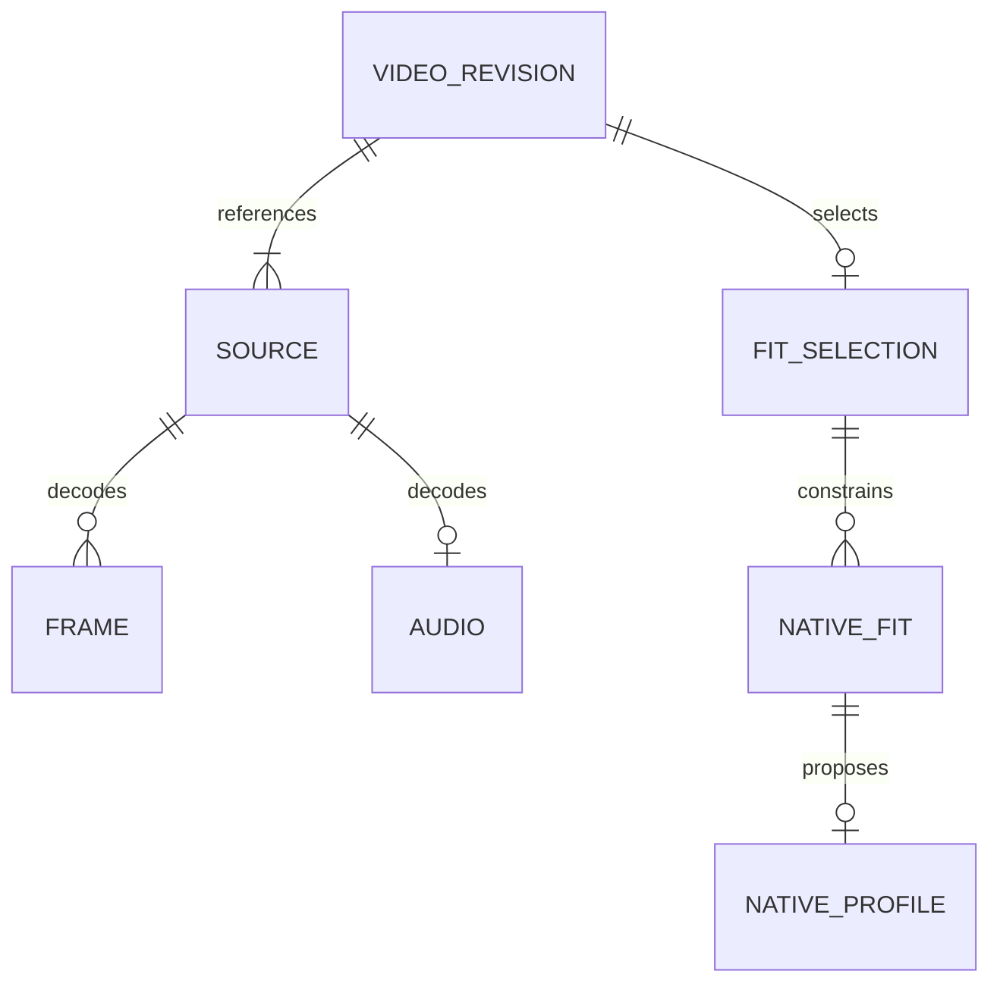

[Back to REPO_ROOT](../../README.md) | [Command guide](README.md)

# Video-derived identity and performance

## 1. Problem Statement

Recorded expressions provide temporal evidence, not a neutral scan.
Retain original video/audio and exact timing. Use one-frame-per-second sampling
for routine geometry or explicit all-frame extraction for expression timelines.
Never average smiles/speech into rest geometry or silently relax neutrality.

Two routes are distinct: `video-fit` proposes bounded native geometry changes;
`video-create` creates a fresh photo-derived head, Blender handoff and Character.
Neither establishes likeness from successful animation or low residual alone.

## 2. Implementation

### Route choices

| Route | Product | Limit |
|---|---|---|
| Sampled images and shared parametric identity | Fresh neutral-head estimate | Predicted landmarks and unseen anatomy remain uncertain |
| Native response-based `video-fit` | Unapplied bounded sculpt profile | Approximate response/correspondence and expression models |
| Native mono-video Performance | Motion on an existing identity | Not rest-identity reconstruction |
| Supported depth/stereo capture | Native identity workflow when available | Do not present synthetic depth as measured capture |
| Rigid photogrammetry over expressive frames | Static-scene surface estimate | Masking cannot make facial deformation rigid |

### Evidence and selection

PyAV decodes local media sequentially. The evidence manifest records original
presentation timestamps/time bases, decoded index, clock origins, source hashes
and saved-image-grid landmarks. Audio is PCM16 mono 48 kHz; discontinuities fail
rather than being silently concatenated.

`config\video-evidence.json` defaults to `frame_mode=sampled`, `sample_fps=1`,
`image_long_side=1920` and `detection_long_side=1280`. Images preserve aspect
ratio without upscaling. `original_source_size` is distinct from the saved
processing grid. `frame_mode=all` explicitly retains the complete decoded
timeline and rejects truncation/count mismatch.

Strict-neutral and expression-aware selection are separate. The latter requires
per-frame expression variables, pose balancing and temporal train/validation
separation. Selecting fitting views does not relabel an expressive frame neutral.

### Native fitting and application

`head_reconstruction\geometry\video_identity_fitting.py` consumes source-pinned
finite-difference responses, same-native ray correspondences and GNM expression
modes. It separates shared native identity from per-frame camera/expression.
Only shared identity generates rest-geometry sculpt deltas.

Pose-balanced held-out reprojection requires configured improvement and category
nonregression, followed by displacement limits. Applying the profile is a separate
`metahuman\character_features.py` operation on a duplicate Character.
Source hashes, requested appearance and independent saved-surface checks remain
mandatory. This path does not require Blender or imply cloud authorization.

### Fresh creation

`video-create --evidence` reuses retained image bytes and capture metadata only.
It computes fresh landmarks, expressions and parsing, fits a new shared identity,
creates the required Blender scene/export, then conforms/verifies a new Character.
It does not decode original videos or reuse an earlier head, fit or appearance
profile. See [execution phases](dev.readme.md#execution).

Native posed-state finalization precedes commits. Photo projection must account
for canonical pose alignment. Native UV extraction occurs while the exported
mesh remains valid; the native V convention is converted for shared OBJ-style
rasterization without changing saved UVs. Preview framing uses facial controls
and the horizontal-FOV/image-aspect relation, not shoulder-inclusive bounds.

### Capacity and retained entities

Planning example: 80 seconds at 30 fps gives `80 * 30 = 2400` frames.
At an assumed 1 MiB/JPEG that is approximately 2.34 GiB, plus
`80 * 48000 * 2 = 7,680,000` bytes of mono PCM. Actual image sizes differ.
Sequential decode/inference/writes provide backpressure; policy caps fail rather
than silently dropping required timeline data. Local disk, decoder and editor
failure leave an explicit failed revision, not a replacement of prior output.



Backed by `head_reconstruction\evidence\video_sampling.py` and
`head_reconstruction\geometry\video_identity_fitting.py`.
These are manifest relationships, not a database or rendered-diagram assertion.

### Commands

```powershell
python -m ailias facefitting video-evidence subject C:\recordings
python -m ailias facefitting video-fit subject --evidence C:\jobs\video\manifest.json --response C:\jobs\response\manifest.json --correspondence C:\jobs\native-rays.npz --appearance C:\profiles\appearance.json --fit-config C:\profiles\fit.json
python -m ailias facefitting video-create subject --evidence C:\jobs\video\manifest.json --editor $ue --project $project
```

Optional decoding dependencies are declared in `.[video]`; model preparation
is explicit. Preserve the existing shared GPU stack.

## 3. Success Criteria

| Boundary | Acceptance |
|---|---|
| Timing | Exact selected/all-frame policy, timestamps, clock origins and count checks |
| Coordinates | Landmarks match the saved image grid and retained transforms |
| Identity | Per-frame camera/expression separation and unchanged neutrality semantics |
| Native proposal | Source-pinned response/correspondence, held-out/category and displacement gates |
| Persistence | Independent surface/reload checks without relaxed tolerances |
| Appearance | Explicit native/photo-UV coverage and unresolved feature limits |
| Preview | New output from the new Character; no substituted screenshot or implicit likeness pass |

## 4. Task Breakdown

| Responsibility | Validation |
|---|---|
| Evidence | Sampling/all-frame, timestamp, audio discontinuity and source-hash tests |
| Fitting | Expression separation, category balance and bounded-profile tests |
| Native application | Duplicate/source preservation and independent reload checks |
| Fresh creation | Stage failure, Blender handoff, UV orientation and framing tests |
| Visual acceptance | Actual matched-view geometry/appearance review |

Unit/native integration procedures are in
[workflow development](dev.readme.md#validation-and-development).

## 5. Reference Links

- [Epic: Identity from footage](https://dev.epicgames.com/documentation/metahuman/from-video-footage?application_version=5.8).
- [Epic: video capture guidance](https://dev.epicgames.com/documentation/metahuman/metahuman-animator-video-capture-guidelines-in-unreal-engine?application_version=5.8).
- [MediaPipe Face Landmarker](https://ai.google.dev/edge/mediapipe/solutions/vision/face_landmarker).
- [Local command/configuration reference](README.md).
