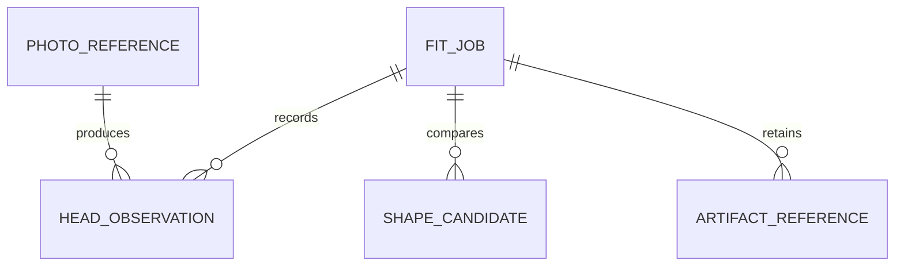

[Back to REPO_ROOT](../../README.md) | [Generation internals](dev.readme.md)

# Photo references to MetaHuman: verified route and gates

| Field | Value |
|---|---|
| Owner | Arka |
| Status | GPU fitting, photographic preview, static UE import and a native Character head fit verified; final review/rig/binding open |
| Last updated | 2026-11-16 |
| Scope | Photo-conditioned head, UE 5.8 head fitting, appearance and runtime performance |
| Reviewer | Owner likeness review pending |

## 1. Problem Statement

**Gap A:** The first coherent GNM head is a fitting baseline, not evidence that
this is the best likeness pipeline. Its 468 mapped face landmarks do not measure
all 17,821 vertices, ears, skin detail or hidden anatomy
(`facefitting\model.py:HeadModel.audit`, `facefitting\observations.py:observe`).
**Gap B:** CPU numerical derivatives consumed about 90% of a 372.859s run
([measured evidence](../facefitting/dev.readme.md#evidence)).
**Gap C:** The legacy Unreal conform code targets an already-solved Identity.
The new `facefitting\unreal_handoff.py` imports a hair-free custom-head candidate,
but does not create/conform a MetaHuman Character. The separate
`facefitting\unreal_conform.py` adapter now creates local head-only Character drafts.

Local metadata verifies UE **5.8.4**, including the Character plugin and its
editor subsystem header. A subsequent real NullRHI commandlet loaded the
head-conforming Python APIs in an owned project. It did not create assets,
import a head, conform or request cloud work.
`data\arka\unreal\AiliasReview\capability-probe.json` retains the exposed
types/signatures; the companion log confirms missing Core Data.
Epic's required **MetaHuman Creator Core Data** is absent [10]: the installed
plugin's Optional/TextureSynthesis and Optional/BodyTextures directories are
missing. This limits Creator/skin functionality; it is not evidence that
plain mesh import is impossible. The doctor now reports this separately.
A later real import saved eight packages and verified upright head bounds:
appearance `20261116T163340Z-14973ca7`, handoff
`99504db87d434eceb922b52cf96b02f7`. This confirms static mesh/texture import,
not by itself a MetaHuman solve. Subsequent job
`73508d43f43540eaafa792c527abc083` completed a native head-only fit, committed
face/body state and saved a Character that survived a separate editor reload.
Missing optional content disabled skin editing but did not block this solve.
The native +Y-facing target and matching perspective camera were essential:
the first +X attempt returned true but had distorted geometry. Final surface/
eyelid refinement, likeness review, skin transfer, rig and assembly remain open;
see [actual native geometry and caveats](../facefitting/README.md#native-character-draft-and-hair-later).
No other owning team/on-call is involved in this local single-owner workflow.
Accuracy, explicit cloud controls, source preservation and human approval remain
load-bearing gates; speed will not substitute for them.

## 2. Implementation

### Compare real workflows, not just model names

| Route | Verified precedent | Decision |
|---|---|---|
| Photos -> fitted head -> MetaHuman | KeenTools documents a 4-8-photo FaceBuilder workflow with MetaHuman UV texture transfer [1] | A strong commercial comparator, not benchmarked locally. Do not claim our fitter matches its likeness or texture quality |
| Photos -> photogrammetric scan -> MetaHuman | Epic accepts scanned/sculpted mesh inputs [2]; our current COLMAP runs fail reliable overlap | Prefer a scan for controlled consistent captures; do not keep relaxing gates on this heterogeneous photo collection |
| Learned identity reconstruction | MICA's authors provide photo-based FLAME reconstruction [3] | Research comparator, not installed: its published model/software terms are non-commercial scientific/educational/artistic use [4]. Not a drop-in permissive project dependency |
| Shared head prior fitted to many views | Current GNM implementation and preserved jobs | Continue as the measurable local baseline, not a proven best method. Improve surface/appearance evidence before calling it a scan |

### UE 5.8 route

**Preferred first experiment:** native **From Custom Mesh**, using its head-only
mode. It accepts non-MetaHuman topology, auto-solves and permits facial-curve
correction/refinement [5]. GNM topology must not be passed to From Template as
though it were native MetaHuman topology.

**Fallback/comparator:** From Mesh -> solved Identity -> From Identity [2,6].
Epic requires visible eye/lid separation and recommends distinguishable sclera
materials; a useful frontal neutral view is essential. Additional Identity
frames should add missing markers, not duplicate frontal constraints [2].
Our multi-photo fitting uses all supported observations; that is separate from
Identity's promoted-frame rules.

For an Identity handoff, do not enable measured scale or force generic GNM eye/
teeth anatomy into MetaHuman defaults as if personalized. Epic exposes separate
eye, teeth and metric-scale options [6]. Preserve source, solve and output
revisions so conform-induced shape drift can be checked.

### Relevant features and optimization order

| Priority | Measure or inspect | Current state |
|---|---|---|
| 1: identity geometry | Face outline/width/height, jaw/chin, cheek/nose profile, eye spacing, eyelid and lip boundaries | Dense 2D fitting exists; silhouette, surface and independent depth validation do not |
| 2: neutral and deformation | Separate smile/blink/jaw pose from identity; check eyelid closure, lip seal and mouth corners after rigging | Per-photo expression fitting exists; animation checks remain open |
| 3: trustworthy appearance | Skin colour under lighting, UV texture transfer, eyebrows, facial hair, scars | Photo-derived UV colour and approximate hair now exist; residual lighting/seams remain, and MetaHuman appearance transfer is unfinished |
| 4: uncertain anatomy | Ears, rear head, throat/neck, teeth and eyeballs | Prior-driven; do not invent measured accuracy or use demographic defaults as evidence |
| 5: UE runtime | Assemble UE Optimized at an appropriate quality; then profile LODSync, grooms and texture cost [7,8] | Not implemented/benchmarked locally; keep high-quality close-up review separate from runtime optimization |

The CUDA adapter batches all eligible views and differentiates the existing fit
objective on the selected GPU. It does not improve geometric evidence merely by
being faster. The benchmark must compare the same frozen inputs, split and
accuracy gates against the CPU result before further UE automation.
The fresh GPU run now passes the existing software gates: 42.187s outer wall
versus 372.859s CPU (8.838x faster); balanced held-out error is 0.02470406 versus
0.02508408 CPU. Both retained jobs pass integrity checks. This removes the
optimization prerequisite, not the project/API or likeness gates
([full evidence](../facefitting/dev.readme.md#evidence)).

No new database, queue or service is proposed: the existing single-session writer
lock and local artifacts remain. At 64 photos, the observation fan-out is
64 x 478 = 30,592 predicted points; only supported mapped points constrain fitting.
One completed 372.859s job corresponds to **0.00268 jobs/s**, not an interactive
service RPS target. Queue requests are not implemented. Backpressure is explicit
writer exclusion; competing CPU/GPU jobs must not be spawned without bounds.
The single GPU and local disk are single points of failure: fail explicitly,
retain diagnostics and start an immutable new revision rather than fake success.

Backed by `observations.py:observe`, `pipeline.py:run_fit`, `save_fit` and
`storage.py:Store.reference_artifact`. These are JSON/NPZ entities, not SQL tables.
Only existing entities are shown; a future Unreal result is deliberately absent.

## 3. Success Criteria

| Check | Baseline / target |
|---|---|
| Effective optimization | Measured full GPU run faster than 372.859s CPU baseline; disclose first-use/import time and different optimizer |
| Equivalent evidence | Same input hashes, usable source IDs and held-out identity split; fresh dense inference, not cached generation replay |
| Quality preserved | Existing 1% view-balanced gain and 5% frontal guard; compare GPU held-out error against CPU, not speed alone |
| Actual GPU work | CUDA device, gradient device, runtime/build, batch size and memory metadata; no fallback or utilization-based correctness claim |
| UE handoff | Installed-version API/properties verified; real saved assets, matched-camera before/after comparison and explicit state for any unsolved step |
| Finished MetaHuman | Human-approved likeness plus blink, lip-seal, jaw/smile and neck-seam checks; a receipt or head mesh alone is insufficient |

The optimal end-to-end route is **not established** until comparable visual and
geometric evidence exists. Vendor demonstrations establish feasibility, not
accuracy on this photo collection. Epic's overview and detailed Identity pages
also differ on whether solving is local/cloud [2,9]; do not infer network
behaviour from labels or silently enable a cloud operation.

## 4. Task Breakdown

| ID | Deliverable | Dependency / state |
|---|---|---|
| MH-1 | Complete compatible CUDA runtime, full-photo speed/accuracy benchmark and provenance | Done; 162 isolated units and two explicit CUDA tests passed; both jobs verified |
| MH-2 | Validate custom-mesh head-only API and compare with Identity handoff in an owned UE project | API exposure and upright textured static-head import verified; Core Data missing; Character conform remains open |
| MH-3 | Add regional/silhouette checks and post-conform drift evidence | After MH-2; avoid treating hair silhouette as bare skull |
| MH-4 | Add appearance transfer and rig/LOD validation with a close-up reference baseline | Blender photographic preview/hair approximation generated after clay approval; MetaHuman transfer/rig/LOD and owner appearance approval remain open |

These are delivery themes, not measured duration estimates; split the unproven UE
and appearance work into 1-2 week items after the first real project benchmark.

## 5. Reference Links

1. [KeenTools photo-to-MetaHuman workflow](https://keentools.io/integrations/fbb-mh)
2. [Epic: From Mesh](https://dev.epicgames.com/documentation/metahuman/from-mesh?application_version=5.8)
3. [MICA authors' implementation](https://github.com/Zielon/MICA)
4. [MICA model/software license](https://github.com/Zielon/MICA/blob/master/LICENSE)
5. [Epic: UE 5.8 From Custom Mesh, including Head Only](https://dev.epicgames.com/documentation/metahuman/metahuman-creator-from-custom-mesh-tool-in-unreal-engine?application_version=5.8)
6. [Epic: From Identity options](https://dev.epicgames.com/documentation/metahuman/metahuman-creator-from-identity-tool-in-unreal-engine)
7. [Epic: Assembly](https://dev.epicgames.com/documentation/metahuman/assembly?application_version=5.8)
8. [Epic: LODSync](https://dev.epicgames.com/documentation/en-us/metahuman/lodsync-component-for-unreal-engine)
9. [Epic: Mesh to MetaHuman overview](https://dev.epicgames.com/documentation/metahuman/mesh-to-metahuman?application_version=5.8)
10. [Epic: install MetaHuman Creator Core Data](https://dev.epicgames.com/documentation/metahuman/getting-started-with-metahuman-creator-in-unreal-engine?application_version=5.8)

Local source of truth: `src\ailias\facefitting`, `config\facefitting.json`,
`src\ailias\generation\unreal.py`; installed
`UE_5.8\Engine\Build\Build.version` and
`MetaHumanCharacterEditorSubsystem.h`. API exposure is not a successful solve;
no geometry/rig result or quality comparison against commercial tools is available.
