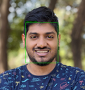
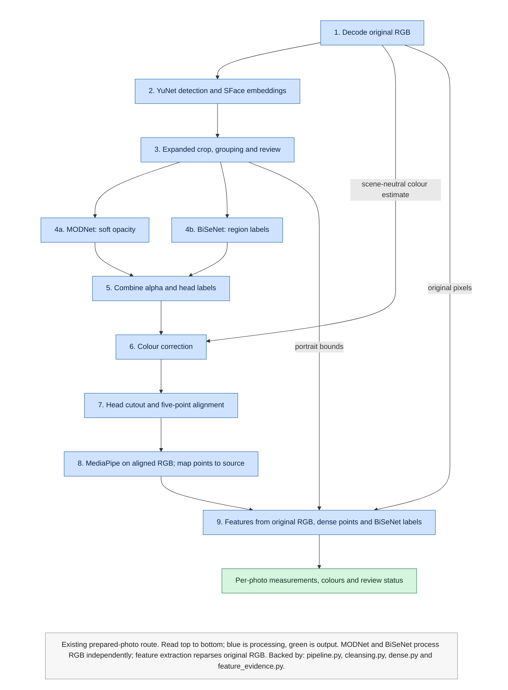

[Back to REPO_ROOT](../../README.md) | [Imageprocessing](README.md)

# Photo to facial features

**Actual images below; isolated demonstrations, not one completed production run.**

**New API:** `ImageProcessor.process_image()` prepares **original -> MODNet ->
BiSeNet -> optional white balance**. Then `FaceFeatureExtractor.extract_features()`
runs **MediaPipe -> features**, reusing the existing head, original RGB and region
labels. No repeated head isolation, YuNet or alignment. [Usage](README.md#simple-python-api).

## Existing CLI: step-by-step image flow

| Step | Actual image | What passes forward |
|---|---|---|
| **1. Original photo** |  | RGB pixels |
| **↓ 2. YuNet** |  | Face box + five points. SFace separately computes an identity embedding. |
| **↓ 3. Expand box and crop** |  | Native-resolution crop + original-image bounds. This preview reproduces the recorded crop coordinates. |
| **↓ 4a. MODNet** |  | Soft transparency. Neck/shirt remain. |
| **4b. BiSeNet, alongside MODNet** |  | Head/skin/hair/etc. labels. **Shown: separate full-image test, not the crop above.** |
| **↓ 5. Combine opacity + head labels** |  | Head-only RGBA. **Shown: full-image MODNet → grey composite → BiSeNet experiment; not the production merge.** |
| **↓ 6. White balance / exposure** | **Not demonstrated** | Corrected RGB when evidence supports it; otherwise skipped. No additional CNN. |
| **↓ 7. Align using YuNet's eye points** | **Not demonstrated** | Separate 512 × 512 analysis image + reversible coordinate transform |
| **↓ 8. MediaPipe** | **Not demonstrated** | RGB image → 478 facial points + expression scores; points mapped back to original |
| **↓ 9. Extract features** | **Not demonstrated** | Original RGB + dense points + fresh BiSeNet labels → facial ratios, skin/lip/brow/hair colours, iris evidence and review flags |

**Production distinction:** MODNet and BiSeNet both receive the RGB crop; their outputs are combined. BiSeNet does **not** receive MODNet's grey composite in production. Feature colours are sampled from original pixels, not the corrected cutout.

## Existing CLI architecture

**Backed by:** [scan/crop](../../src/ailias/imageprocessing/pipeline.py#L134-L175) · [merge/colour/alignment](../../src/ailias/imageprocessing/cleansing.py#L253-L295) · [MediaPipe](../../src/ailias/imageprocessing/dense.py#L35-L78) · [final features](../../src/ailias/imageprocessing/feature_evidence.py#L95-L125).

Image previews are included in the adjacent `images` folder. Missing stages were not run for this guide.
