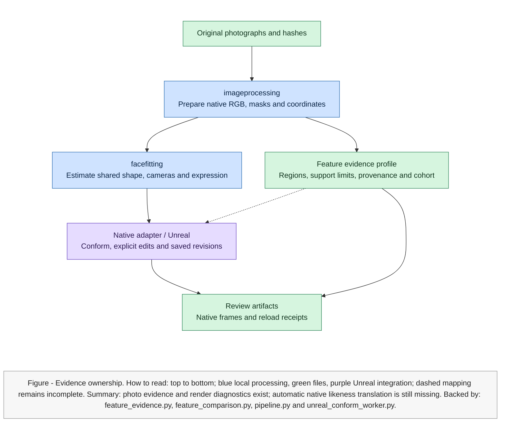
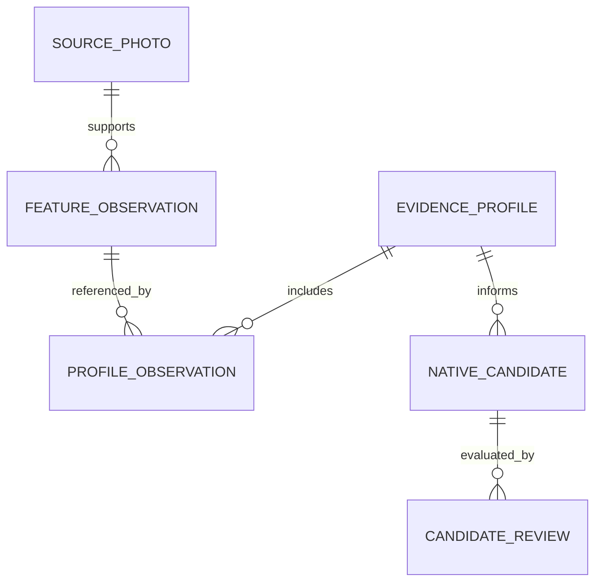

[Back to REPO_ROOT](../../README.md) | [Module guide](README.md) | [Decisions](../analysis.md)

# Photo-to-MetaHuman: face-first routes and feature extraction

| Field | Value |
|---|---|
| Owner | ailias |
| Status | Research complete; regional evidence/comparison implemented, alternative reconstructors not benchmarked |
| Last updated | 2026-11-17 |
| Services in scope | imageprocessing, facefitting, generation, native Unreal handoff |
| Reviewers | *(fill alias)* |

**Recommendation:** first measure where identity is lost between photographs,
the preserved fitted head and the saved native Character. Refine the existing
native face against that evidence before another groom/animation pass. Compare
one independent identity model, MICA, if the source shape is itself the problem.
Study MetahumanMaker's native bridge as an integration reference, not a proven
replacement. Small vision models can enrich observations; a language model is
not required to construct this pipeline.

## 1. Problem Statement

### What exists, and why it has not produced a convincing face

| Boundary | Verified behavior | Gap |
|---|---|---|
| Photo preparation | Detection, identity grouping, masks/alignment plus new regional geometry/colour/iris evidence profiles | **A:** separate beard/lash evidence and calibrated multi-view aggregation remain incomplete; [imageprocessing guide](README.md#reusable-feature-evidence) |
| Numerical head fit | GNM, a statistical head-shape prior, is fitted jointly with per-photo cameras and expression; held-out views select identity complexity | **B:** conditional reprojection is not proof of correct 3D anatomy; [head fitting workflow](../../src/ailias/facefitting/workflows/head_fitting.py) |
| Blender | Reviews/exports the fitted geometry; appearance projects photo colour and approximates scalp hair | Blender is not the identity estimator. Photo colour retains lighting; [appearance workflow](../../src/ailias/facefitting/workflows/appearance_generation.py) |
| Native conform | Sends mesh vertices/triangles, tracked contours and a matched camera into Unreal's head-only solver | **C:** fitted geometry was used, but the resulting native identity was not validated as a likeness. `appearance_transferred=False`; [native conform worker](../../src/ailias/facefitting/unreal/head_conforming_worker.py) |
| Native editing/build | Explicit groom, iris, bounded sculpt and texture edits plus optional assembly/reload are implemented | **D:** automatic anatomical targets, native-UV skin transfer and visually verified full appearance remain incomplete; [facefitting guide](../facefitting/README.md#native-feature-profile) |

The pipeline separated geometry fitting from appearance/native integration.
That separation is useful, but a successful conform/rig was incorrectly useful
as a progress proxy for a recognizable face. **A valid rig is not a likeness
certificate.** The current root comparison remains visibly below expectations.

Retained evidence: fit `20261116T153125Z-44390de9` has 64 dense observations;
appearance `20261116T163340Z-14973ca7` selected 16 texture views. The latest native
review at the initial research milestone, `e571dac24e6c472681f6767220c6857a`,
was rejected visually. Runtime revision
`5e856ca875794ec6a74f816ba94b8a2c` is failed, despite retained runtime assets:
the strict bound-beard-component check did not pass. These are separate outcomes,
not an accepted end-to-end result. Evidence lives in the corresponding
`data\arka\facefitting\runs`, `appearance`, `native-reviews` and `features` manifests.

Subsequent diagnostic review `800e902f2fbd45ed8d5e00d275ef5059` remains
geometrically rejected despite dark eyes and bound brows/lashes; its feature job
failed final saving. The retained source fit improves held-out frontal landmark
error over the generic prior by only about 0.9%, so another appearance/rig pass
is deferred. See [actual trials and regional geometry diagnostics](../facefitting/dev.readme.md#appearance-and-native-boundaries).

Preserve the selected baseline and original photos. This investigation does not
authorize another GNM fit, saved Blender scene copy or the rejected cross-topology
nearest-surface wrapping experiment. Correctness/reload/coverage gates remain
load-bearing; speed improvements must remove wasted work, not weaken them.

This is a local project, not a multi-team service. External vendor/research
maintainers are reference sources, not project owners or assigned reviewers.
No on-call rotation or additional team contact has been established.

## 2. Implementation

### 2.1 Materially different routes

These are workflow families, not a claim to enumerate every repository.
None of the alternatives below has been run locally during this investigation.

| Route | What reaches MetaHuman | Why use it / limitation | Decision |
|---|---|---|---|
| Existing native face + photo-guided optimization | Native face/sculpt controls, calibrated against photos | Avoids another topology conversion; needs semantic control mapping, camera/expression separation and bounded edits | **First diagnostic/refinement route**, not yet an implemented optimizer |
| Arbitrary mesh -> From Custom Mesh | Reconstructed/sculpted mesh; native standard-topology result | Official route includes auto-solve and keypoint/manual refinement. A source/head error or solve drift still needs independent validation [E1] | Keep as supported handoff; do not assume one auto-solve preserves identity |
| Mesh -> MetaHuman Identity -> Character | Neutral-pose tracking, Identity solve, backend submission, Conform from Identity | Alternative contour/Identity workflow; since UE 5.6 output is in-engine, not the old web Creator [E2] | Comparator when custom-mesh solve drift is demonstrated; not automatically better |
| Template-compatible mesh -> From Template | Standard MetaHuman topology **or standard MetaHuman UV layout** | Not arbitrary GNM geometry. Mesh Fit and body-only Replace are different operations [E3] | Only after compatibility is actually established |
| Compatible captured footage -> Identity | Supported device takes, ingested through Capture Manager/Live Link Hub | Another identity source; unrelated still photos are not automatically compatible footage [E4] | Future capture alternative, not a direct use of the current folder |
| Existing DNA -> native character | Compatible DNA, MetaHuman's identity/rig data | Imports an already encoded identity; does not infer a face from photos [E5] | Useful interchange, not the missing estimator |
| Photogrammetry -> mesh -> official handoff | Multi-view reconstructed surface | Potentially less shape-prior bias, but needs a consistent subject, texture and capture geometry. Local COLMAP trials produced fragments, not a full head; [generation evidence](../generation/dev.readme.md#validation) | Do not keep relaxing gates on mixed historical photos |
| Commercial DCC fitting -> mesh + native texture | Authored photo-fit head and separately exported MetaHuman-compatible texture | FaceBuilder documents 4-8 photos and an explicit MH-texture application step [V1]; paid tooling and current UE compatibility need evaluation | Credible authoring alternative, not adopted or installed |
| Hosted photo-to-MetaHuman service | Vendor-generated Character/mesh | FaceNinja claims UE 5.8 support; requires account, internet and credits [V2]. Its small plugin download is not a small local model | Inventory only; no photos uploaded and no local-memory claim |
| Monocular/audio performance capture | Motion on an existing identity | Animation and identity construction are different problems; the face-capture repository explicitly consumes existing DNA [R8] | Not a substitute for face generation |

**Blender's role:** mesh inspection, exchange and UV baking remain useful.
The numerical fitter does not need Blender to infer identity. A native-control
route can eventually bypass Blender for shape fitting, while appearance baking
may still use it. Do not remove the preserved scene or claim Blender is causing
the current shape mismatch without measuring the handoff.

### 2.2 Repository shortlist and exclusions

| Repository | Useful capability | Compatibility / dependency / terms | Recommendation |
|---|---|---|---|
| [TREE-Ind/MetahumanMaker][R1] | Photo/mesh authoring, source-colour reconstruction and a native UE bridge | Preview 0.346.0; targets Windows x64, Blender 5.2.x and UE 5.8.x, exercised on 5.2.3/5.8.2. Separate numerical worker and licensed references; original code MIT, third-party terms separate | Closest inspected end-to-end toolchain. Our Blender 4.5.15 is **not validated**. Accurate likeness/hair still need authoring; no bundled LLM. Study bridge/validation rather than importing its whole workflow |
| [Zielon/MICA][R2] | Identity-oriented image-to-FLAME face geometry; FLAME is a parametric face model, not MetaHuman | Requires FLAME assets/registration and model terms; local Windows/CUDA compatibility and peak memory unmeasured | **First independent shape comparator** if source geometry fails. No native DNA, skin/grooms or automatic handoff |
| [SimonGiebenhain/pixel3dmm][R3] | Normal/UV image predictions followed by FLAME optimization; explicitly supports discontinuous multi-image fitting | Python 3.9/CUDA 11.8 instructions, PyTorch3D/nvdiffrast and registered FLAME assets; CC BY-NC 4.0. Eye prediction limitations noted; local 12GB fit unknown | Stronger multi-view research candidate, but higher port/runtime cost. Second-line, not an automatic replacement |
| [yfeng95/DECA][R4] | Estimates shape, expression, albedo, illumination and detailed displacement | FLAME/model terms and research environment need review; local peak memory unknown | Useful detail/appearance comparator; predicted albedo/detail is not measured skin or native UV/DNA |
| [georgeretsi/smirk][R5] | Expression-focused reconstruction, using MICA identity pretraining | Legacy Python/CUDA/PyTorch3D setup and FLAME assets | Lower priority for neutral identity; no direct native MetaHuman output |
| [cleardusk/3DDFA_V2][R6] | Dense alignment with a CPU ONNX path and mesh/UV exports | Model assets and full runtime still need local compatibility checks | Lightweight alignment alternative, not a high-fidelity complete identity/rig pipeline |
| [MykytaPetrenko/MetaReForge][R7] | Editing existing MetaHuman geometry/rest bones with RigLogic support | GPL-3.0 repository; UE 5.8 compatibility not established here | Editing helper, not a verified photo-to-identity generator |
| [EpicGames/MetaHuman-DNA-Calibration][R9] | DNA manipulation/calibration | Repository explicitly excludes characters created in UE 5.6+ and points to MetaHuman for Maya for newer characters | **Not a drop-in for this UE 5.8 Character**, and not a photo reconstructor |

Recommendation is based on documented function, not stars, demo attractiveness
or an unrun claim of better likeness. Pin a revision, inspect its actual adapter,
check asset terms and benchmark native output before adopting any repository.
Optional restoration/diffusion output must be marked synthetic, not reference
anatomy or texture evidence.

### 2.3 What imageprocessing should extract separately

**Ownership:** imageprocessing owns observations in photo coordinates;
facefitting owns identity/camera/expression inference and photo-to-native
translation. UE asset paths, sculpt indices and material controls must not leak
into the generic extraction contract.

Dense extraction now lives in [dense.py:10-78](../../src/ailias/imageprocessing/dense.py#L10-L78);
the old facefitting imports remain compatible. The new
`appearance_features.py` / `feature_evidence.py` modules produce versioned
regional geometry/colour/iris evidence without a GNM dependency. `features`
explicitly reuses dense observations; `inspect-image` runs fresh CPU detection.
The downstream `compare-features` command can write a hash-pinned iris edit
proposal. None of these operations edits the native face automatically.

| Feature | Reusable photo evidence to persist | Downstream native use | Limits / current gap |
|---|---|---|---|
| Face proportions, nose, jaw, cheek, chin, ears | Source-coordinate landmarks/curves, visible silhouette, pose/expression and occlusion evidence | Corresponding native shape/sculpt/mesh constraints [E1, E5] | Predicted depth is not measured mm; control correspondence and native validation unfinished |
| Eyes / eyelids | Iris boundary, eye opening, pupil-excluding iris colour samples, highlight/occlusion masks and sample counts | Iris/material settings separately from eyeball/lid geometry [E5] | Observed RGB is lighting-dependent; no intrinsic colour or iris-diameter calibration |
| Eyebrows | Region mask, outline, density/colour evidence, orientation | Brow asset choice and groom parameters [E6] | Parser labels do not reconstruct strands; expression changes brow position |
| Eyelashes | Visible lash extent/darkness only when resolved | Lash type/material/groom controls [E5, E6] | No separate lash class in the current parser; ordinary portraits may not resolve lashes |
| Scalp hair | Hair mask, silhouette/parting, observed colour and visible length | Groom selection, cut/style/colour matching [E6] | Hidden roots/back hair remain unknown; current approximate scalp strands are not a native groom |
| Beard / moustache | Separate regional presence, density, outline, colour and confidence | Independent Beard/Mustache slots, not the scalp-hair slot [E6] | **Current 19-class parser has no beard/moustache class**; add a validated extractor or explicit review, not a fabricated segmentation |
| Skin / lips / marks | Visible-region colour distributions, coverage, texture samples, per-view lighting/exposure evidence | Native material fitting, photo projection into verified native UVs [E5] | No calibrated albedo, roughness or subsurface estimate from an uncalibrated RGB median; preserve marks instead of generative restoration |
| Teeth | Visible shape/colour evidence, with expression and visibility | Teeth model/material settings [E5] | Do not infer hidden dentition from closed-mouth photos |
| Asymmetry | Consistent signed differences across unmirrored, pose-corrected views | Supported asymmetric geometry/material edits | Separate lens/pose/expression/mirroring artifacts from stable identity |

Parser evidence: [faceparsing.py:11-43](../../src/ailias/imageprocessing/faceparsing.py#L11-L43).
Native UI/API support [E5, E6] is broader than ailias's current adapter; the
mapping table describes possible destinations, not completed integrations.
Separate stable identity from a chosen appearance cohort: historical beard,
hairstyle and lighting differences must not be averaged into one face.

### 2.4 Small CNN/VLM models and the 12GB GPU

A **CNN** is a convolutional image model. A **VLM** combines image and language
input, usually returning text; it can describe a beard but does not thereby
produce metrically correct facial geometry or MetaHuman DNA.

| Candidate | Useful role | Size / memory evidence | Decision |
|---|---|---|---|
| Existing MediaPipe Face Landmarker [M1] | Dense geometry anchors, expression and transforms | Installed task file **3,758,596 bytes**; already explicit CPU inference. File size is not runtime RAM | Reuse first; no additional language model needed |
| Existing BiSeNet ResNet18 parser | Face-part masks and sampled regions | Installed ONNX **53,205,364 bytes**; explicit CPU/CUDA adapter; not peak memory | Reuse; cannot supply a beard label that its taxonomy lacks |
| SmolVLM-256M-Instruct [M2] | Optional bounded appearance descriptors/review | Publisher: **under 1GB GPU RAM for one image**; 0.256B x 2 bytes = approximately 0.512GB weights only | Smallest optional VLM trial, not a geometry replacement |
| SmolVLM-500M-Instruct [M3] | Optional richer image/text descriptions | Publisher: **1.23GB GPU RAM for one image**; nominal 0.5B x 2 = approximately 1GB weights only | Apache-2.0; evaluate only if descriptors improve reviewed feature extraction |
| Florence-2-base [M4] | Captioning, detection, grounding/segmentation proposals | Publisher: **0.23B parameters**; 0.23B x 2 = approximately 0.46GB FP16 weights only. No local peak measured | MIT; useful generic candidate, **not a validated beard/face-metrology model** |
| MICA / DECA / Pixel3DMM | Actual estimated 3D face geometry, not language descriptions | No verified local peak or concurrent-UE benchmark from this investigation | Run one isolated comparator serially if selected; do not assume all CNNs are tiny |

Decimal GB arithmetic above counts weights only, excluding activations,
image patches, generation cache, CUDA context, libraries and allocator reserve.
Publisher memory figures are not measurements on this machine.

**Proposed execution policy, not implemented configuration:** CPU observations
first; at most one optional GPU model, batch size 1 with bounded image pixels and
output tokens. Extract -> persist evidence -> close the owned worker -> run UE.
The GPU is shared: measure total/free memory and owned-process peaks before
launch; never terminate another user's process or unload their models.
Only consider simultaneous residency after measuring both realistic workloads.
A planning example is 12GiB - 2GiB reserve = 10GiB available to workloads;
the reserve is an estimate, **not measured UE usage or a concurrency guarantee**.

Preserve the existing working Torch/CUDA environment. Older CUDA/Python research
stacks need isolated compatibility work, not a global downgrade. No new models
were downloaded, loaded or benchmarked for this research.

### 2.5 Evidence flow and proposed contract extensions

The solid file-based path exists; the dashed edge is unfinished automatic
photo-to-native anatomical/appearance translation.

**Backed by:** local code linked in sections 1/2.3 and
[native operation contracts](../facefitting/README.md#inputs-and-outputs).
Layout reviewed as source; no Mermaid render check was performed.

**Original photographs:** immutable external inputs; synchronous filesystem
reads and hash validation from imageprocessing, never a cloud-model upload.

**Imageprocessing:** local Python/model calls produce native RGB, masks and
coordinate transforms; files/manifests pass synchronously to consumers.

**Facefitting:** numerical fitting reads those files and writes shared identity,
per-view state and exchange meshes; launches owned Blender/UE workers via request
files and process exit/receipt checks.

**Native adapter / Unreal:** synchronous child-editor jobs consume explicit
geometry/settings/assets; save isolated Character/runtime packages and receipts.
Proposed photo-evidence translation must validate anatomical correspondences
before a native mutation.

**Review artifacts:** local retained frames, projections and receipts consumed
by offline checks and visual inspection; not an online scoring service.

**Feature evidence profile:** versioned JSON plus referenced masks;
one extraction reads photos, downstream fitting/native/review consumers read the
same evidence. Each observation needs source hash/ID, region, native coordinates,
visibility/status, estimator/version/device, sample count, cohort and uncertainty.
Unknown/unresolved is a valid status, not a default guessed value.

The following ER model is a **proposed contract**, not an existing database or
implemented schema. An association entity allows one observation to be reused in
multiple profiles without duplicating its measurements.

**Backed by:** explicit proposed ownership/contract above; cardinalities are
design choices. Figure - One photo supports multiple observations; profiles reuse
observations and can inform multiple candidates/reviews. No persistence migration
or ER render validation is claimed.

### 2.6 Scale, bottlenecks and failure boundaries

**Measured scope:** one current subject, 192 original photos in the retained
full scan, 64 dense observations in the pinned fit, up to 16 selected texture
views. File sizes/growth and future subject count need measurement; no hosted
users, HTTP API, read/write traffic or cache-hit rate is being invented.

**Sizing estimate:** one 64-photo extraction over 60 seconds is
64 / 60 = 1.07 photo jobs/s average; 478 x 64 = 30,592 predicted points.
Writing one observation JSON and one mask per photo implies
2 x 64 / 60 = 2.13 artifact writes/s average. These are not measured peaks.
Proposed concurrency is one GPU/editor job, not 64 concurrent requests.

The retained timing audit measured native apply 85.015s and a subsequent build
229.812s on one failed run: 314.827s total before independent verification.
Sixteen input-integrity checks took 0.178s. Editor startup/build/compile are the
priority bottleneck, not photo hashing. Apply and optional assembly now share
one editor, with independent reload retained; **post-change speedup is unmeasured**.
Evidence: `data\arka\facefitting\benchmarks\native-editor-overhead-20261117.json`.

| Backpressure / single point of failure | Blast radius | Mitigation / tradeoff |
|---|---|---|
| Shared 12GB GPU / one native editor | OOM or blocked native job | Serialize owned heavy work; bound previews; inspect shared availability, do not claim spare VRAM |
| Native compile/rig/texture prerequisites | Minutes lost per unsuccessful iteration | Validate feature payload before build; save edit checkpoint; measure phases; do not animate just to inspect a face |
| Sole local artifact disk / original-photo paths | Missing evidence invalidates dependent jobs | Preserve originals, verify hashes and manifest dependencies; checkpoint atomically; backup policy remains outside this proposal |
| Observation/model failure | Invalid target geometry or appearance | Record review/unknown; skip unsupported feature rather than inventing it |
| Backend-dependent Identity/rig operations | Network/service blocks that route | Declare dependency explicitly; retain local evidence/candidate; do not label a partial solve complete |

Use the existing file-based Store and owned-worker lifecycle. No application
database, broker or distributed queue is proposed, so a CAP classification
(consistency/availability under network partition) does not apply to a new
storage choice here. COLMAP's transient SQLite is unrelated reconstruction scratch.

### 2.7 Implementation/configuration boundaries

| Area | Keep | Proposed change / gate |
|---|---|---|
| `imageprocessing\dense.py`, `appearance_features.py`, `feature_evidence.py` | Shared detector and versioned source-coordinate regional evidence implemented | Separate beard/lash evidence and multi-view visibility calibration remain |
| `facefitting\evidence\landmark_detection.py`, `facefitting\appearance\iris_color_matching.py`, `feature_comparison.py` | Compatibility imports and downstream bounded photo/render comparison | Native anatomical/UV mapping still required; an iris proposal is not an applied edit |
| `config\imageprocessing.json`, `cleansing.json` | Existing extraction/colour semantics | Any new feature policy must document pixels/units, sample sufficiency, cohort and abstention; no new keys implemented here |
| `config\facefitting.json`, `appearance.json` | Explicit device, fit/texture budgets | Preserve pinned geometry; alternatives are research until separately evaluated |
| `facefitting\unreal\character_features.py`, `character_features_worker.py`, `character_portrait.py` | Isolated revisions, strict saved-state verification, neutral reviews | Semantic mapping, native-UV transfer and coordinated appearance remain required |
| `generation` | Separate photogrammetry route | Do not relabel fragments as complete heads or mix its evidence with the prior fit |

## 3. Success Criteria

| Criterion | Baseline | Acceptance target |
|---|---|---|
| Identity retained through handoff | Native resemblance rejected; source-versus-native drift not yet quantified | Matched front/oblique/profile overlays compare photos, preserved fit and native result; identify whether source shape, camera or native solve causes mismatch |
| Face geometry | Conditional fit evidence exists, no native regional likeness pass | Report region-wise landmark/silhouette errors on held-out photos with common camera/expression policy; no fabricated physical-mm accuracy or single similarity percentage |
| Alternative adoption | No alternatives locally benchmarked | One bounded comparator on the same permitted inputs/protocol improves evidence without regressing key regions; compatible saved/reloaded native result required |
| Feature evidence | Regional profile/iris samples and native-render comparison implemented; beard/lash extraction remains unresolved | Per-feature provenance, source coordinates, cohort, visibility and uncertainty; unresolved beard/lashes remain explicitly unresolved |
| Appearance handoff | Photo atlas not transferred by conform | Verified native UV/bake coverage, no source-illumination/albedo confusion; coordinated skin/eyes/brows/lashes/hair/beard review after geometry gate |
| Runtime resources | Only installed file sizes and publisher VLM memory figures available | Measure owned-process peak VRAM/RAM and wall time before concurrent UE/model residency; no shared-stack regression |
| Integrity / rig | Native assets technically exist; last beard-bound-component gate failed | Originals/baseline unchanged; fresh editor reload verifies saved edits and correct runtime representation; inspect baked stubble policy without blindly removing the gate |

NoW evaluates reconstructed geometry with alignment/surface error; that is a
different claim from an image embedding or a successful animation [B1].
Use regional reprojection/silhouette reports to locate errors and visual review
to assess recognizability. **Exit:** a recognizable, neutral native face passing
saved-state/geometry checks, followed by a coordinated appearance pass; a working
movie alone does not close this work.

## 4. Task Breakdown

Work-package estimates below are 1-2 engineering weeks each, not elapsed-time
promises or a request to wait. Execute the smallest diagnostic first.

| ID | Deliverable | Dependencies / gap | Estimate |
|---|---|---|---|
| FACE-1 | Matched multi-view source-fit/native comparison, documented camera policy and regional error report; locate loss before mutation | Existing preserved baseline; B/C | 1 week |
| FEAT-1 | Generic source-coordinate feature contract/extractors, source-held-out functional cases, cohort and abstention policy | Existing imageprocessing; A | 1-2 weeks |
| FACE-2 | Bounded native-control calibration/refinement; if source fit is the limiting factor, evaluate MICA as one isolated comparator without overwriting baseline | FACE-1 and semantic targets; B/C | 1-2 weeks |
| LOOK-1 | Verified native-UV photo transfer and coordinated eye/brow/lash/hair/beard policy with mask/coverage evidence | FEAT-1 and face geometry gate; D | 1-2 weeks |
| RUN-1 | Owned-worker resource/timing benchmark and explicit concurrency policy; conditional compact VLM trial only for measurable descriptor gaps | FEAT-1 task definition; supports FACE-2/LOOK-1 | 1 week |

## 5. Reference Links

### Local source of truth

- [Imageprocessing configuration and limits](README.md), [internals](dev.readme.md).
- [Fit and native operation contracts](../facefitting/README.md), [fit evidence](../facefitting/dev.readme.md#evidence).
- [Current comparison](../../README.md#current-state---below-expectations), [generation evidence](../generation/dev.readme.md#validation).
- Source code/line anchors appear beside the relevant claims above. Run-local evidence is under Git-ignored `data\arka`; it is not redistributed with docs.
- No dashboard, new PR, model benchmark or new appearance result was produced for this investigation. Missing artifacts are the task deliverables in section 4.

### Primary external references

[E1]: https://dev.epicgames.com/documentation/metahuman/metahuman-creator-from-custom-mesh-tool-in-unreal-engine?application_version=5.8
[E2]: https://dev.epicgames.com/documentation/metahuman/from-mesh?lang=en-US
[E3]: https://dev.epicgames.com/documentation/metahuman/metahuman-creator-from-template-tool-in-unreal-engine?application_version=5.8
[E4]: https://dev.epicgames.com/documentation/metahuman/from-video-footage?application_version=5.8
[E5]: https://dev.epicgames.com/documentation/metahuman/metahuman-creator-python-scripting-in-unreal-engine?lang=en-US
[E6]: https://dev.epicgames.com/documentation/metahuman/hair-and-clothing-tools?application_version=5.8
[R1]: https://github.com/TREE-Ind/MetahumanMaker
[R2]: https://github.com/Zielon/MICA
[R3]: https://github.com/SimonGiebenhain/pixel3dmm
[R4]: https://github.com/yfeng95/DECA
[R5]: https://github.com/georgeretsi/smirk
[R6]: https://github.com/cleardusk/3DDFA_V2
[R7]: https://github.com/MykytaPetrenko/MetaReForge
[R8]: https://github.com/effectustasi/metahuman-face-capture
[R9]: https://github.com/EpicGames/MetaHuman-DNA-Calibration
[V1]: https://keentools.io/integrations/fbb-mh
[V2]: https://faceninja.net/integrations/unreal
[M1]: https://developers.google.com/edge/mediapipe/solutions/vision/face_landmarker?tab=Python
[M2]: https://huggingface.co/HuggingFaceTB/SmolVLM-256M-Instruct
[M3]: https://huggingface.co/HuggingFaceTB/SmolVLM-500M-Instruct
[M4]: https://huggingface.co/microsoft/Florence-2-base
[B1]: https://now.is.tue.mpg.de/

- [E1: Custom Mesh][E1]; [E2: Identity from mesh][E2]; [E3: From Template][E3]; [E4: Identity from footage][E4]; [E5: native Python controls][E5]; [E6: hair slots][E6].
- Repositories R1-R9 and vendors V1-V2 are linked in the comparison tables.
- [M1: MediaPipe][M1]; [M2: SmolVLM-256M][M2]; [M3: SmolVLM-500M][M3]; [M4: Florence-2][M4]; [B1: NoW][B1].

External documentation/repository statements were checked November 17, 2026.
GitHub CLI discovery was blocked by absent authentication; public repository and
publisher documentation were read on the web instead. Compatibility and vendor
claims are explicitly distinguished from local execution above.
