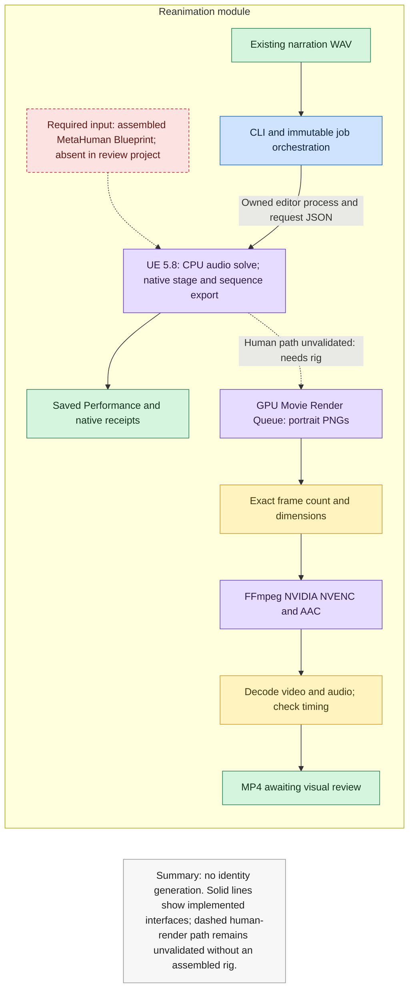

[Back to REPO_ROOT](../../README.md) | [Usage](README.md) | [Research](implementation.md)

# Reanimation internals

`src\ailias\reanimation` is independent of head fitting. `settings.py` validates
the portrait policy and derives lens geometry. `media.py` validates PCM/frames
and constructs explicit FFmpeg commands. `pipeline.py` owns unique jobs,
timeouts, hashes and publication gates. `unreal_worker.py` runs inside UE's
Python interpreter; it imports no host package.

## Workflow and communication



Backed by: `src\ailias\reanimation\pipeline.py:48`,
`unreal_worker.py:17`, `unreal_worker.py:78`, `unreal_worker.py:190`,
`media.py:35`, `media.py:48`, `media.py:61`; role colors: blue orchestration,
purple native tools, green artifacts, yellow gates, red missing input.
Mermaid source has not been renderer-checked.

**CLI/orchestrator:** synchronous command input starts an owned editor subprocess
with a JSON request path in its environment. It consumes file receipts on exit,
holds the existing alias writer lock and persists manifest/hash evidence.

**UE adapter:** imports audio, runs the blocking native solve and saves the
Performance. With a rig it exports face/head Control Rig tracks and audio into
Sequencer, creates a new map and calls the GPU renderer in-process. No cloud
identity service is requested.

**GPU renderer:** Movie Render Queue asynchronously renders the private queue;
global references preserve callbacks, and Python's keep-alive flag prevents the
startup script from exiting before the finished delegate writes its receipt.
Its output channel is a contiguous PNG sequence on disk. A dedicated game-mode
override avoids a default player pawn.

**FFmpeg/validators:** the host checks every PNG, then synchronously invokes
NVENC/AAC encoding and software decode validation in subprocesses. No encoder
fallback occurs. The original narration supplies the soundtrack; successful
export of a native audio track alone is not treated as an MP4 audio guarantee.

## Tests and operational boundaries

```powershell
& C:\projectWorkspace\.venv\Scripts\python.exe -m unittest ailias.reanimation.tests.test_reanimation -v
```

Nine units use temporary media, fake native execution and mocked decoding.
They do not load UE, speech models or GPU hardware. No additional dependencies
or linter were introduced.

Separate explicitly run integration evidence, all Git-ignored:

| Evidence under `data\arka\reanimation` | What it proves |
|---|---|
| `capability.json` | Installed UE 5.8 API/enums and absence of assembled project Blueprints |
| `stage-api-check.json` | Real camera filmback/cut-binding, RectLight, backdrop and MRQ setting APIs |
| `nvenc-capability-check.mp4` | Actual 1080x1920, three-frame NVIDIA hardware encode, no human content |
| `renderer-check\receipt.json` and `verified.json` | Actual D3D12 MRQ callback success, three exact 1080x1920 frames, NVENC/AAC encode and decoded frame/duration checks; green backdrop and synthetic technical tone only |
| `narration\20261117_pocket_testuser_9c37a2\mcp_receipt.json` and `yapit_provenance.json` | Actual MCP stdio `generate_audio`, PocketTTS/testuser, 24.74-second mono PCM16 at 24 kHz, existing CPU runtime; original voice hashes unchanged |
| `runs\5a0ae3435a1546f181ee87ee1032a267\manifest.json` and `reload-check.json` | Actual narration solved in 38.453 seconds of editor runtime, 742 processed frames; Performance saved, separately reloaded and exportable; all manifest artifact hashes valid |

Yapit initially stalled loading SciPy after other native imports. An isolated
import check passed; pre-importing `scipy.linalg` before the actual MCP entrypoint
resolved it without installs or package changes. The retained MCP receipt
records the bounded command and exact existing CPU environment.

The review project is `data\arka\unreal\ReanimationReview`. Its static heads and
Character drafts are not substituted for the required rig. Full character
export/render, actual face framing, natural skin illumination and subjective
lip-sync quality remain blocked/unvalidated until a real assembled MetaHuman is
available. Preserve failed receipts rather than weakening checks.

Jobs are synchronous and serialized per alias, not a distributed queue. A crash
can leave a `running` manifest and partial native assets; inspect logs and start
a fresh job instead of reusing its namespace. The implementation never prunes
another job's assets. A Performance can be solved without a rig, but a later
render command currently starts a new solve rather than resuming it.
