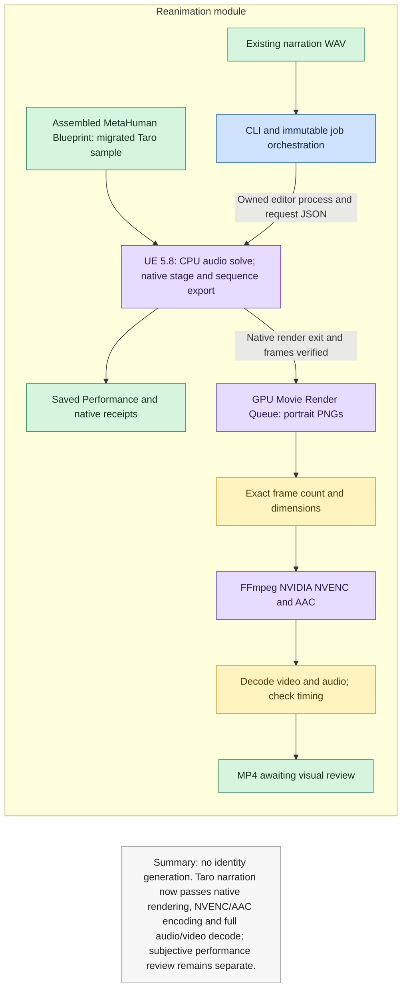

[Back to REPO_ROOT](../../README.md) | [Usage](README.md) | [Research](implementation.md)

# Reanimation internals

`src\ailias\reanimation` is independent of head fitting. `settings.py` validates
the portrait policy and derives lens geometry. `media.py` validates PCM/frames
and constructs explicit FFmpeg commands. `pipeline.py` owns unique jobs,
timeouts, hashes and publication gates. `unreal_worker.py` runs inside UE's
Python interpreter; it imports no host package.

## Workflow and communication



Backed by: `src\ailias\reanimation\pipeline.py:48`,
`unreal_worker.py:17`, `unreal_worker.py:97`, `unreal_worker.py:223`,
`media.py:35`, `media.py:48`, `media.py:61`,
`data\arka\reanimation\taro-rig-audit.json`,
`data\arka\reanimation\runs\7f59ccf3576645c2b452dbbdab985d19\manifest.json`;
role colors: blue orchestration,
purple native tools, green artifacts, yellow gates.
Mermaid source has not been renderer-checked.

**CLI/orchestrator:** synchronous command input starts an owned editor subprocess
with a JSON request path in its environment. It consumes file receipts on exit,
holds the existing alias writer lock and persists manifest/hash evidence.

**UE adapter:** imports audio, runs the blocking native solve and saves the
Performance. With a rig it exports face/head Control Rig tracks and audio into
Sequencer, creates a new map and calls the GPU renderer in-process. No cloud
identity service is requested.

**GPU renderer:** Movie Render Queue asynchronously renders the private queue;
global references preserve callbacks, and Python's keep-alive flag prevents the
startup script from exiting before the finished delegate writes its receipt.
Its output channel is a contiguous PNG sequence on disk. A dedicated game-mode
override avoids a default player pawn.

**FFmpeg/validators:** the host checks every PNG, then synchronously invokes
NVENC/AAC encoding and software decode validation in subprocesses. No encoder
fallback occurs. The original narration supplies the soundtrack; successful
export of a native audio track alone is not treated as an MP4 audio guarantee.

## Tests and operational boundaries

```powershell
& C:\projectWorkspace\.venv\Scripts\python.exe -m unittest ailias.reanimation.tests.test_reanimation -v
```

Thirteen units use temporary media, fake native execution and mocked decoding.
They do not load UE, speech models or GPU hardware. No additional dependencies
or linter were introduced.

Separate explicitly run integration evidence, all Git-ignored:

| Evidence under `data\arka\reanimation` | What it proves |
|---|---|
| `capability.json` | Initial installed UE 5.8 API/enums and then-absent assembled project Blueprints |
| `stage-api-check.json` | Real camera filmback/cut-binding, RectLight, backdrop and MRQ setting APIs |
| `nvenc-capability-check.mp4` | Actual 1080x1920, three-frame NVIDIA hardware encode, no human content |
| `renderer-check\receipt.json` and `verified.json` | Initial D3D12 test wrote three black frames due to a test-only camera rotation error; NVENC/AAC and decoded timing checks passed, but this is not acceptable stage output |
| `renderer-check2` through `renderer-check4`, plus corresponding logs under `data\arka\unreal` | Corrected look-at camera produced green portrait frames, but the process exited with access violation `0xC0000005` after frame completion; both `UnrealEditor-Cmd.exe` and `UnrealEditor.exe` reproduce it |
| `narration\20261117_pocket_testuser_9c37a2\mcp_receipt.json` and `yapit_provenance.json` | Actual MCP stdio `generate_audio`, PocketTTS/testuser, 24.74-second mono PCM16 at 24 kHz, existing CPU runtime; original voice hashes unchanged |
| `runs\5a0ae3435a1546f181ee87ee1032a267\manifest.json` and `reload-check.json` | Actual narration solved in 38.453 seconds of editor runtime, 742 processed frames; Performance saved, separately reloaded and exportable; all manifest artifact hashes valid |
| `taro-dependencies.json`, `taro-migration.json` and `taro-rig-audit.json` | Native Taro-only dependency migration: 441 target packages registered, no Ada, all source hashes match the downloaded cache; actual Blueprint, Face/head and facial post-process load in UE 5.8; facial bones confirm +Y front |
| `previews\fe1cc961aa6c4539b4847361b93f4d95` | Actual 1080x1920 sharp-focus preview with unchanged accepted camera, softer/dimmer lighting, eight samples, exact chroma-green PNG background and clean native exit |
| `runs\7f59ccf3576645c2b452dbbdab985d19\manifest.json` | Complete actual CLI integration: native exit 0 in 216.015 seconds, 743 frames, 1080x1920/30 fps NVIDIA H.264 with original narration AAC; both streams completely decoded, timing checked, artifact hashes verified |

Yapit initially stalled loading SciPy after other native imports. An isolated
import check passed; pre-importing `scipy.linalg` before the actual MCP entrypoint
resolved it without installs or package changes. The retained MCP receipt
records the bounded command and exact existing CPU environment.

The test-only camera used positional `Rotator` arguments incorrectly. Production
staging already uses `find_look_at_rotation`, which the corrected fixture also
uses. That change fixed the black image, **not** the shutdown crash. Deferring
shutdown outside the MRQ completion callback also failed to repair the crash;
that speculative change was removed. Further empty-fixture retries were stopped.
The host treats a nonzero process exit as failure even when a native receipt
says frames completed, retaining both pieces of evidence rather than encoding
and publishing a nominally successful reel.

A subsequent source-guided change removes the worker's direct `quit_editor()`.
Installed `PythonScriptPlugin\Private\EditorUtilities\EditorPythonExecuter.cpp`
already watches the keep-alive flag and calls `DestroyNotification()` before
its own deferred editor exit. The adapter now yields exit to that owner rather
than racing it. This lifecycle is unit-tested and **now passes clean native
exit on real Taro previews and the complete narration reel**. This observed
fix does not prove a native stack match with the earlier community report.

The first Taro preview showed only green because native audio export adds a
static reference-pose translation/yaw, while portrait framing used the origin.
`normalize_subject_root` resets only the selected actor's static nine-channel
root transform; face/head Control Rig keys remain untouched. Missing/ambiguous
subjects or an animated root fail rather than discard motion.

Early drafts were 540x960 with one temporal sample, and manual focus targeted
the head joint behind the eyes. They are not final-quality examples.
The current policy renders 1080x1920 with eight samples and disables depth of
field. Larger 200 cm lights, a 900-lumen key, 65% fill and -5.5 EV exposure
implement the owner's softer/dimmer request without moving the accepted camera.
The unlit background compensates exposure; disabling the tone curve and lens
effects keeps measured PNG background samples at `(0,255,0)`.

The review project is `data\arka\unreal\ReanimationReview`. Its static heads and
Character drafts are not substituted for the required rig. The completed sample
download is at `data\arka\unreal\MarketplaceMetaHumans`; only Taro and its
audited dependencies were migrated. The target explicitly enables
`MetaHumanRuntime` for this legacy sample. Native migration changes target package
serialization; an initial strict binary-equality check correctly failed, then
separate original/cache hashes and target asset-registry/rig checks passed.
Neither source project nor cache was removed or altered.

Full character rendering and technical audio/video integration pass. Actual
facial frames were inspected and the completed MP4 was opened for the owner.
Subjective lip-sync, voice delivery and acting review are not implied by decode
or duration checks. Preserve failed receipts rather than weakening checks.

Jobs are synchronous and serialized per alias, not a distributed queue. A crash
can leave a `running` manifest and partial native assets; inspect logs and start
a fresh job instead of reusing its namespace. The implementation never prunes
another job's assets. A Performance can be solved without a rig, but a later
render command currently starts a new solve rather than resuming it.
