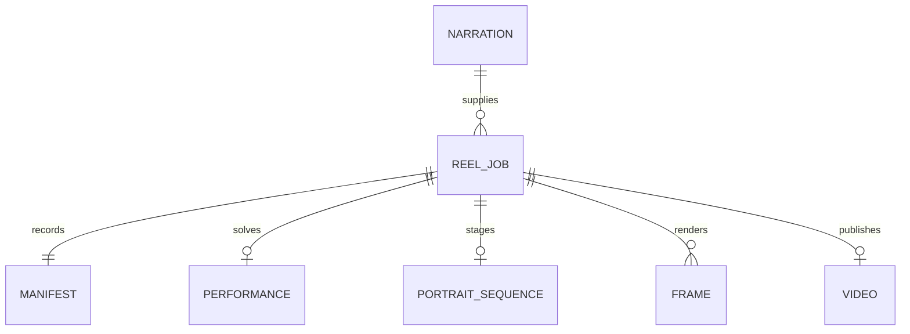

[Back to REPO_ROOT](../../README.md) | [Module usage](README.md) | [Developer guide](dev.readme.md)

# Audio-driven portrait reanimation

| Field | Value |
|---|---|
| Owner | ailias workspace |
| Status | Full Taro narration reel technically verified; subjective performance review remains |
| Last updated | 2026-11-17 |
| Services in scope | Externally supplied narration, UE 5.8 adapter, FFmpeg |
| Reviewers | Workspace owner; no separate team/on-call owner established |

## 1. Problem Statement

Generate a forward-facing, energetic 9:16 reel from an **existing rigged
MetaHuman** and Yapit PocketTTS narration using the existing `testuser` voice.
Keep a chroma-key green background, close-up camera and soft natural-style face
lighting. Do not restart the stopped likeness-generation experiments or present
their unrigged output as a finished person.

**Gap A, resolved for sample testing:** the initially absent assembled rig is now
the migrated Taro Blueprint. All 441 dependency packages register in the target;
the actual Face mesh, head bone and facial post-process load successfully.
Evidence: `data\arka\reanimation\taro-migration.json` and `taro-rig-audit.json`.
Static heads still do not satisfy the input gate in
`src\ailias\reanimation\unreal_worker.py:62`.

**Gap B, subjective review remains:** even with native exportable speech data, actual lip-sync quality,
face crop and natural-style skin illumination need a render of that rig.
Technical checks are load-bearing; speed does not waive them. This is a local
workspace task; no separate production team or on-call contact is established.

**Gap C, resolved in the tested workflow:** corrected green-stage GPU fixtures wrote their frames, then both
editor executables exit with `0xC0000005`. A deferred shutdown also failed.
Do not treat a successful MRQ callback as a successful editor process; further
fixture retries were stopped. The startup-owner shutdown change now passes real
Taro previews and complete CLI job `7f59ccf3576645c2b452dbbdab985d19`.
Historical evidence: `reanimation-renderer-check2.log` through
`reanimation-renderer-check4.log` under `data\arka\unreal`.

The owner explicitly approved a free marketplace character for testing:
**Taro from Epic's MetaHumans sample**. Acquisition is separate from the stopped
personal-likeness pipeline; no generated owner head is a prerequisite.
Source: [free listing](https://www.fab.com/listings/0281d63e-71f7-4e07-a344-5fa721ac4d35)
and [Epic's sample guide](https://dev.epicgames.com/documentation/de-de/metahuman/metahumans-sample-for-unreal-engine-5?application_version=5.0-5.5).

## 2. Implementation

### Selected approach and alternatives

| Choice | Why chosen | Tradeoff / evidence |
|---|---|---|
| Native offline MetaHuman Animator | Face, blinks, mood and head motion in one supported local workflow | More processing than real-time audio; [Epic audio workflow](https://dev.epicgames.com/documentation/en-us/metahuman/audio-driven-animation) |
| Real-time Audio Live Link not selected | This is an offline reel, not a live stream | Real-time audio solving does not produce head motion; same Epic reference |
| No external lipsync plugin | Native controls satisfy the initial facial requirements | Does not synthesize whole-body acting; third-party compatibility is not assumed |
| Python native adapter | Automates the installed editor and export API | Pinned to UE 5.8; [Epic scripting examples](https://dev.epicgames.com/documentation/metahuman/python-scripting-for-metahuman-animator?lang=en-US) and installed `process_audio_performance.py` / `export_performance.py` |
| PNG sequence then FFmpeg | Auditable per-frame output plus explicit original soundtrack | More disk I/O than direct movie output; [Epic render pipeline](https://dev.epicgames.com/documentation/unreal-engine/movie-render-pipeline-in-unreal-engine?application_version=5.8) |
| D3D12 rendering and NVENC encoding | Use the installed NVIDIA GPU at supported stages | Native Speech2Face's installed `Speech2FaceInternal.cpp` uses `NNERuntimeORTCpu`/CPU inference; no CUDA claim |

The installed mood enum is `EXCITEMENT`, intensity 0.7. Solve full-face controls,
generate blinks and select Control Rig head motion. Save and check actual
processed frames before export. RigLogic means MetaHuman's facial rig evaluation;
Control Rig is Unreal's editable rig animation system. Native settings are in
`src\ailias\reanimation\unreal_worker.py:17`.

### Components and communication

The [module architecture](dev.readme.md#workflow-and-communication) describes each
implemented component and its channels. Narration generation is upstream via
local Yapit MCP, not an embedded UE provider or a replacement for the user's
voice. The module consumes a verified external WAV synchronously through
`--voice WAV` or compatibility spelling `--audio WAV`. `--alias` names the
output session and `--resolution` overrides only that run. Yapit is one possible
upstream audio producer, not an ailias module, runtime or test dependency.
Audio from any source follows the same validation and unchanged native pipeline.

The host launches its own editor through the process API and exchanges local
JSON requests/receipts. UE imports a SoundWave, solves a Performance, exports a
LevelSequence for the supplied Blueprint, then renders PNGs asynchronously.
The host invokes FFmpeg, checks H.264/AAC and decodes both streams before
publishing. Source audio, native packages, worker and final video carry hash
references in the manifest (`pipeline.py:48`, `media.py:61`).

### Camera and lighting

For 1080x1920 output, portrait filmback width is
`36 mm * 1080 / 1920 = 20.25 mm`. With an 85 mm lens and 52 cm visible height,
similar triangles give `distance = 52 * 85 / 36 = 122.78 cm`; visible width is
`52 * 9 / 16 = 29.25 cm`. Place the eye-level camera toward the explicitly
configured neutral front axis and aim at the head socket plus 6 cm. Depth of
field is disabled: focusing at the head joint softened the eyes. These framing
values were checked on the actual Taro rig; the owner accepted its position
(`settings.py:14`, `unreal_worker.py:97`, current job's native receipt).

Use an unlit chroma-green plane and two 200x200 cm, 5600 K RectLights.
The current key is 900 lumens, fill 585 lumens (65%), exposure -5.5 EV, and
eight temporal samples are used. These settings follow the owner's softer,
dimmer feedback. Disable tone curve, bloom, vignette and lens flare; compensate
background emission for exposure. The actual full-resolution PNG preview
verifies `(0,255,0)` at four background samples; video compression may alter
pixels. Evidence: `previews\fe1cc961aa6c4539b4847361b93f4d95\image-check.json`.

### Data model

An ER diagram is used here specifically to express file/entity cardinality,
not to imply a database:

Backed by: `src\ailias\reanimation\pipeline.py:48` and
`unreal_worker.py:17`. Optional outputs represent blocked/failed jobs.
Mermaid source has not been renderer-checked.

No database, message broker or distributed storage is introduced. CAP
(consistency, availability and partition tolerance) tradeoffs therefore do not
select a database here: local files and a per-alias writer lock fail closed,
with no multi-node replication or partition availability claim.

### Scale, backpressure and failure

Design estimates, **not measurements**: one interactive owner, one active job
per alias; a hypothetical 30-second reel submitted once a minute is
`1/60 = 0.0167` job submissions/s. Status polling every five seconds is
`1/5 = 0.2` reads/s. A 30-second output is `30*30 = 900` frames; the 120-second
policy limit is `120*30 = 3600` frames. Uncompressed RGBA reference volume is
`1080*1920*4 = 8,294,400 bytes/frame`, or approximately 7.46 GB/30-second reel
and 29.86 GB/maximum reel. Actual PNG sizes differ; no compression ratio is
assumed. This arithmetic explains why image output needs free disk capacity,
not an assertion that the GPU has to hold all frames simultaneously.

Backpressure occurs in native speech inference, shared GPU shading, disk PNG
writes and encoding. The alias lock rejects concurrent writers, each job has a
bounded duration and an 1800-second timeout, and no unbounded task queue exists.
Different aliases/applications can still contend for the shared GPU: no global
GPU scheduler is implemented. Disk preflight/reservation is not implemented;
disk failure must prevent video publication.

The local disk, editor process and single GPU are single points of failure.
Mitigations are unique output namespaces, original-input hashes, retained
failure receipts, exact output gates and fresh-job retries. They are recovery
mechanisms, not high availability. This module owns only its editor process and
does not stop unrelated UE, Blender, model servers or other users' processes.
Evidence: `pipeline.py:48`, `media.py:35`, `config\reanimation.json`.

## 3. Success Criteria

| Gate | Current evidence / acceptance |
|---|---|
| Correct narration provider/voice | Actual Yapit MCP result retained: PocketTTS/testuser, CPU, 24.74-second nonsilent WAV; voice hashes unchanged |
| Native audio solve | Real job processed 742 frames in 38.453 seconds of editor runtime; saved Performance independently reloaded and exportable; artifact hashes valid |
| GPU applicability | Actual full Taro D3D12 render and NVIDIA NVENC encoding pass with native exit 0; installed speech inference remains CPU |
| Portrait configuration | Actual 1080x1920 character render inspected; owner accepted face position, then requested softer/dimmer lighting, sharper focus and chroma green |
| Final file | Exact contiguous 1080x1920 frames, native render success, 30 fps H.264/AAC, decoded frame count and audio/video timing |
| Visual quality | Owner must review the actual rigged face, lip sync, excited delivery, headroom, green background and natural-style lighting |
| No false likeness claim | Static/head-only drafts never satisfy the rig gate; technical file verification is not visual approval |

Seventeen isolated units currently pass. Full CLI job
`7f59ccf3576645c2b452dbbdab985d19` passes native exit, 743-frame 1080x1920/30 fps
rendering, NVIDIA encoding, complete H.264/AAC decode, duration and integrity
checks. Subjective lip-sync/acting acceptance remains open. Runtime receipts, not this design, determine
whether any particular job solved or rendered successfully.
Measured evidence is retained under
`data\arka\reanimation\narration\20261117_pocket_testuser_9c37a2` and
`data\arka\reanimation\runs\5a0ae3435a1546f181ee87ee1032a267`.

## 4. Task Breakdown

| Work item | Scope | State |
|---|---|---|
| RA-1: Narration provenance | Real local MCP call, PocketTTS/testuser, bounded energetic script, WAV and device evidence | Complete; no voice substitution |
| RA-2: Reanimation adapter | Policy, native solve/export, portrait stage, GPU renderer, explicit NVENC and exact publication checks; consumes RA-1 WAV | Implemented; native speech solve/reload and NVIDIA encoding verified; rendering fails closed on gap C |
| RA-3: Human render acceptance | Taro rig, clean native shutdown, sharp portrait staging and actual narration integration | Technical checks complete on job `7f59ccf3576645c2b452dbbdab985d19`; owner review of lip sync/acting remains |

For RA-3 use the selected free Taro sample; do not wait for or resume the owner's
face generation. The shutdown investigation also found a
[matching community report for UE 5.8.4](https://forums.unrealengine.com/t/editor-intermittently-crashes-with-0xc0000005-after-log-file-closed-heap-free-during-static-destruction-of-a-slate-notification-after-icu-teardown/2852372).
It implicates late Slate notification destruction after internationalization
teardown. This is a lead, not a confirmed native stack match. The adapter now
lets the startup-script owner clear its notification and request exit; the
tested Taro workflow now exits cleanly.

Optional apparel selection is deferred and must not block current video/audio
integration. When enabled its requested default is a dark-green crew-neck
T-shirt; current output preserves the original hoodie. No wardrobe selection,
body-gesture synthesis or identity repair is claimed in this milestone.

## 5. Reference Links

- [Epic: Audio Driven Animation](https://dev.epicgames.com/documentation/en-us/metahuman/audio-driven-animation)
- [Epic: Python Scripting for MetaHuman Animator](https://dev.epicgames.com/documentation/metahuman/python-scripting-for-metahuman-animator?lang=en-US)
- [Epic: Movie Render Pipeline, UE 5.8](https://dev.epicgames.com/documentation/unreal-engine/movie-render-pipeline-in-unreal-engine?application_version=5.8)
- [Implementation](../../src/ailias/reanimation/) and [policy](../../config/reanimation.json)
- Installed Epic examples:
  `Engine\Plugins\MetaHuman\MetaHumanAnimator\Content\Python\process_audio_performance.py`,
  `export_performance.py`;
  `Engine\Plugins\MovieScene\MovieRenderPipeline\Content\Python\MoviePipelineEditorExample.py`.
- Installed native CPU implementation:
  `Engine\Plugins\MetaHuman\MetaHumanAnimator\Source\MetaHumanSpeech2Face\Private\Speech2FaceInternal.cpp`.
