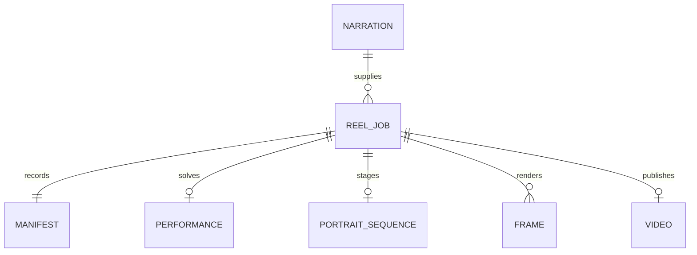

[Back to REPO_ROOT](../../README.md) | [Usage](README.md) | [Development](dev.readme.md)

# Audio-driven portrait reanimation

## 1. Problem Statement

Generate a portrait video from supplied narration and an existing assembled,
rigged MetaHuman. Speech generation and identity construction are upstream
concerns. A static head or editable-but-unrigged Character does not satisfy the
runtime input gate.

Technical validity, lip-sync quality, acting and facial resemblance are separate
acceptance conditions.

## 2. Implementation

### Selected approach

| Choice | Why chosen | Limit |
|---|---|---|
| Offline MetaHuman Animator | Native full-face controls, blinks and head motion | Not whole-body acting or identity repair |
| External WAV | Independent audio provider and unchanged source identity | No embedded TTS/model-selection dependency |
| Native Python adapter | Automates the installed editor solve/export interfaces | Requires compatible editor/plugins and rig |
| PNG sequence then FFmpeg | Inspectable frames, explicit soundtrack and complete decoding | Intermediate disk I/O; finalizers remove redundant frames |
| Explicit D3D12 and encoder | Renderer/encoder choice is visible in policy | Installed Speech2Face inference is CPU; no silent encoder fallback |

The host submits request JSON to the project-owned editor. Unreal imports a
SoundWave, solves/saves a Performance, exports a LevelSequence for the selected
Blueprint and renders asynchronously through Movie Render Queue.
The host checks receipts/files, encodes H.264/AAC and completely decodes both
streams before publication. Source audio, native packages, worker and video
carry artifact references.

`unreal_worker.py` uses `EXCITEMENT` at the configured intensity, generates
blinks and selects Control Rig head motion. RigLogic evaluates the facial rig;
Control Rig provides editable animation controls. Request-owned callbacks are
released without ending the persistent editor.

### Camera and lighting

At 1080x1920, filmback width is `36 * 1080 / 1920 = 20.25 mm`.
With the standard 85 mm lens and 52 cm framing height, camera distance is
`52 * 85 / 36 = 122.78 cm`; visible width is `52 * 9 / 16 = 29.25 cm`.
The camera follows the configured front axis, actor yaw and head offset.
Screen placement shifts the target without changing the lens.

The default stage uses an unlit green plane, 200 cm soft lights at 5600 K,
900-lumen key, 0.65 fill ratio and -5.5 EV exposure. Depth of field, tone curve,
bloom, vignette and lens flare are disabled. The independent character-review
profile does not replace speaking-video lighting.
See [all keys and overrides](README.md#configuration).

### Retained entities

Backed by `src\ailias\reanimation\pipeline.py` and `unreal_worker.py`.
These are manifest/native entities, not SQL tables. Outputs are optional for
blocked/failed jobs. No diagram rendering check is implied.

### Capacity and recovery

A 30-second, 30 fps sequence contains `30 * 30 = 900` frames.
An uncompressed RGBA frame at 1080x1920 is `1080 * 1920 * 4 = 8,294,400` bytes:
about 7.46 GB for that sequence. This is sizing arithmetic, not measured PNG
storage or GPU residency.

Speech inference, rendering, disk writes and encoding are sequential
backpressure boundaries. Alias/project exclusion bounds cooperating writers;
there is no global GPU scheduler or unbounded queue. Local disk, editor and GPU
failures prevent publication. Unique revisions, source hashes and retained
failure receipts support recovery, not high availability.

Keep the verified MP4, boundary PNGs and diagnostics; `--keep-frames` retains
the whole sequence. Native retention follows stopped-project dependency checks.

## 3. Success Criteria

| Gate | Required evidence |
|---|---|
| Input | Nonsilent supported WAV and compiled compatible actor |
| Native solve | Saved processed Performance with actual output frames |
| Native render | Successful job completion and exact contiguous portrait frames |
| Encoding | Requested encoder, H.264/AAC and full audio/video decode |
| Integrity | Unchanged source WAV and valid retained artifact hashes |
| Visual review | Inspect lip sync, blink, expression, framing, skin and keying edges |

## 4. Task Breakdown

| Responsibility | Validation |
|---|---|
| Policy and input handling | Temporary WAV fixtures and argument/default tests |
| Native solve/stage/render | Fake native contracts; explicitly selected real editor integration |
| Encoding/publication | Exact-frame, decode/duration and failure-path tests |
| Resource lifecycle | Boundary-frame retention, interrupted work and source protection |
| Visual acceptance | Review the actual requested output, not an earlier preview |

See [test commands](dev.readme.md#tests). Audio-Performance reuse, apparel
selection and body-gesture synthesis are separate extensions.

## 5. Reference Links

- [Epic: Audio Driven Animation](https://dev.epicgames.com/documentation/en-us/metahuman/audio-driven-animation).
- [Epic: MetaHuman Animator Python](https://dev.epicgames.com/documentation/metahuman/python-scripting-for-metahuman-animator?lang=en-US).
- [Epic: Movie Render Pipeline](https://dev.epicgames.com/documentation/unreal-engine/movie-render-pipeline-in-unreal-engine?application_version=5.8).
- [Implementation](../../src/ailias/reanimation/) and [policy](../../config/reanimation.json).
