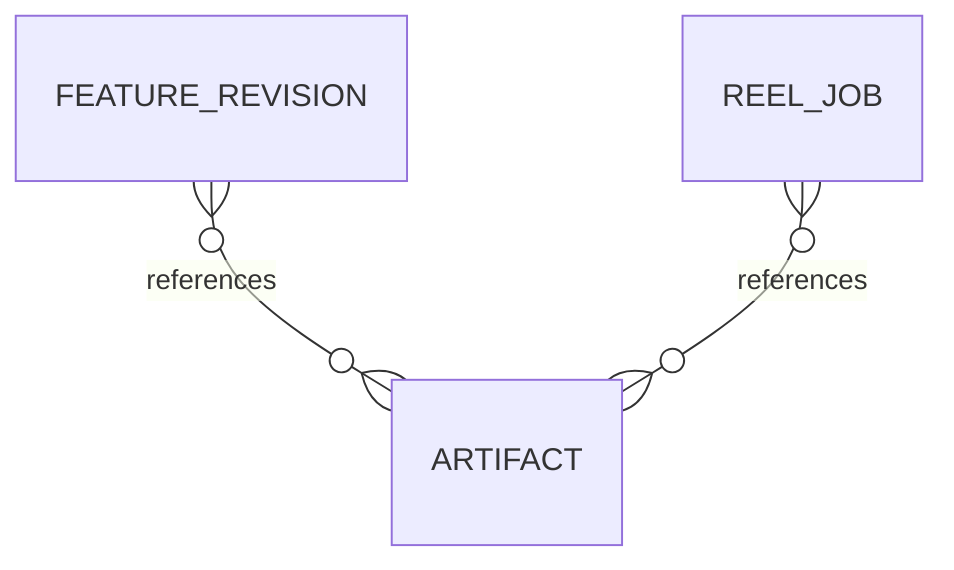

[Back to REPO_ROOT](../../README.md) | [Reanimation guide](README.md)

# Persistent Unreal execution and pipeline latency

| Field | Value |
|---|---|
| Owner | ailias repository owner |
| Status | Research and implementation proposal; persistent execution is not implemented |
| Last updated | 2026-11-18 |
| Services in scope | Photo preparation, fitting, native Character editing/assembly, portrait rendering, encoding |
| Reviewers | Repository owner; additional reviewers: *(fill alias)* |

**Finding:** use one owned, persistent Unreal Editor for ordinary operations,
not a new process per stage. Keep an independent saved-asset verification at
the publication boundary, not after every parameter adjustment. Running without
a visible editor window is already implemented; running these MetaHuman editor
operations without an initialized editor engine is a different problem.
Do not refactor or restart the current generation to test this proposal.

## 1. Problem Statement

- **Gap A - process lifecycle.** `NativeTools.run` calls `subprocess.run` for
  every operation. Feature application/build and independent verification are
  separate launches; neutral review and narration rendering launch again.
  The feature worker already combines editing and assembly in one registration.
  Sources: `src\ailias\generation\tools.py:58`,
  `src\ailias\facefitting\unreal\character_features.py:70`,
  `src\ailias\facefitting\unreal\character_portrait.py:79`,
  `src\ailias\reanimation\pipeline.py:82`.
- **Gap B - worker lifetime.** Rendering is asynchronous, but its completion
  callback releases `-ExecutePythonScript` keep-alive. A reusable session must
  complete the job without ending the editor. Some other workers explicitly
  call `quit_editor`; they cannot be blindly imported as persistent jobs.
  Sources: `src\ailias\reanimation\unreal_worker.py:230`,
  `src\ailias\facefitting\unreal\sculpt_response_worker.py:171`.
- **Gap C - larger costs outside startup.** The 162-configuration identity
  search consumed 3523.735 / 4309.235 = **81.77%** of the full photo-to-preview
  run. Persistent Unreal will help native iterations, but cannot eliminate that
  fitting cost. See the measured manifest inventory in section 5.
- **Gap D - invalid work.** Photo-atlas skin and the brighter review preset were
  used in speaking drafts despite earlier native complexion and reel-lighting
  choices. Avoiding incorrect rebuilds is as important as faster execution.
  The current native-skin change skips Unreal photo-atlas baking/import and
  supports explicitly removing the photo override. It has not yet established
  final visual quality. Sources: `config\appearance-arka.json`,
  `config\reanimation.json`, `docs\facefitting\dev.readme.md`.

The existing subprocess design provides isolated failures and a strong fresh
reload boundary, but applies that expensive boundary too often. Preserve source
hashes, source geometry, requested complexion/grooms, camera/voice independence,
actual material inspection, native process errors and visual review. Never
trade those gates for startup savings.

This is a local repository, not a multi-team service. No Microsoft team,
on-call rotation or additional owner has been established; none is invented.

## 2. Implementation

### Verified execution choices

| Option | Evidence and limitation | Decision |
|---|---|---|
| Persistent editor plus Epic Python remote execution | Installed `remote_execution.py` exposes discovery, connection and repeated `run_command` calls. Official Python settings expose remote execution and host-local discovery. Needs a session lifecycle adapter and testing with asynchronous MRQ. | **Preferred after current generation.** Reuse the installed transport rather than build an HTTP server or custom MCP. |
| Offscreen editor / commandlet | Python documentation supports full-editor and commandlet script execution. Current D3D12/offscreen launches already avoid a visible window; each still initializes Unreal. MetaHuman conform, rig/texture requests and assembly require its editor subsystem. | Keep offscreen rendering. Do not equate no window with no engine startup, or assume commandlet/NullRHI supports every stage. |
| Runtime packaged renderer | Epic documents Movie Render Queue in runtime builds. That can render prepared content, but editor Python is editor-only; it does not replace the current editing/assembly path. | Later render-only option, not the first optimization. Cooking/build maintenance must justify its cost. |
| UELibrary embedding | The installed 5.8 header exposes initialize, tick, window messages and shutdown. Epic's accessible build tutorial is **4.27**, not a verified 5.8 MetaHuman recipe. Embedding still initializes an engine and would need custom builds/API exposure. | Not a drop-in standalone Python skin/rig/render library. Defer; no local embedding benchmark or MetaHuman compatibility claim. |
| Normal Python libraries | Existing fitting, image processing, manifests and FFmpeg orchestration already run outside Unreal. Native editor operations do not become ordinary Python functions by installing a package named `unreal`. | Keep portable work outside Unreal; do not rewrite Epic's native material/rig systems. |

Primary references: [Python scripting][python], [Python settings][settings],
[MetaHuman scripting][metahuman], [runtime MRQ][runtime], [UELibrary][uelibrary].
Installed API paths and exact inspected entry points are in section 5.

### Proposed lifecycle and responsibilities

**Host coordinator:** retain the current Python job APIs and JSON requests,
receipts, hashes and unique output namespaces. Add a dedicated Unreal-session
adapter rather than change the generic Blender/COLMAP subprocess behavior.
Start or explicitly attach to the intended project/editor; establish ownership
and engine/project/worker identity, not merely the first discovered editor.
Communicate with the editor through Epic's host-local UDP discovery and TCP
command channel. No remote execution settings or listeners were enabled during
this investigation. Source for transport capabilities: installed
`remote_execution.py:13-32,101-136`; [Python settings][settings].

**Persistent editor:** execute one mutating native operation at a time, keeping
the engine loaded between edits, assembly, review and render. Acknowledge an
asynchronous render submission separately from its final receipt; return
control to the engine tick loop while MRQ runs. Job completion must not invoke
editor shutdown. Keep Characters registered only while an edit session needs
them, then release preview actors, delegates and unused job state. Reusing an
editor alone does not remove a new Character's registration/synthesis cost.
Proposed changes concern `character_features_worker.py`, `unreal_worker.py` and
their launch adapters; they are not implemented by this research.

**Publication verifier:** preserve one fresh-process verification of the saved
Character/runtime after a completed asset revision, before final publication.
Ordinary adjustments do not each trigger it. A same-process unload/reload is
not equivalent evidence. Measure dual-editor RAM/VRAM before choosing whether
to retain the main editor during that check. If residency is too expensive,
use one deliberate checkpoint/restart and make the new editor the reusable
worker; do not silently weaken verification. The existing independent gate is
in `character_features.py:70-119`.

**Encoder/media verifier:** keep FFmpeg outside Unreal, reading the completed
PNG/WAV artifacts and producing a fully decoded, verified MP4. Do not spend
effort replacing a roughly two-second encode while startup and fitting dominate.
Sources: `src\ailias\reanimation\pipeline.py:111-129` and the manifests below.

Use the existing local JSON artifact model. No distributed database, broker or
distributed queue is proposed, so a CA/AP/CP classification would be misleading:
CAP concerns behavior under network partitions in distributed data systems.
The host admits at most one mutating operation; return an explicit busy result
rather than accumulate unbounded work.

Existing durable data relationships, not a proposed database schema:

**Backed by:** `character_features.py:34-47,120-155`,
`reanimation\pipeline.py:54-64,111-129`. Multiple immutable manifests can
reference the same source artifact; blocked jobs may have no output assets.

### Full-pipeline priorities and measurements

| Priority / area | Measured baseline | Proposed action and acceptance constraint |
|---|---|---|
| P0: stop wrong rebuilds | Draft `bb05dc1c`: 743 decoded frames, 150.906s native job; actual skin/exposure rejected | Bind explicit appearance and reel policies to the reviewed candidate. Inspect a frame using the **same render/color pipeline and lighting** before the full clip. A technically playable clip cannot pass the skin/likeness gate. |
| P0: native startup/registration | Four operation launches for edit/build, verify, review and reel; recent registration 45.801s | Reuse the working editor; final independent verification remains. Compare cold startup, warm submission, registration, actual operation and shutdown separately. The registration sample is not a measurement of startup or an expected saving. |
| P0: unexplained startup stall | Revision `828334c0` verify process 2023.578s; worker 50.535s; observed log gap 1911.849s before worker execution | Capture CPU/asset-load/I/O startup traces after generation. Do not call the unexplained interval shader computation, cloud time or GPU work. |
| P1: fitting search | 162 candidates, 260 views, 3523.735s search / 4309.235s whole run | Profile existing CUDA operator/transfer/solve time on a bounded representative workload. Do not discard views, lower capacities or change winner selection merely for speed. Existing warm-start changes need their own real benchmark. |
| P1: observation extraction | 230.390s in the same full run | Split decode, detector, landmark, parser and transfer time first. Consider explicitly requested reuse keyed by image/model/preprocessing hashes; preserve fresh-run semantics and never silently replay earlier observations/fits. |
| P1: native asset build | Earlier cinematic apply 384.359s including 262.415s worker build | Rebuild only asset-affecting changes; distinguish appearance, geometry/rig, narration and camera/lighting invalidation. Do not assume a native complexion-index edit preserves downloaded texture validity. |
| P1: DDC / startup configuration | Cache hits, storage latency and Developer Mode are **not measured** | Inspect existing local Derived Data Cache before changing it. Epic documents DDC reuse and Developer Mode's boot-time stub generation. Do not delete caches, migrate the shared machine or disable needed plugins speculatively. |
| P2: Blender | 59.094s, one export/review stage in the full run | Retain hair-free Blender and required fresh geometry export. Do not restart fitting/Blender for an appearance-only Unreal iteration. |
| P2: native photo atlas | Bake 15.344s plus import 26.953s | Current configured native-complexion route skips these Unreal-specific stages; source Blender appearance remains separate. These totals include real work, not just removable launch overhead. |
| P2: rendering/encoding | Earlier 743-frame MRQ 103.326s; encode about 2s | Reuse stage/sequence/solved Performance only when dependencies and explicit reuse permit. Keep 540x960 iterative resolution and the established camera/lighting; no lower-quality final claim. |

Sources: measured manifests in section 5; code paths above; [DDC][ddc],
[Unreal Insights][insights], [PyTorch profiler][profiler]. These are priorities,
not measured speedups. No benchmark or new profiling capture was run during the
active generation.

**Scale and throughput:** the observed workload is one local owner/project with
260 fitting views, 162 search configurations and a 743-frame draft. At that
observed full-run duration, `1 / 4309.235 = 0.000232` full runs/second; the
150.906s native reel stage is `1 / 150.906 = 0.00663` stages/second, excluding
encoding and other pipeline stages. These are single-run reciprocals, not
capacity tests. Proposed admission is one active GPU/editor operation, no
unbounded backlog; peak read/write request rates and sustained disk/VRAM usage
remain to be measured. A candidate warm session changing four launches to two
has a **model**, not a forecast, of `2 * startup_cost - resident_session_overhead`
saved; cloud, synthesis, registration and actual rendering remain.

**Backpressure and single points of failure:**

| Critical component | Failure / pressure | Mitigation in the proposal |
|---|---|---|
| One editor / project writer | Stuck native operation, crash or conflicting mutations | One active operation, job deadline, durable receipts/checkpoints, explicit busy response, restart only owned process |
| One local GPU | Fit/render contention and unknown dual-editor VRAM peak | Serialize heavy work by default; measure residency before overlapping verification; no unrelated process termination |
| Epic rig/texture services | Network/authentication/service wait cannot usefully be solved by local CUDA | Stage-specific progress/error evidence, preserved prior assets, no automatic replay of uncertain completed requests |
| Local disk / DDC | Large assets, PNG writes, cache miss or slow storage | Measure I/O/cache behavior, retain verified checkpoints, bounded job-owned cleanup; do not erase shared caches |
| Persistent process state | Stale objects, delegates, MRQ globals, leaks across jobs | Lifecycle/failure tests, per-job namespace and final independent saved-asset check; controlled recycle only on evidence |

### Targeted diagnostics and files

Use stage-duration stacked bars to separate startup/registration/cloud/build/
render; warm-latency distributions across repeated operations; RAM/VRAM max
time series for residency; and a job/event timeline for stalls. Do not add a
dashboard service for this single-machine workload. Existing stage receipts are
the initial source; missing spans require bounded local instrumentation.

Keep the current renderer/material gates and source-integrity checks. Proposed
edits belong in the Unreal-specific launcher/session adapter and native worker
lifetime callbacks; image/CUDA optimizations belong in the existing preparation
and fitting modules after a profile identifies a real cost. New public session
commands/configuration, if introduced, require documentation and explicit
ownership-aware start/status/stop semantics, not an automatic global daemon.

## 3. Success Criteria

| Criterion | Baseline | Target / guardrail |
|---|---|---|
| Process reuse | Per-operation launches | Two sequential appearance/review operations execute in the same owned PID; preview and reel do not restart the working editor |
| Saved-asset correctness | Independent Character/runtime reload | Preserve one clean verification per finalized asset revision and actual per-LOD skin/groom evidence |
| Latency | Timings above; warm-session baseline absent | Measure cold and warm runs with identical inputs/settings; report absolute/relative improvements only after measurement |
| Resident resources | Peak not measured | Bounded actors/delegates/RAM/VRAM across repeated jobs; no unrelated editor/process shutdown |
| Fault handling | Subprocess timeout and native receipt gates | Inject busy, disconnect, late callback, native failure, crash and cancellation; no stale success or duplicate publication |
| Appearance/reel policy | Prior native choices and -5.5 EV video preset exist | Preserve requested geometry, native complexion, hair, lighting, framing and voice; inspect actual new frames and reject regressions |
| Search quality | All 162 candidates and 260 views accounted for | No silent evidence/capacity loss, changed holdout selection or output replay |

Exit requires a real two-job warm-session test, final independent reload and
actual new rendered frame/video review, with failures and resource limits
reported. Documentation/API availability alone does not establish feasibility
of our complete asynchronous MetaHuman/MRQ lifecycle.

## 4. Task Breakdown

Sizing is a rough work-item estimate including tests/hardening, **not an ETA for
the current video**. No orchestration refactor begins during active generation.

| ID | Deliverable | Dependencies / estimated size |
|---|---|---|
| OPT-1 | Instrument cold/warm startup, Character registration, cloud, native build, render and encoding; diagnose the long pre-worker stall using Insights and DDC evidence | Gaps A/C; about 1 week for a reproducible profiling/benchmark suite |
| OPT-2 | Add the owned persistent-editor adapter using installed Epic remote execution; separate worker completion from editor lifetime; test async MRQ, clean cancellation and final verification | Gap A/B; OPT-1 baseline; about 1-2 weeks including real two-job and leak/failure validation |
| OPT-3 | Add dependency-aware native/reel iteration boundaries and profile-guided fitting/preparation improvements, preserving fresh-generation semantics and all visual/quality gates | Gap C/D; OPT-1, and OPT-2 for resident-session acceptance; about 1-2 weeks |

## 5. Reference Links

**Repository source:** paths and function locations above. Historical timing
evidence lives under `data\arka`, not in a public telemetry dashboard:

- `facefitting\fresh-video\252acd173452429388a7e40718bce9a6\manifest.json`:
  `seconds`, `stages`, and native operation runtimes.
- `facefitting\features\828334c0592049a982a24076f4b623c6\manifest.json`:
  apply/verify runtime; corresponding verify log and receipt separate process
  wait from actual worker time. Long startup gap cause remains unestablished.
- `facefitting\features\185f51210d0e481096d42040f8c28e84\apply-receipt.json`:
  observed 45.801s registration sample during the current correction; not a
  completed-generation claim.
- `reanimation\runs\639dc1bc90234c55b2c4ecacd14a27d6`:
  earlier measured MRQ/encoding logs; rejected checkerboard-skin draft.
- `reanimation\runs\bb05dc1cfd5842cb9da2912498eca2a6\manifest.json`:
  native runtime, decode evidence, policy and actual frame references; visually
  rejected photo-atlas/bright-exposure draft.

**Installed Epic APIs inspected read-only:**

- `C:\Program Files\Epic Games\UE_5.8\Engine\Plugins\Experimental\PythonScriptPlugin\Content\Python\remote_execution.py`:
  protocol/defaults at lines 13-32; connection/command API at 101-136.
- `C:\Program Files\Epic Games\UE_5.8\Engine\Source\Runtime\UELibrary\Public\UELibraryAPI.h`:
  initialization, tick, window messages and shutdown; no direct MetaHuman
  fitting/skin/assembly API is exposed by this header.

**Official documentation checked November 18, 2026:**

- [Editor Python scripting][python] (5.8).
- [Python settings and remote execution][settings] (versioned page currently
  redirects to the current documentation; installed 5.8 transport checked too).
- [MetaHuman Creator scripting][metahuman] (5.8+ prerequisites).
- [Movie Render Queue in runtime builds][runtime].
- [UELibrary build tutorial][uelibrary] (**4.27**; 5.8 embedding untested).
- [Derived Data Cache][ddc].
- [Unreal Insights][insights] (current reference; installed trace support must
  be checked before configuring a 5.8 capture).
- [PyTorch profiler][profiler] (current docs; use only APIs supported by the
  existing pinned environment, no package upgrade implied).

Still required: cold/warm traces, peak memory measurements, installed project
remote-execution configuration verification and a real persistent async render
proof. No external team aliases, dashboard, PR or standalone MetaHuman SDK
benchmark was established.

**Generation outcome during research:** native revision `185f5121` completed
application and independent reload in 317.859s/129.109s. Its actual review
`64beeee4` still shows gray checkerboard face/body skin despite correct saved
native controls and restored -5.5 EV exposure. It was rejected; no full video
was started. This demonstrates why warm execution must retain actual texture
and visual gates rather than treating a successful receipt as acceptable skin.

[python]: https://dev.epicgames.com/documentation/en-us/unreal-engine/scripting-the-unreal-editor-using-python?application_version=5.8
[settings]: https://dev.epicgames.com/documentation/en-us/unreal-engine/python-settings-in-the-unreal-engine-project-settings
[metahuman]: https://dev.epicgames.com/documentation/metahuman/metahuman-creator-python-scripting-in-unreal-engine?lang=en-US
[runtime]: https://dev.epicgames.com/documentation/unreal-engine/movie-render-queue-in-runtime-in-unreal-engine?lang=en-US
[uelibrary]: https://dev.epicgames.com/documentation/en-us/unreal-engine/building-unreal-engine-as-a-library?application_version=4.27
[ddc]: https://dev.epicgames.com/documentation/unreal-engine/using-derived-data-cache-in-unreal-engine?lang=en-US
[insights]: https://dev.epicgames.com/documentation/unreal-engine/unreal-insights-reference-in-unreal-engine-5
[profiler]: https://docs.pytorch.org/docs/stable/profiler.html
